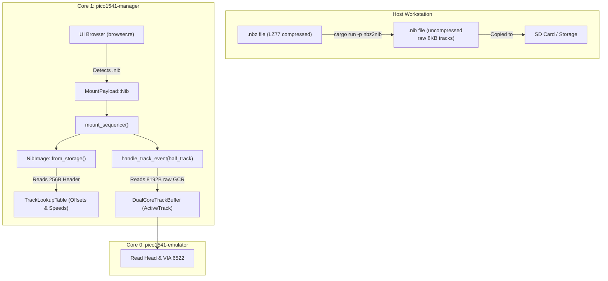

# NIB Disk Image Support & NBZ Decompression Tool Implementation Plan

> **For agentic workers:** REQUIRED SUB-SKILL: Use superpowers:subagent-driven-development to implement this plan task-by-task. Steps use checkbox (`- [ ]`) syntax for tracking.

**Goal:** Implement direct, cycle-exact `.nib` (MNIB raw dump) disk image streaming in Pico1541 firmware and build a dedicated `tools/nbz2nib` CLI workspace member to decompress `.nbz` images into `.nib`.

**Architecture:** 
1. `tools/nbz2nib` implements a clean, standalone Marcus Geelnard LZ77 decompressor and CLI utility in the root workspace.
2. `NibImage` in `pico1541-manager` parses 256-byte NIB headers, builds a zero-extra-RAM `TrackLookupTable` for the 8,192-byte raw GCR tracks, and implements `DiskImage`.
3. UI Browser and Mount Manager recognize `.nib` files, mounting and streaming tracks using the unified track loading and buffer swapping engine.

**Architecture Diagram:**



**Tech Stack:** Rust (`no_std` for firmware, standard Rust for host CLI), Cargo workspace, `embedded-io-async`.

## Global Constraints

- Firmware changes must remain strictly `no_std`.
- No inline canonical namespaces; use `use` declarations at the top of files.
- Zero compiler warnings on all targets.
- RP2040 release build (`thumbv6m-none-eabi`) must pass cleanly.
- Existing logs must be preserved.

---

### Task 1: Host Tool `tools/nbz2nib` (LZ77 Decompressor & CLI)

**Files:**
- Modify: `Cargo.toml` (root workspace)
- Create: `tools/nbz2nib/Cargo.toml`
- Create: `tools/nbz2nib/src/lz77.rs`
- Create: `tools/nbz2nib/src/main.rs`
- Test: `tools/nbz2nib/src/lz77.rs` (inline module tests)

**Interfaces:**
- Produces: CLI binary `nbz2nib` and `pub fn decompress_nbz(input: &[u8]) -> Result<Vec<u8>, NbzError>`.

- [ ] **Step 1: Register `tools/nbz2nib` in root `Cargo.toml`**

Add `"tools/nbz2nib"` to the root `[workspace] members` array.

- [ ] **Step 2: Create `tools/nbz2nib/Cargo.toml`**

```toml
[package]
name = "nbz2nib"
version = "0.1.0"
edition = "2021"
description = "Decompresses Commodore 64 .nbz files to .nib images"

[dependencies]
```

- [ ] **Step 3: Write unit tests for LZ77 decompression in `tools/nbz2nib/src/lz77.rs`**

```rust
#[cfg(test)]
mod tests {
    use super::*;

    #[test]
    fn test_literal_and_marker_escapes() {
        // Marker is 0xAA.
        // Stream: marker (0xAA), literal 'H', literal 'i', marker followed by 0x00 (literal 0xAA).
        let input = vec![0xAA, b'H', b'i', 0xAA, 0x00];
        let decompressed = decompress(input.as_slice()).expect("decompress failed");
        assert_eq!(decompressed, vec![b'H', b'i', 0xAA]);
    }

    #[test]
    fn test_history_reference_copy() {
        // Marker 0xFF. "ABCD" followed by repeat of "ABCD" (length=4, offset=4).
        // Length 4: byte 0x04. Offset 4: byte 0x04.
        let input = vec![0xFF, b'A', b'B', b'C', b'D', 0xFF, 0x04, 0x04];
        let decompressed = decompress(input.as_slice()).expect("decompress failed");
        assert_eq!(decompressed, b"ABCDABCD");
    }
}
```

- [ ] **Step 4: Implement LZ77 decompressor in `tools/nbz2nib/src/lz77.rs`**

Implement Marcus Geelnard's variable-size int reader and main LZ77 loop:
```rust
#[derive(Debug, PartialEq, Eq)]
pub enum DecompressError {
    EmptyInput,
    UnexpectedEof,
    InvalidReference { offset: usize, current_pos: usize },
}

fn read_var_size(buf: &[u8], pos: &mut usize) -> Result<usize, DecompressError> {
    let mut val: usize = 0;
    loop {
        if *pos >= buf.len() {
            return Err(DecompressError::UnexpectedEof);
        }
        let b = buf[*pos];
        *pos += 1;
        val = (val << 7) | ((b & 0x7F) as usize);
        if (b & 0x80) == 0 {
            break;
        }
    }
    Ok(val)
}

pub fn decompress(input: &[u8]) -> Result<Vec<u8>, DecompressError> {
    if input.is_empty() {
        return Err(DecompressError::EmptyInput);
    }
    let marker = input[0];
    let mut inpos = 1;
    let mut output = Vec::with_capacity(input.len() * 2);

    while inpos < input.len() {
        let symbol = input[inpos];
        inpos += 1;

        if symbol == marker {
            if inpos >= input.len() {
                return Err(DecompressError::UnexpectedEof);
            }
            let next_byte = input[inpos];
            if next_byte == 0 {
                inpos += 1;
                output.push(marker);
            } else {
                let length = read_var_size(input, &mut inpos)?;
                let offset = read_var_size(input, &mut inpos)?;

                if offset == 0 || offset > output.len() {
                    return Err(DecompressError::InvalidReference {
                        offset,
                        current_pos: output.len(),
                    });
                }

                for _ in 0..length {
                    let b = output[output.len() - offset];
                    output.push(b);
                }
            }
        } else {
            output.push(symbol);
        }
    }

    Ok(output)
}
```

- [ ] **Step 5: Run tests to verify LZ77 decompression passes**

Run: `cargo test -p nbz2nib`  
Expected: PASS

- [ ] **Step 6: Implement CLI argument handling and header validation in `tools/nbz2nib/src/main.rs`**

```rust
mod lz77;

use std::env;
use std::fs;
use std::path::{Path, PathBuf};

fn convert_file(input_path: &Path, output_path: &Path) -> Result<(), Box<dyn std::error::Error>> {
    println!("Decompressing: {} -> {}", input_path.display(), output_path.display());
    let data = fs::read(input_path)?;
    let decompressed = lz77::decompress(&data)?;

    if decompressed.len() < 0x100 {
        return Err("Decompressed file too small to contain a valid NIB header".into());
    }

    let magic = &decompressed[0..13];
    if magic != b"MNIB-1541-RAW" && magic != b"MNIB-1571-RAW" {
        return Err(format!(
            "Invalid NIB magic signature: {:?}",
            String::from_utf8_lossy(magic)
        ).into());
    }

    fs::write(output_path, decompressed)?;
    println!("Successfully wrote {}", output_path.display());
    Ok(())
}

fn main() -> Result<(), Box<dyn std::error::Error>> {
    let args: Vec<String> = env::args().collect();
    if args.len() < 2 {
        eprintln!("Usage: nbz2nib <input.nbz> [output.nib]");
        eprintln!("       nbz2nib <directory_with_nbz_files>");
        std::process::exit(1);
    }

    let input_path = Path::new(&args[1]);
    if input_path.is_dir() {
        for entry in fs::read_dir(input_path)? {
            let entry = entry?;
            let path = entry.path();
            if path.is_file() {
                if let Some(ext) = path.extension() {
                    if ext.eq_ignore_ascii_case("nbz") {
                        let out_path = path.with_extension("nib");
                        if let Err(e) = convert_file(&path, &out_path) {
                            eprintln!("Error converting {}: {}", path.display(), e);
                        }
                    }
                }
            }
        }
    } else {
        let output_path = if args.len() >= 3 {
            PathBuf::from(&args[2])
        } else {
            input_path.with_extension("nib")
        };
        convert_file(input_path, &output_path)?;
    }

    Ok(())
}
```

- [ ] **Step 7: Verify `nbz2nib` builds cleanly**

Run: `cargo check -p nbz2nib`  
Expected: Clean build with 0 warnings.

---

### Task 2: Implement `NibImage` in `pico1541-manager`

**Files:**
- Create: `crates/pico1541-manager/src/formats/nib.rs`
- Modify: `crates/pico1541-manager/src/formats/mod.rs`
- Test: `crates/pico1541-manager/tests/formats.rs`

**Interfaces:**
- Produces: `NibImage<S: Read + Seek>` implementing `DiskImage`.
- Exposes `AnyDiskImage::Nib(NibImage<S>)`.

- [ ] **Step 1: Write unit tests in `crates/pico1541-manager/tests/formats.rs`**

Add a test `test_nib_image_read_track` that constructs a synthetic NIB byte array:
```rust
#[tokio::test]
async fn test_nib_image_read_track() {
    let mut data = vec![0u8; 0x100 + 8192];
    // Header magic
    data[0..13].copy_from_slice(b"MNIB-1541-RAW");
    data[13] = 2; // version
    // Track entry 0 at 0x10: Track 18.0 (track_num = 36), density = 2 (speed zone 2)
    data[0x10] = 36;
    data[0x11] = 0x02;
    // Track payload at 0x100
    for i in 0..8192 {
        data[0x100 + i] = (i % 256) as u8;
    }

    let storage = MockStorage::new(data);
    let mut nib = NibImage::from_storage(storage).await.expect("failed to load NIB");

    let mut dest = [0u8; 8192];
    // Track 18.0 corresponds to half_track 34 in Pico1541
    let (layout, len, speed) = nib.read_track(34, &mut dest).await.expect("read_track failed");
    assert_eq!(layout, TrackLayout::Accurate);
    assert_eq!(len, 8192);
    assert_eq!(speed, Some(2));
    assert_eq!(&dest[0..10], &[0, 1, 2, 3, 4, 5, 6, 7, 8, 9]);

    // Unmapped track should return Void
    let (layout, len, speed) = nib.read_track(0, &mut dest).await.expect("unmapped failed");
    assert_eq!(layout, TrackLayout::Void);
    assert_eq!(len, 0);
    assert_eq!(speed, None);
}
```

- [ ] **Step 2: Implement `crates/pico1541-manager/src/formats/nib.rs`**

```rust
use embedded_io_async::{Read, Seek, SeekFrom};
use pico1541_common::track_buffer::TrackLayout;

use super::{DiskImage, Error, TrackLookupTable};

pub struct NibImage<S: Read + Seek> {
    storage: S,
    lookup_table: TrackLookupTable,
}

impl<S: Read + Seek> NibImage<S> {
    pub async fn from_storage(mut storage: S) -> Result<Self, Error> {
        let mut lookup_table = TrackLookupTable::new();

        // Read 256-byte header
        storage
            .seek(SeekFrom::Start(0))
            .await
            .map_err(|_| Error::Io)?;
        let mut header = [0u8; 0x100];
        storage
            .read_exact(&mut header)
            .await
            .map_err(|_| Error::Io)?;

        let magic = &header[0..13];
        if magic != b"MNIB-1541-RAW" && magic != b"MNIB-1571-RAW" {
            return Err(Error::Corrupted);
        }

        // Parse track table starting at 0x10
        let mut h_index = 0x10;
        let mut t_index = 0;
        while h_index < 0x100 && header[h_index] != 0 {
            let track_num = header[h_index];
            let density = header[h_index + 1];

            // In NIB format, track 1.0 is 2, track 18.0 is 36.
            // Pico1541 0-indexed half-track = track_num - 2.
            if track_num >= 2 {
                let half_track = (track_num - 2) as usize;
                if half_track < lookup_table.offsets.len() {
                    lookup_table.offsets[half_track] = Some(0x100 + (t_index * 8192));
                    lookup_table.speed_zones[half_track] = Some(density & 0x03);
                }
            }

            h_index += 2;
            t_index += 1;
        }

        Ok(Self {
            storage,
            lookup_table,
        })
    }
}

impl<S: Read + Seek> DiskImage for NibImage<S> {
    async fn read_track(
        &mut self,
        half_track: u8,
        dest: &mut [u8],
    ) -> Result<(TrackLayout, usize, Option<u8>), Error> {
        let track_offset = self
            .lookup_table
            .offsets
            .get(half_track as usize)
            .copied()
            .flatten();

        if track_offset.is_none() {
            return Ok((TrackLayout::Void, 0, None));
        }

        let offset = track_offset.unwrap();
        let speed_zone = self
            .lookup_table
            .speed_zones
            .get(half_track as usize)
            .copied()
            .flatten();

        if dest.len() < 8192 {
            return Err(Error::TrackTooLarge);
        }

        self.storage
            .seek(SeekFrom::Start(offset as u64))
            .await
            .map_err(|_| Error::Io)?;

        self.storage
            .read_exact(&mut dest[..8192])
            .await
            .map_err(|_| Error::Io)?;

        Ok((TrackLayout::Accurate, 8192, speed_zone))
    }
}
```

- [ ] **Step 3: Expose `NibImage` in `crates/pico1541-manager/src/formats/mod.rs`**

Add `pub mod nib; pub use nib::NibImage;` and add the `Nib(NibImage<S>)` variant to `AnyDiskImage`. Delegate `read_track` and `as_virtual_disk_mut` accordingly.

- [ ] **Step 4: Run unit tests to verify `NibImage` passes**

Run: `cargo test -p pico1541-manager --test formats`  
Expected: PASS

---

### Task 3: UI & Mount Manager Integration

**Files:**
- Modify: `crates/pico1541-manager/src/lib.rs`
- Modify: `crates/pico1541-manager/src/tasks/ui/browser.rs`
- Modify: `crates/pico1541-manager/src/tasks/mount_manager/mod.rs`

**Interfaces:**
- `MountPayload::Nib(heapless::String<128>, bool)`
- Browser menu mounts `.nib` files.

- [ ] **Step 1: Add `Nib` variant to `MountPayload` in `crates/pico1541-manager/src/lib.rs`**

```rust
pub enum MountPayload {
    VirtualDirectory(heapless::String<128>, bool),
    D64(heapless::String<128>, bool),
    G64(heapless::String<128>, bool),
    Nib(heapless::String<128>, bool),
}
```

- [ ] **Step 2: Recognize `.nib` in `browser.rs`**

In `crates/pico1541-manager/src/tasks/ui/browser.rs`:
Detect `.nib` / `.NIB`:
```rust
let is_nib = filename.ends_with(".nib") || filename.ends_with(".NIB");
...
else if is_nib {
    #[cfg(feature = "defmt")]
    defmt::info!("Sending Mount for NIB...");
    let _ = ctx.context.cmd_tx
        .send(crate::InternalCommand::Mount(crate::MountPayload::Nib(
            full_path.clone(),
            manager.use_internal,
        )))
        .await;
    *ctx.mounted_file_path = Some(full_path);
}
```

- [ ] **Step 3: Handle `is_nib` in `mount_sequence` in `crates/pico1541-manager/src/tasks/mount_manager/mod.rs`**

```rust
let is_nib = p_str.ends_with(".nib") || p_str.ends_with(".NIB");
...
} else if is_nib {
    let file = if use_internal {
        self.opener.open_internal_file(p_str)
    } else {
        self.opener.open_sd_file(p_str)
    };
    if let Ok(nib) = crate::formats::NibImage::from_storage(file).await {
        self.disk_image = Some(crate::formats::AnyDiskImage::Nib(nib));
    } else {
        self.disk_image = None;
    }
}
```

Ensure `mount_sequence` invokes `self.handle_track_event(half_track).await;` as unified track loading.

- [ ] **Step 4: Run workspace tests**

Run: `cargo test -p pico1541-manager -p pico1541-emulator -p pico1541-common -p nbz2nib`  
Expected: All tests pass.

- [ ] **Step 5: Verify RP2040 release build**

Run: `cargo build -p pico1541-rp2040 --target thumbv6m-none-eabi --release`  
Expected: Succeeded with 0 warnings.
