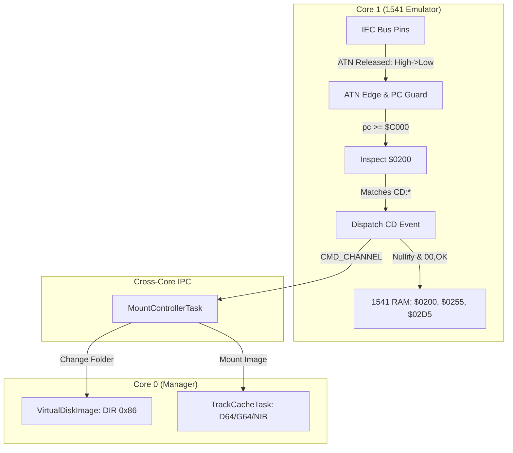

# Implementation Plan: CBM-FileBrowser ("fb") & SD2IEC Command Interception

> **For agentic workers:** REQUIRED SUB-SKILL: Use superpowers:subagent-driven-development to implement this plan task-by-task. Steps use checkbox (`- [ ]`) syntax for tracking.

**Goal:** Support browsing SD card directories and mounting disk images on a Commodore 64 using the SD2IEC CBM-FileBrowser (`fb` / `fb64`) tool by intercepting `CD:` commands at the 1541 DOS level and formatting virtual directories.

**Architecture:**
- **Core 1 (Emulator):** Detects ATN release transitions (GPIO falling edge: HIGH to LOW). When the 6502 is executing in ROM (`pc >= 0xC000`), it inspects the 1541 command buffer at `$0200`. If `CD:` is found, it extracts the path, sends `InternalCommand::Cd` across cores, nullifies `cmdbuf` and `cmdwat`, and primes the DOS status buffer (`errbuf`) with `00, OK, 00, 00`.
- **Core 0 (Manager):** `MountControllerTask` handles `InternalCommand::Cd`, updating `CURRENT_DIR` or mounting disk images into `TrackCacheTask`.
- **VirtualDiskImage:** Formats subdirectories with CBM file type `DIR` (`0x86`) so `fb` recognizes navigable folders.

**Architecture Diagram:**



**Tech Stack:** Rust (`no_std`), 6502 Emulation, Commodore 1541 DOS internals, Embassy async, RP2040 GPIO & IPC.

## Global Constraints

- Firmwares must remain `no_std`.
- Core 0 is Manager (Embassy async), Core 1 is Emulator (cycle-exact 1 MHz 6502).
- Logical IEC convention: `true` = Asserted (low on bus), `false` = Released (high on bus).
- Hardware 7405 inverters: GPIO HIGH is Asserted, GPIO LOW is Released. ATN release is HIGH $\rightarrow$ LOW.
- 1541 Command Buffer is fixed at `$0200` (`cmdbuf`), Command Waiting flag at `$0255` (`cmdwat`), Error Buffer at `$02D5` (`errbuf`).

---

### Task 1: Virtual Directory Formatting for Subfolders (`DIR` Type `0x86`)

**Files:**
- Modify: `crates/pico1541-manager/src/storage.rs:85-102`
- Test: `crates/pico1541-manager/tests/formats.rs`

**Interfaces:**
- Consumes: `DirectoryEntry::from_file_info(name, is_dir, size)`
- Produces: `DirectoryEntry.file_type == 0x86` for directories (CBM `DIR`), `0x82` for files (`PRG`).

- [ ] **Step 1: Write the failing unit test**

In `crates/pico1541-manager/tests/formats.rs`:
```rust
#[test]
fn test_directory_entry_file_type_is_dir() {
    let dir_entry = pico1541_manager::storage::DirectoryEntry::from_file_info(b"GAMES", true, 0);
    assert_eq!(
        dir_entry.file_type, 0x86,
        "Directory entries must have file type 0x86 (DIR) for SD2IEC / fb compatibility"
    );

    let prg_entry = pico1541_manager::storage::DirectoryEntry::from_file_info(b"GAME.D64", false, 174848);
    assert_eq!(
        prg_entry.file_type, 0x82,
        "File entries must have file type 0x82 (PRG)"
    );
}
```

- [ ] **Step 2: Run test to verify it fails**

Run: `cargo test -p pico1541-manager --test formats test_directory_entry_file_type_is_dir`
Expected: FAIL with `0x83 != 0x86`.

- [ ] **Step 3: Update `DirectoryEntry::from_file_info` in `storage.rs`**

In `crates/pico1541-manager/src/storage.rs`:
```rust
    pub fn from_file_info(name: &[u8], is_dir: bool, size: u32) -> Self {
        let filename = mangle_filename(name);

        let file_type = if is_dir {
            0x86 // DIR (Commodore 1581 / SD2IEC directory type)
        } else {
            0x82 // PRG
        };

        Self {
            file_type,
            filename,
            first_track: 1,
            first_sector: 1,
            block_size: if is_dir { 0 } else { size.div_ceil(254) as u16 },
        }
    }
```

- [ ] **Step 4: Run test to verify it passes**

Run: `cargo test -p pico1541-manager --test formats test_directory_entry_file_type_is_dir`
Expected: PASS.

- [ ] **Step 5: Commit**

```bash
git add crates/pico1541-manager/src/storage.rs crates/pico1541-manager/tests/formats.rs
git commit -m "feat(manager): format directory entries with CBM DIR type 0x86 for fb"
```

---

### Task 2: Cross-Core IPC Command `InternalCommand::Cd`

**Files:**
- Modify: `crates/pico1541-manager/src/lib.rs:83-91`
- Modify: `crates/pico1541-common/src/interface.rs:22-35`
- Test: `crates/pico1541-emulator/tests/common/mod.rs`

**Interfaces:**
- Consumes: `heapless::String<64>`
- Produces: `InternalCommand::Cd(heapless::String<64>)` and `HostInterface::intercept_cd_command(&mut self, path: &str)`

- [ ] **Step 1: Write test for `HostInterface::intercept_cd_command`**

In `crates/pico1541-emulator/tests/common/mod.rs`:
Add recording of intercepted CD commands in `TestBridge`:
```rust
pub struct TestBridge {
    // ...
    pub intercepted_cds: Vec<String>,
}

impl HostInterface for TestBridge {
    // ...
    fn intercept_cd_command(&mut self, path: &str) {
        self.intercepted_cds.push(path.to_string());
    }
}
```

- [ ] **Step 2: Run test to verify compile failure**

Run: `cargo test -p pico1541-emulator --test iec`
Expected: FAIL with method `intercept_cd_command` not found on trait `HostInterface`.

- [ ] **Step 3: Define `InternalCommand::Cd` and `HostInterface::intercept_cd_command`**

In `crates/pico1541-manager/src/lib.rs`:
```rust
#[derive(Clone, Debug)]
pub enum InternalCommand {
    MotorState(bool),
    Mount(MountPayload),
    Unmount,
    Cd(heapless::String<64>),
}
```

In `crates/pico1541-common/src/interface.rs`:
```rust
pub trait HostInterface: crate::context::ViaHardware {
    fn send_event(&mut self, event: DriveEvent);

    /// Called when an SD2IEC "CD" command is intercepted from channel 15
    fn intercept_cd_command(&mut self, _path: &str) {}

    // ...
}
```

In `crates/pico1541-rp-common/src/emulation/bridge.rs`:
```rust
    #[link_section = ".core1_text"]
    #[inline(always)]
    fn intercept_cd_command(&mut self, path: &str) {
        let mut s = heapless::String::<64>::new();
        let _ = s.push_str(path);
        let _ = pico1541_manager::CMD_CHANNEL.try_send(pico1541_manager::InternalCommand::Cd(s));
    }
```

- [ ] **Step 4: Run test to verify it compiles**

Run: `cargo test -p pico1541-emulator --test iec`
Expected: PASS.

- [ ] **Step 5: Commit**

```bash
git add crates/pico1541-manager/src/lib.rs crates/pico1541-common/src/interface.rs crates/pico1541-rp-common/src/emulation/bridge.rs crates/pico1541-emulator/tests/common/mod.rs
git commit -m "feat(ipc): add InternalCommand::Cd and HostInterface::intercept_cd_command"
```

---

### Task 3: Emulator (Core 1) ATN Falling-Edge Interception & Error Suppression

**Files:**
- Modify: `crates/pico1541-emulator/src/systembus.rs`
- Modify: `crates/pico1541-emulator/src/lib.rs`
- Test: `crates/pico1541-emulator/tests/iec.rs`

**Interfaces:**
- Consumes: `HardwareBridge::read_iec_port()`, `self.cpu.pc`, `self.systembus.memory`
- Produces: Command interception when `ATN_RX` falls, clearing `$0200`, `$0255`, writing `"00, OK,00,00\r"` to `$02D5`.

- [ ] **Step 1: Write the failing unit test**

In `crates/pico1541-emulator/tests/iec.rs`:
```rust
#[test]
fn test_sd2iec_cd_command_interception() {
    let (mut drive, mut bridge) = common::setup_drive(true, 8);

    // 1. Send "CD:GAMES" on channel 15
    pollster::block_on(async {
        let mut bus = common::IecTestBridge {
            drive: &mut drive,
            bridge: &mut bridge,
        };
        pico1541_common::iec_com::IecCommander::new(&mut bus)
            .open(8, 15)
            .send(b"CD:GAMES")
            .execute()
            .await
            .unwrap();
    });

    // Verify command was intercepted
    assert_eq!(bridge.intercepted_cds.len(), 1);
    assert_eq!(bridge.intercepted_cds[0], "CD:GAMES");

    // 2. Read channel 15 status - must return 00, OK,00,00
    let mut status_vec = Vec::new();
    pollster::block_on(async {
        let mut bus = common::IecTestBridge {
            drive: &mut drive,
            bridge: &mut bridge,
        };
        pico1541_common::iec_com::IecCommander::new(&mut bus)
            .open(8, 15)
            .receive(|b| status_vec.push(b))
            .await
            .unwrap();
    });
    let status = String::from_utf8_lossy(&status_vec);
    assert!(
        status.starts_with("00, OK"),
        "Expected status '00, OK...', got: {:?}",
        status
    );
}
```

- [ ] **Step 2: Run test to verify it fails**

Run: `cargo test -p pico1541-emulator --test iec test_sd2iec_cd_command_interception`
Expected: FAIL (command not intercepted, status returns `31, SYNTAX ERROR`).

- [ ] **Step 3: Implement ATN falling edge detection and `$0200` intercept**

In `crates/pico1541-emulator/src/systembus.rs`:
Add field `last_atn: bool` to `SystemBus`:
```rust
    pub last_atn: bool,
```

In `SystemBus::sync_iec_bus`:
```rust
        let iec_in = hardware.read_iec_port() | self.device_id_pb_bits;
        let curr_atn = (iec_in & pico1541_common::context::via::VIA1_IEC_MASK_ATN_RX) != 0;
        self.via1.set_pb_in(iec_in);
        self.via1.set_ca1(curr_atn);

        // Falling edge on ATN_RX (Host released ATN):
        // Hardware: 7405 inverts bus, so true=Asserted, false=Released.
        // Transition true -> false is ATN release.
        if self.last_atn && !curr_atn {
            self.check_sd2iec_command(hardware);
        }
        self.last_atn = curr_atn;

        let via1_pb_out = self.via1.get_pb_out();
        hardware.write_iec_port(via1_pb_out);
```

Add helper `check_sd2iec_command` in `SystemBus`:
```rust
    #[link_section = ".core1_text"]
    fn check_sd2iec_command(&mut self, hardware: &mut H) {
        // Fastloader guard: standard DOS only runs when PC is in ROM ($C000-$FFFF)
        let pc = hardware.get_pc();
        if pc != 0 && pc < 0xC000 {
            return;
        }

        let b0 = self.memory.read(0x0200);
        let b1 = self.memory.read(0x0201);
        let b2 = self.memory.read(0x0202);

        // Check for CD: (b"CD:"), CD/ (b"CD/"), or CD<- (b"CD\x1F")
        let is_cd = b0 == b'C' && b1 == b'D' && (b2 == b':' || b2 == b'/' || b2 == 0x1F);
        if !is_cd {
            return;
        }

        // Extract command string
        let mut buf = [0u8; 40];
        let mut len = 0;
        while len < 40 {
            let ch = self.memory.read(0x0200 + len as u16);
            if ch == 0 || ch == b'\r' {
                break;
            }
            buf[len] = ch;
            len += 1;
        }

        if let Ok(cmd_str) = core::str::from_utf8(&buf[..len]) {
            hardware.intercept_cd_command(cmd_str);
        }

        // Suppress 1541 DOS syntax error
        self.memory.write(0x0200, 0); // nullify cmdbuf
        self.memory.write(0x0255, 0); // cmdwat = 0

        // Write "00, OK,00,00\r" into errbuf at $02D5
        let ok_str = b"00, OK,00,00\r";
        for (i, &b) in ok_str.iter().enumerate() {
            self.memory.write(0x02D5 + i as u16, b);
        }
        self.memory.write(0x006E, 0);
        self.memory.write(0x006F, 0);
    }
```

In `crates/pico1541-emulator/src/lib.rs`, ensure `HardwareBridge::get_pc()` returns `self.cpu.pc` during tick.

- [ ] **Step 4: Run test to verify it passes**

Run: `cargo test -p pico1541-emulator --test iec test_sd2iec_cd_command_interception`
Expected: PASS.

- [ ] **Step 5: Commit**

```bash
git add crates/pico1541-emulator/src/systembus.rs crates/pico1541-emulator/src/lib.rs crates/pico1541-emulator/tests/iec.rs
git commit -m "feat(emulator): intercept CD: commands on ATN release and prime 00, OK status"
```

---

### Task 4: Manager (Core 0) Navigation & Image Mounting in `MountControllerTask`

**Files:**
- Modify: `crates/pico1541-manager/src/tasks/mount_manager/mod.rs:240-270`
- Create: `crates/pico1541-manager/src/tasks/mount_manager/cd_handler.rs`
- Test: `crates/pico1541-manager/tests/cd_navigation.rs`

**Interfaces:**
- Consumes: `InternalCommand::Cd(path)`
- Produces: Path updating for `CURRENT_DIR` / `mounted_dir`, invoking `mount_sequence` for `.D64`, `.G64`, `.NIB`.

- [ ] **Step 1: Write the failing unit test for `resolve_cd_path`**

Create `crates/pico1541-manager/tests/cd_navigation.rs`:
```rust
use pico1541_manager::tasks::resolve_cd_path;

#[test]
fn test_resolve_cd_paths() {
    let mut current = heapless::String::<128>::new();
    let _ = current.push_str("/");

    // 1. Enter folder
    let target = resolve_cd_path(&current, "CD:GAMES").unwrap();
    assert_eq!(target.as_str(), "/GAMES");

    // 2. Subfolder
    let target2 = resolve_cd_path(&target, "CD:ACTION").unwrap();
    assert_eq!(target2.as_str(), "/GAMES/ACTION");

    // 3. Parent directory (left arrow 0x1F or ..)
    let target3 = resolve_cd_path(&target2, "CD:\x1F").unwrap();
    assert_eq!(target3.as_str(), "/GAMES");

    // 4. Root
    let target4 = resolve_cd_path(&target3, "CD//").unwrap();
    assert_eq!(target4.as_str(), "/");
}
```

- [ ] **Step 2: Run test to verify it fails**

Run: `cargo test -p pico1541-manager --test cd_navigation`
Expected: FAIL (`resolve_cd_path` not found).

- [ ] **Step 3: Implement `resolve_cd_path` and `MountControllerTask` handling**

Create `crates/pico1541-manager/src/tasks/mount_manager/cd_handler.rs`:
```rust
pub fn resolve_cd_path(
    current_path: &str,
    cd_cmd: &str,
) -> Option<heapless::String<128>> {
    let raw_arg = if let Some(stripped) = cd_cmd.strip_prefix("CD:") {
        stripped
    } else if let Some(stripped) = cd_cmd.strip_prefix("CD//") {
        return Some(heapless::String::try_from("/").ok()?);
    } else if let Some(stripped) = cd_cmd.strip_prefix("CD/") {
        stripped
    } else {
        return None;
    };

    let arg = raw_arg.trim();

    // 1. Root
    if arg.is_empty() || arg == "/" || arg == "//" {
        return Some(heapless::String::try_from("/").ok()?);
    }

    // 2. Parent directory (<- or ..)
    if arg == "\x1F" || arg == ".." || arg == "_" {
        if current_path == "/" || current_path.is_empty() {
            return Some(heapless::String::try_from("/").ok()?);
        }
        let trimmed = current_path.trim_end_matches('/');
        if let Some(idx) = trimmed.rfind('/') {
            let parent = if idx == 0 { "/" } else { &trimmed[..idx] };
            return Some(heapless::String::try_from(parent).ok()?);
        } else {
            return Some(heapless::String::try_from("/").ok()?);
        }
    }

    // 3. Child folder or file
    let mut new_path = heapless::String::<128>::new();
    if current_path != "/" && !current_path.is_empty() {
        let _ = new_path.push_str(current_path);
        let _ = new_path.push('/');
    } else {
        let _ = new_path.push('/');
    }
    let _ = new_path.push_str(arg);
    Some(new_path)
}
```

In `crates/pico1541-manager/src/tasks/mount_manager/mod.rs`:
Update `MountControllerTask::run()` to handle `InternalCommand::Cd(cd_str)`:
```rust
                crate::InternalCommand::Cd(cd_str) => {
                    let current = {
                        let guard = self.mounted_dir.lock().await;
                        guard.0.clone()
                    };
                    if let Some(new_path) = cd_handler::resolve_cd_path(current.as_str(), cd_str.as_str()) {
                        let is_image = new_path.ends_with(".d64") || new_path.ends_with(".D64")
                            || new_path.ends_with(".g64") || new_path.ends_with(".G64")
                            || new_path.ends_with(".nib") || new_path.ends_with(".NIB");

                        let led_mode = if is_image {
                            crate::driver::StatusLedMode::NonAccurateDisk
                        } else {
                            crate::driver::StatusLedMode::VirtualDisk
                        };

                        {
                            let mut guard = self.mounted_dir.lock().await;
                            guard.0 = new_path;
                            guard.1 = false; // SD card
                        }
                        self.leds.set_status(led_mode);
                    }
                }
```

- [ ] **Step 4: Run test to verify it passes**

Run: `cargo test -p pico1541-manager --test cd_navigation`
Expected: PASS.

- [ ] **Step 5: Commit**

```bash
git add crates/pico1541-manager/src/tasks/mount_manager/crates/pico1541-manager/src/tasks/mount_manager/cd_handler.rs crates/pico1541-manager/src/tasks/mount_manager/mod.rs crates/pico1541-manager/tests/cd_navigation.rs
git commit -m "feat(manager): handle CD: navigation and mount switching in MountControllerTask"
```

---

### Task 5: End-to-End Test & Release Build Verification

**Files:**
- Test: `crates/pico1541-emulator/tests/iec.rs`
- Workspace build: `crates/pico1541-rp2040`

- [ ] **Step 1: Run all workspace unit tests**

Run: `cargo test --workspace`
Expected: All tests pass.

- [ ] **Step 2: Verify pico1541-rp2040 builds in --release mode**

Run: `cargo build --package pico1541-rp2040 --release`
Expected: Build succeeds with zero compiler warnings.

- [ ] **Step 3: Update documentation and task tracking**

Update `docs/specs/task.md` and commit.
