# Root Directory Virtual Disk & Unified Location Architecture Implementation Plan

> **For agentic workers:** REQUIRED SUB-SKILL: Use superpowers:subagent-driven-development to implement this plan task-by-task. Steps use checkbox (`- [ ]`) syntax for tracking.

**Goal:** Implement the top-level Root Directory Virtual Disk (`INTERNAL` and `SD CARD` directory entries) and replace disjoint UI/Manager path variables with a single canonical `CURRENT_LOCATION` shared state so the OLED display and the 1541 drive emulator always stay in sync.

**Architecture:** A single `DriveLocation` enum (`Root`, `VirtualDirectory`, `DiskImage`) is shared between Core 0 and Core 1 as `CURRENT_LOCATION`. When at `Root`, Track 18 generates two directory entries: `INTERNAL` (Track 17, Sector 0) and `SD CARD` (Track 17, Sector 1). When the C64 or UI selects a drive/directory or issues `CD` commands, `CURRENT_LOCATION` is updated and signals `LOCATION_CHANGED`, which reactively updates both the drive's emulated track layout and the OLED UI menu.

**Architecture Diagram:**

```mermaid
graph TD
    subgraph "Core 0: Emulator"
        JOB[Job Queue Snooper $0000-$0005]
        CD[IEC CD: Interceptor $0200]
    end

    subgraph "Core 1: Manager & UI"
        LOC[Shared CURRENT_LOCATION]
        SIG[LOCATION_CHANGED Signal]
        MCTRL[MountControllerTask]
        TCACHE[TrackCacheTask]
        UI[MainMenuTask / OLED Menu]
    end

    JOB -->|SelectVirtualFile| MCTRL
    CD -->|InternalCommand::Cd| MCTRL
    MCTRL -->|Updates| LOC
    MCTRL -->|Signals| SIG
    SIG -->|Wakes| TCACHE
    SIG -->|Wakes| UI
    LOC -->|Reads| TCACHE
    LOC -->|Reads| UI
    TCACHE -->|Formats Track 18| VDISK[VirtualDiskImage]
```



**Tech Stack:** Rust (`no_std`), Embassy async/sync primitives (`Mutex`, `Signal`), 6502 assembly / 1541 DOS emulation, GCR sector encoding.

## Global Constraints

- All firmware crates must remain `#![no_std]`.
- Strict dual-core separation: Core 0 is cycle-exact 1541 emulator; Core 1 is Embassy manager and UI.
- No compiler warnings.
- All unit tests (`cargo test`) must pass.
- Release builds for both `pico1541-rp2040` (`thumbv6m-none-eabi`) and `pico1541-rp2350` (`thumbv8m.main-none-eabihf`) must succeed.
- Branch: `support-fb-tool` (do not merge to `main` or create a PR; hand over to user).

---

### Task 1: Canonical `DriveLocation` Type

**Files:**
- Create: `crates/pico1541-common/src/location.rs`
- Modify: `crates/pico1541-common/src/lib.rs:1-30`
- Test: `crates/pico1541-common/tests/location.rs`

**Interfaces:**
- Produces: `pub enum DriveLocation` with variants `Root`, `VirtualDirectory { path, use_internal }`, `DiskImage { path, use_internal }`.
- Helper methods: `is_root(&self) -> bool`, `use_internal(&self) -> bool`, `path(&self) -> &str`.

- [ ] **Step 1: Write the failing test**

Create `crates/pico1541-common/tests/location.rs`:
```rust
use pico1541_common::location::DriveLocation;
use heapless::String;

#[test]
fn test_drive_location_variants_and_helpers() {
    let root = DriveLocation::Root;
    assert!(root.is_root());
    assert_eq!(root.path(), "/");
    assert!(!root.use_internal());

    let vdir = DriveLocation::VirtualDirectory {
        path: String::try_from("/files").unwrap(),
        use_internal: true,
    };
    assert!(!vdir.is_root());
    assert_eq!(vdir.path(), "/files");
    assert!(vdir.use_internal());

    let img = DriveLocation::DiskImage {
        path: String::try_from("/GAMES/TEST.D64").unwrap(),
        use_internal: false,
    };
    assert!(!img.is_root());
    assert_eq!(img.path(), "/GAMES/TEST.D64");
    assert!(!img.use_internal());
}
```

- [ ] **Step 2: Run test to verify it fails**

Run: `cargo test -p pico1541-common --test location`  
Expected: FAIL with module `location` not found.

- [ ] **Step 3: Implement `DriveLocation`**

Create `crates/pico1541-common/src/location.rs`:
```rust
use heapless::String;

#[derive(Clone, PartialEq, Eq, Debug)]
#[cfg_attr(feature = "defmt", derive(defmt::Format))]
pub enum DriveLocation {
    /// Top-level root container presenting "INTERNAL" and "SD CARD".
    Root,

    /// Virtual directory listing within either Internal flash (/files) or SD card.
    VirtualDirectory {
        path: String<128>,
        use_internal: bool,
    },

    /// A mounted disk image file (.D64, .G64, .NIB).
    DiskImage {
        path: String<128>,
        use_internal: bool,
    },
}

impl DriveLocation {
    pub fn is_root(&self) -> bool {
        matches!(self, Self::Root)
    }

    pub fn use_internal(&self) -> bool {
        match self {
            Self::Root => false,
            Self::VirtualDirectory { use_internal, .. }
            | Self::DiskImage { use_internal, .. } => *use_internal,
        }
    }

    pub fn path(&self) -> &str {
        match self {
            Self::Root => "/",
            Self::VirtualDirectory { path, .. }
            | Self::DiskImage { path, .. } => path.as_str(),
        }
    }
}
```

In `crates/pico1541-common/src/lib.rs`:
Add `pub mod location;` and `pub use location::DriveLocation;`.

- [ ] **Step 4: Run test to verify it passes**

Run: `cargo test -p pico1541-common --test location`  
Expected: PASS.

- [ ] **Step 5: Commit**

```bash
git add crates/pico1541-common/src/location.rs crates/pico1541-common/src/lib.rs crates/pico1541-common/tests/location.rs
git commit -m "feat(common): add canonical DriveLocation enum and helpers"
```

---

### Task 2: Root Directory Virtual Disk Track 18 Formatter

**Files:**
- Modify: `crates/pico1541-manager/src/formats/virtual_disk.rs:25-60,450-535`
- Test: `crates/pico1541-manager/tests/formats.rs`

**Interfaces:**
- Consumes: `VectorDirectorySource<2>`, `DirectoryEntry::new_dir`
- Produces: Byte-exact GCR Track 18 representing the Root Container with `INTERNAL` and `SD CARD` directory entries.

- [ ] **Step 1: Write the failing unit test**

In `crates/pico1541-manager/tests/formats.rs`:
```rust
#[test]
fn test_root_directory_virtual_disk_track_18() {
    use pico1541_manager::formats::VirtualDiskImage;
    use pico1541_manager::storage::{DirectoryEntry, VectorDirectorySource, MemoryStorage};
    use pico1541_manager::DiskImage;
    use pico1541_manager::gcr::decode_gcr_block;
    use pollster::block_on;

    let mut entries = heapless::Vec::<DirectoryEntry, 2>::new();
    let _ = entries.push(DirectoryEntry::new_dir(b"INTERNAL", 17, 0));
    let _ = entries.push(DirectoryEntry::new_dir(b"SD CARD", 17, 1));

    let source = VectorDirectorySource::new(b"STORAGE", entries);
    let mut vdisk = VirtualDiskImage::<MemoryStorage<'static>, _>::new(source, b"STORAGE");

    let mut dest = vec![0u8; 10000];
    let (layout, len, _) = block_on(vdisk.read_track(34, &mut dest)).unwrap();
    assert_eq!(layout, pico1541_common::track_buffer::TrackLayout::Accurate);

    // Decode all sectors into map
    let mut sector_data_map = std::collections::HashMap::new();
    let mut pos = 0;
    while pos + 5 <= len {
        if dest[pos..pos + 5] == [0xFF, 0xFF, 0xFF, 0xFF, 0xFF] {
            let mut header_raw = [0u8; 8];
            decode_gcr_block((&dest[pos + 5..pos + 10]).try_into().unwrap(), (&mut header_raw[0..4]).try_into().unwrap());
            decode_gcr_block((&dest[pos + 10..pos + 15]).try_into().unwrap(), (&mut header_raw[4..8]).try_into().unwrap());
            if header_raw[0] == 0x08 {
                let sector = header_raw[2];
                let data_gcr_pos = pos + 5 + 10 + 9 + 5;
                if data_gcr_pos + 325 <= len {
                    let mut data_raw = [0u8; 260];
                    for chunk_idx in 0..65 {
                        let src_slice = &dest[data_gcr_pos + chunk_idx * 5..data_gcr_pos + chunk_idx * 5 + 5];
                        let dst_slice = &mut data_raw[chunk_idx * 4..chunk_idx * 4 + 4];
                        decode_gcr_block(src_slice.try_into().unwrap(), dst_slice.try_into().unwrap());
                    }
                    assert_eq!(data_raw[0], 0x07);
                    let mut sector_buf = [0u8; 256];
                    sector_buf.copy_from_slice(&data_raw[1..257]);
                    sector_data_map.insert(sector, sector_buf);
                    pos = data_gcr_pos + 325;
                    continue;
                }
            }
        }
        pos += 1;
    }

    // Verify Sector 0 (BAM) points to (18, 1) and disk name is STORAGE
    let s0 = sector_data_map.get(&0).unwrap();
    assert_eq!(s0[0], 18);
    assert_eq!(s0[1], 1);
    assert_eq!(&s0[0x90..0x97], b"STORAGE");

    // Verify Sector 1: points to (0, 0xFF), contains INTERNAL and SD CARD
    let s1 = sector_data_map.get(&1).unwrap();
    assert_eq!(s1[0], 0);
    assert_eq!(s1[1], 0xFF);

    // Entry 0: INTERNAL
    assert_eq!(s1[2], 0x86, "First entry must be DIR (0x86)");
    assert_eq!(s1[3], 17, "First entry target track must be 17");
    assert_eq!(s1[4], 0, "First entry target sector must be 0");
    assert_eq!(&s1[5..13], b"INTERNAL");

    // Entry 1: SD CARD
    assert_eq!(s1[0x20 + 2], 0x86, "Second entry must be DIR (0x86)");
    assert_eq!(s1[0x20 + 3], 17, "Second entry target track must be 17");
    assert_eq!(s1[0x20 + 4], 1, "Second entry target sector must be 1");
    assert_eq!(&s1[0x20 + 5..0x20 + 12], b"SD CARD");

    // Entries 2..7 must be empty (file_type == 0)
    for entry_idx in 2..8 {
        assert_eq!(s1[entry_idx * 32 + 2], 0, "Unused entry must be 0");
    }
}
```

- [ ] **Step 2: Run test to verify it fails**

Run: `cargo test -p pico1541-manager --test formats test_root_directory_virtual_disk_track_18`  
Expected: FAIL (missing `DirectoryEntry::new_dir` or layout mismatch).

- [ ] **Step 3: Implement Root helper and directory entry constructor**

In `crates/pico1541-manager/src/storage.rs`:
Add constructor `DirectoryEntry::new_dir(name: &[u8], track: u8, sector: u8) -> Self`:
```rust
impl DirectoryEntry {
    pub fn new_dir(name: &[u8], track: u8, sector: u8) -> Self {
        let mut filename = [0xA0; 16];
        let copy_len = name.len().min(16);
        for i in 0..copy_len {
            filename[i] = ascii_to_petscii(name[i]);
        }
        Self {
            file_type: 0x86, // Closed DIR
            filename,
            first_track: track,
            first_sector: sector,
            block_size: 0,
        }
    }
}
```

In `crates/pico1541-manager/src/formats/virtual_disk.rs`:
Ensure `read_track` at track 18 correctly chains `VectorDirectorySource<2>`:
When `source` has 2 entries (less than 8 entries), sector 1 gets both entries and sets forward link `(0, 0xFF)`. Subsequent sectors 2..18 set `(0, 0xFF)`.

- [ ] **Step 4: Run test to verify it passes**

Run: `cargo test -p pico1541-manager --test formats test_root_directory_virtual_disk_track_18`  
Expected: PASS.

- [ ] **Step 5: Commit**

```bash
git add crates/pico1541-manager/src/storage.rs crates/pico1541-manager/src/formats/virtual_disk.rs crates/pico1541-manager/tests/formats.rs
git commit -m "feat(manager): root directory virtual disk formatter with INTERNAL and SD CARD entries"
```

---

### Task 3: Unified CD Action Resolution & Location State Machine

**Files:**
- Modify: `crates/pico1541-manager/src/tasks/mount_manager/cd_handler.rs:1-80`
- Test: `crates/pico1541-manager/tests/cd_navigation.rs`

**Interfaces:**
- Consumes: `DriveLocation`, raw CD command string
- Produces: `pub enum CdNavAction` with variants:
  - `NextPage`, `PrevPage`
  - `Transition(DriveLocation)`
  - `Ignore`

- [ ] **Step 1: Write the failing unit tests**

In `crates/pico1541-manager/tests/cd_navigation.rs`:
```rust
use pico1541_common::location::DriveLocation;
use pico1541_manager::tasks::mount_manager::cd_handler::{resolve_cd_nav, CdNavAction};
use heapless::String;

#[test]
fn test_resolve_cd_nav_from_root() {
    let root = DriveLocation::Root;

    // CD:INTERNAL -> enters Internal /files
    assert_eq!(
        resolve_cd_nav(&root, "CD:INTERNAL"),
        CdNavAction::Transition(DriveLocation::VirtualDirectory {
            path: String::try_from("/files").unwrap(),
            use_internal: true,
        })
    );

    // CD:SD CARD -> enters SD card /
    assert_eq!(
        resolve_cd_nav(&root, "CD:SD CARD"),
        CdNavAction::Transition(DriveLocation::VirtualDirectory {
            path: String::try_from("/").unwrap(),
            use_internal: false,
        })
    );

    // Bare CD: or CD// at Root remains Root
    assert_eq!(resolve_cd_nav(&root, "CD:"), CdNavAction::Ignore);
    assert_eq!(resolve_cd_nav(&root, "CD//"), CdNavAction::Ignore);
}

#[test]
fn test_resolve_cd_nav_from_virtual_directory() {
    let sd_root = DriveLocation::VirtualDirectory {
        path: String::try_from("/").unwrap(),
        use_internal: false,
    };

    // CD:.. from SD root returns to Root
    assert_eq!(resolve_cd_nav(&sd_root, "CD:.."), CdNavAction::Transition(DriveLocation::Root));
    assert_eq!(resolve_cd_nav(&sd_root, "CD:_"), CdNavAction::Transition(DriveLocation::Root));
    assert_eq!(resolve_cd_nav(&sd_root, "CD:"), CdNavAction::Transition(DriveLocation::Root));

    // CD:GAMES from SD root enters /GAMES
    assert_eq!(
        resolve_cd_nav(&sd_root, "CD:GAMES"),
        CdNavAction::Transition(DriveLocation::VirtualDirectory {
            path: String::try_from("/GAMES").unwrap(),
            use_internal: false,
        })
    );

    let internal_files = DriveLocation::VirtualDirectory {
        path: String::try_from("/files").unwrap(),
        use_internal: true,
    };
    // CD:.. from internal files returns to Root
    assert_eq!(resolve_cd_nav(&internal_files, "CD:.."), CdNavAction::Transition(DriveLocation::Root));
    assert_eq!(resolve_cd_nav(&internal_files, "CD:"), CdNavAction::Transition(DriveLocation::Root));
}
```

- [ ] **Step 2: Run test to verify it fails**

Run: `cargo test -p pico1541-manager --test cd_navigation test_resolve_cd_nav`  
Expected: FAIL with `resolve_cd_nav` not found.

- [ ] **Step 3: Implement `resolve_cd_nav`**

In `crates/pico1541-manager/src/tasks/mount_manager/cd_handler.rs`:
```rust
use pico1541_common::location::DriveLocation;
use heapless::String;

#[derive(Clone, Debug, PartialEq, Eq)]
pub enum CdNavAction {
    NextPage,
    PrevPage,
    Transition(DriveLocation),
    Ignore,
}

pub fn resolve_cd_nav(current: &DriveLocation, cmd: &str) -> CdNavAction {
    let cmd = cmd.trim();
    let body = if let Some(stripped) = cmd.strip_prefix("CD:") {
        stripped
    } else if let Some(stripped) = cmd.strip_prefix("CD/") {
        stripped
    } else if let Some(stripped) = cmd.strip_prefix("cd:") {
        stripped
    } else if let Some(stripped) = cmd.strip_prefix("cd/") {
        stripped
    } else {
        return CdNavAction::Ignore;
    };

    let body = body.trim();

    // Page navigation commands
    if body.eq_ignore_ascii_case(">>> MORE >>>") || body == "..." {
        return CdNavAction::NextPage;
    }
    if body.eq_ignore_ascii_case("<<< PREV <<<") {
        return CdNavAction::PrevPage;
    }

    match current {
        DriveLocation::Root => {
            if body.eq_ignore_ascii_case("INTERNAL") {
                CdNavAction::Transition(DriveLocation::VirtualDirectory {
                    path: String::try_from("/files").unwrap_or_default(),
                    use_internal: true,
                })
            } else if body.eq_ignore_ascii_case("SD CARD")
                || body.eq_ignore_ascii_case("SD")
                || body.is_empty()
            {
                if body.is_empty() {
                    CdNavAction::Ignore
                } else {
                    CdNavAction::Transition(DriveLocation::VirtualDirectory {
                        path: String::try_from("/").unwrap_or_default(),
                        use_internal: false,
                    })
                }
            } else {
                CdNavAction::Ignore
            }
        }
        DriveLocation::VirtualDirectory { path, use_internal } => {
            // Returning to Root
            if body.is_empty() || body == "/" {
                return CdNavAction::Transition(DriveLocation::Root);
            }
            if body == ".." || body == "_" || body == "\u{1f}" || body == "<-" {
                if (*use_internal && path == "/files") || (!*use_internal && path == "/") {
                    return CdNavAction::Transition(DriveLocation::Root);
                }
                // Parent folder in nested hierarchy
                let parent = match path.rfind('/') {
                    Some(0) => "/",
                    Some(idx) => &path[..idx],
                    None => "/",
                };
                return CdNavAction::Transition(DriveLocation::VirtualDirectory {
                    path: String::try_from(parent).unwrap_or_default(),
                    use_internal: *use_internal,
                });
            }

            // Check if mounting a disk image (.d64, .g64, .nib)
            let is_image = body.ends_with(".d64")
                || body.ends_with(".D64")
                || body.ends_with(".g64")
                || body.ends_with(".G64")
                || body.ends_with(".nib")
                || body.ends_with(".NIB");

            let mut target_path = String::<128>::new();
            if path == "/" {
                let _ = target_path.push('/');
                let _ = target_path.push_str(body);
            } else {
                let _ = target_path.push_str(path.as_str());
                let _ = target_path.push('/');
                let _ = target_path.push_str(body);
            }

            if is_image {
                CdNavAction::Transition(DriveLocation::DiskImage {
                    path: target_path,
                    use_internal: *use_internal,
                })
            } else {
                CdNavAction::Transition(DriveLocation::VirtualDirectory {
                    path: target_path,
                    use_internal: *use_internal,
                })
            }
        }
        DriveLocation::DiskImage { path, use_internal } => {
            if body == ".." || body == "_" || body.is_empty() || body == "<-" {
                // Exit image to containing folder
                let parent = match path.rfind('/') {
                    Some(0) => "/",
                    Some(idx) => &path[..idx],
                    None => "/",
                };
                CdNavAction::Transition(DriveLocation::VirtualDirectory {
                    path: String::try_from(parent).unwrap_or_default(),
                    use_internal: *use_internal,
                })
            } else {
                CdNavAction::Ignore
            }
        }
    }
}
```

- [ ] **Step 4: Run test to verify it passes**

Run: `cargo test -p pico1541-manager --test cd_navigation`  
Expected: PASS.

- [ ] **Step 5: Commit**

```bash
git add crates/pico1541-manager/src/tasks/mount_manager/cd_handler.rs crates/pico1541-manager/tests/cd_navigation.rs
git commit -m "feat(manager): unified cd navigation state machine supporting Root and VirtualDirectory"
```

---

### Task 4: Job Queue Selection for Root Slots & Mount Manager Integration

**Files:**
- Modify: `crates/pico1541-manager/src/tasks/mount_manager/mod.rs:410-460,540-580`
- Test: `crates/pico1541-emulator/tests/virtual_disk.rs`

**Interfaces:**
- Consumes: `CURRENT_LOCATION`, `LOCATION_CHANGED`, slot 0 (`INTERNAL`), slot 1 (`SD CARD`)
- Produces: Seamless drive transitions when C64 selects entries from Root Virtual Disk.

- [ ] **Step 1: Write unit test for Root slot selection**

In `crates/pico1541-emulator/tests/virtual_disk.rs`:
Verify that when at `Root`, Read jobs to Track 17 Sector 0 (slot 0) and Track 17 Sector 1 (slot 1) trigger `select_virtual_file(0)` and `select_virtual_file(1)`.

- [ ] **Step 2: Update `select_virtual_file` in Mount Manager**

In `crates/pico1541-manager/src/tasks/mount_manager/mod.rs`:
```rust
    pub async fn select_virtual_file(&mut self, slot: usize) {
        let current_loc = {
            let guard = self.location.lock().await;
            guard.clone()
        };

        match current_loc {
            DriveLocation::Root => {
                // Slot 0 = INTERNAL, Slot 1 = SD CARD
                if slot == 0 {
                    self.set_location(DriveLocation::VirtualDirectory {
                        path: heapless::String::try_from("/files").unwrap_or_default(),
                        use_internal: true,
                    }).await;
                } else if slot == 1 {
                    self.set_location(DriveLocation::VirtualDirectory {
                        path: heapless::String::try_from("/").unwrap_or_default(),
                        use_internal: false,
                    }).await;
                }
            }
            DriveLocation::VirtualDirectory { .. } => {
                // Normal PRG / file selection
                if let Some(disk) = self.disk_image.as_mut() {
                    if let Some(vdir) = disk.as_virtual_disk_mut() {
                        if vdir.file_storage.is_some() {
                            return;
                        }
                        if let Some(paged) = vdir.source.as_paged_mut() {
                            if let Some(entry) = paged.entry_at_slot(slot) {
                                if entry.is_dir() {
                                    // Directory selected via DOS job queue
                                    let name_str = match_dir_name(&entry.filename);
                                    let new_loc = cd_handler::resolve_cd_nav(&current_loc, &format!("CD:{}", name_str));
                                    if let cd_handler::CdNavAction::Transition(target) = new_loc {
                                        self.set_location(target).await;
                                    }
                                } else if entry.filename[0] != 0 {
                                    // Open file
                                    if let Ok(file) = self.opener.open_file(&entry.filename).await {
                                        vdir.set_prg_start(entry.first_track, entry.first_sector);
                                        vdir.file_storage = Some(file);
                                        log::info!("Mounted virtual file for slot {}", slot);
                                        let ht = self.track_handle.get_head_half_track();
                                        if ht < 34 {
                                            self.handle_track_event(ht).await;
                                        }
                                    }
                                }
                            }
                        }
                    }
                }
            }
            DriveLocation::DiskImage { .. } => {}
        }
    }
```

- [ ] **Step 3: Handle `CdNavAction` in `MountControllerTask`**

In `MountControllerTask::run()`:
When `InternalCommand::Cd(cd_str)` arrives:
1. Lock `CURRENT_LOCATION`.
2. Compute `resolve_cd_nav(&loc, &cd_str)`.
3. If `CdNavAction::Transition(new_loc)`:
   - Update `*guard = new_loc;`
   - Signal `LOCATION_CHANGED.signal(());`
   - Update LEDs: `Root` / `VirtualDirectory` &rarr; `StatusLedMode::VirtualDisk`, `DiskImage` &rarr; `StatusLedMode::NonAccurateDisk`.
4. If `NextPage` / `PrevPage`: update `CURRENT_PAGE` and `PAGE_CHANGED`.

- [ ] **Step 4: Run tests**

Run: `cargo test -p pico1541-manager`  
Expected: PASS.

- [ ] **Step 5: Commit**

```bash
git add crates/pico1541-manager/src/tasks/mount_manager/mod.rs crates/pico1541-emulator/tests/virtual_disk.rs
git commit -m "feat(manager): mount manager root slot handling and unified location state transitions"
```

---

### Task 5: Reactive OLED UI Integration & State Consolidation

**Files:**
- Modify: `crates/pico1541-rp2040/src/main.rs:80-100,580-620`
- Modify: `crates/pico1541-rp2350/src/main.rs:90-110,580-620`
- Modify: `crates/pico1541-manager/src/tasks/menu.rs:400-460`
- Modify: `crates/pico1541-manager/src/tasks/ui/mod.rs:80-220`
- Modify: `crates/pico1541-manager/src/tasks/ui/browser.rs:40-120`

**Interfaces:**
- Consumes: `&CURRENT_LOCATION`, `LOCATION_CHANGED` signal
- Produces: Real-time UI rendering that always reflects `CURRENT_LOCATION`.

- [ ] **Step 1: Consolidate `CURRENT_LOCATION` in RP2040 and RP2350 `main.rs`**

Replace `CURRENT_DIR` and `MOUNTED_DIR` in both target entry points with:
```rust
static CURRENT_LOCATION: Mutex<CriticalSectionRawMutex, DriveLocation> =
    Mutex::new(DriveLocation::Root);
```
Pass `&CURRENT_LOCATION` to `TrackCacheTask`, `MountControllerTask`, and `MainMenuTask`.

- [ ] **Step 2: Add Location Awake to `menu.rs`**

In `crates/pico1541-manager/src/tasks/menu.rs`:
Add `MenuEvent::LocationChanged`:
```rust
pub enum MenuEvent {
    Selected(usize),
    Back,
    Home,
    Monitor,
    ContextAction(usize),
    LoadBlock(usize),
    Timeout,
    LocationChanged,
}
```
In `Menu::run()`:
```rust
match embassy_futures::select::select(action_rx.receive(), pico1541_manager::LOCATION_CHANGED.wait()).await {
    embassy_futures::select::Either::First(action) => {
        if let Some(event) = process_action(action) {
            return event;
        }
    }
    embassy_futures::select::Either::Second(_) => {
        return MenuEvent::LocationChanged;
    }
}
```

- [ ] **Step 3: Update `MainMenuTask` and `browser.rs` to render `CURRENT_LOCATION`**

In `crates/pico1541-manager/src/tasks/ui/mod.rs`:
- Remove local `sd_path` and `internal_path` copies from `MainMenuTask`.
- In `MainMenuTask::run()`:
  - Read `location = self.current_location.lock().await`.
  - When `location == Root`: state is `MainMenu`.
  - When `location == VirtualDirectory { path, use_internal }`:
    Render file browser for `path` on SD/Internal.
  - When `location == DiskImage { path, .. }`:
    Render mounted image view.
  - On `MenuEvent::LocationChanged`: re-evaluate location and loop.

- [ ] **Step 4: Verify workspace tests and builds**

Run:
- `cargo test --workspace`
- `cargo build --package pico1541-rp2040 --release --target thumbv6m-none-eabi`
- `cargo build --package pico1541-rp2350 --release --target thumbv8m.main-none-eabihf`

- [ ] **Step 5: Commit**

```bash
git add crates/pico1541-rp2040/src/main.rs crates/pico1541-rp2350/src/main.rs crates/pico1541-manager/src/tasks/menu.rs crates/pico1541-manager/src/tasks/ui/mod.rs crates/pico1541-manager/src/tasks/ui/browser.rs
git commit -m "feat(ui): reactive OLED UI reflecting unified CURRENT_LOCATION"
```

---

### Task 6: Full Verification, Release Target Checks & Code Cleanup

**Files:**
- Modify: `docs/specs/task.md`

- [ ] **Step 1: Run complete unit test suite**

Run: `cargo test`  
Verify all tests pass without errors.

- [ ] **Step 2: Build release firmware binaries**

Run:
- `cargo build --package pico1541-rp2040 --release --target thumbv6m-none-eabi`
- `cargo build --package pico1541-rp2350 --release --target thumbv8m.main-none-eabihf`  
Verify clean build with 0 warnings.

- [ ] **Step 3: Clean up and commit documentation updates**

Update `docs/specs/task.md` to reflect all completed tasks.
Commit on branch `support-fb-tool`.
