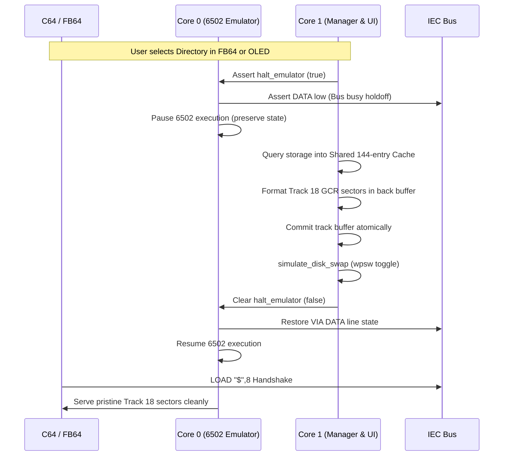

# Design Specification: Directory Synchronization, SD2IEC CD Probe Fix, and Emulation Halt Holdoff

**Date:** 2026-10-15  
**Branch:** `support-fb-tool`  
**Status:** Approved for Implementation  

---

## 1. Overview & Problem Statement

During testing with CBM-FileBrowser (`fb64`) and physical C64 hardware, several critical stability issues were identified:

1. **Bare `CD:` Probe Triggering Root Transition:**
   When `fb64` is loaded and run from `/files` (Internal flash storage), it sends `CD: ` to channel 15 on startup as an SD2IEC device probe and status inquiry. In `cd_handler.rs`, bare `CD:` was mistakenly treated as "return to root container", navigating from `/files` to `Root`. This unmounted the current directory and triggered an unwanted 400ms physical disk swap.

2. **Race Condition & Void Track Read on Disk Swap:**
   During a disk swap simulation, `TrackLayout::Void` is active for 400ms while write-protect is toggled. Because Core 0 (the 6502 emulator) was not paused, the C64 host immediately attempted to read Track 18 (`LOAD "$",8`) while the track layout was `Void`. This resulted in syntax errors or an empty directory listing.

3. **Incorrect Halt Emulation Semantics:**
   In `bridge.rs`, `check_halt_requested()` was wired into `is_reset_line_asserted()`. When halt was requested, Core 0 interpreted it as a hardware reset line assertion, rebooting the 6502 via `emulator.reset(hw)` rather than pausing it.

4. **Architectural Disconnect between OLED Display and Virtual Track 18:**
   The OLED UI (`browser.rs`) maintained its own 48-item cache loaded via independent storage reads, while `VirtualDiskImage` maintained a separate 142-item cache (`PagedDirectorySource<144>`). Furthermore, when `fb64` paged via `>>> NEXT >>>` or `<<< BACK <<<`, `PAGE_CHANGED` was never signaled to the UI event loop in `Menu::run`, leaving the OLED display stale and desynchronized.

---

## 2. Proposed Architecture & Solutions

### 2.1 SD2IEC `CD:` Probe Handling (`cd_handler.rs`)
In SD2IEC and CMD specifications:
- `CD//` changes to root.
- `CD:DIR` changes to subdirectory `DIR`.
- `CD:←`, `CD:_`, `CD:..` change to parent directory.
- Bare `CD:` (and `CD:` followed only by spaces) is a status query / device ping. It **must never** change the directory.

**Resolution:**
Update `resolve_cd_nav` so that when `body.is_empty()`:
- If the original command was `CD//`, transition to `Root`.
- If the command was bare `CD:` or `CD: `, return `CdNavAction::Ignore`.
Update unit tests in `cd_navigation.rs` to enforce this behavior.

### 2.2 Core 0 CPU Pause & IEC DATA Line Holdoff (`pico1541-rp-common`)
In Commodore 1541 IEC protocol:
- When the drive is busy assembling a directory track or servicing a disk change, pulling the IEC DATA line LOW (asserted) forces the C64 host to wait in its listener/talker loop without timing out or failing.

**Implementation Details:**
1. **Decouple Halt from Reset:**
   - In `bridge.rs`, `is_reset_line_asserted()` must only return the physical state of the hardware reset line:
     ```rust
     fn is_reset_line_asserted(&self) -> bool {
         self.iec_reset_gpio.read() != 0
     }
     ```
2. **Dedicated Pause Mechanism:**
   - In `crates/pico1541-rp-common/src/emulation/mod.rs`, before each tick block, check `hw.check_halt_requested()`.
   - When halt is requested:
     - Core 0 forces the IEC DATA line to be asserted (low on bus, `PB1 = 1`).
     - Core 0 pauses execution loop ticking (preserving registers, memory, cycles).
     - Once Core 1 clears the halt request, Core 0 restores the normal VIA PB state to the PIO and resumes ticking.
3. **Manager Track Assembly Coordination:**
   - In `TrackCacheTask` (Core 1), before formatting/updating Track 18 sectors or executing `simulate_disk_swap`:
     1. Assert `halt_emulator` (`true`).
     2. Assemble Track 18 GCR sectors into the back buffer.
     3. Commit the track buffer atomically.
     4. Perform the write-protect swap sequence if needed.
     5. Clear `halt_emulator` (`false`).

### 2.3 Unified 144-Entry Shared Directory Cache & Reactive Paging
1. **Unified Storage Cache:**
   - Expand `ACTIVE_CHILDREN` to hold 144 entries, or introduce `SHARED_DIR_PAGE` holding both PETSCII entries and full filenames.
   - When navigating into a folder or refreshing a page, storage is queried once into this shared buffer.
   - Both `PagedDirectorySource<144>` (Track 18 GCR generator) and the OLED Display Browser consume entries directly from this shared cache.
2. **Page Change Notification to UI:**
   - When `CURRENT_PAGE` changes, set `PAGE_CHANGED` and signal `LOCATION_CHANGED` (or a dedicated `PAGE_CHANGED_SIGNAL`).
   - In `browser.rs` and `menu.rs`, handle page changes by resetting `cursor = 0` and `scroll_offset = 0`, repopulating the menu with the new page entries.

---

## 3. Detailed Data Flow



---

## 4. Verification & Testing

1. **Unit Tests:**
   - Update `tests/cd_navigation.rs` to verify bare `CD:` is ignored across all locations, while `CD//` transitions to `Root`.
   - Add unit tests verifying `SharedPageCache` capacity (144 entries) and child resolution.
2. **Integration Verification:**
   - Run `cargo test --all`.
   - Build RP2040 and RP2350 release binaries:
     - `cargo build --release -p pico1541-rp2040 --target thumbv6m-none-eabi`
     - `cargo build --release -p pico1541-rp2350 --target thumbv8m.main-none-eabihf`
   - Verify 0 compiler warnings and strict `#![no_std]` compliance.
