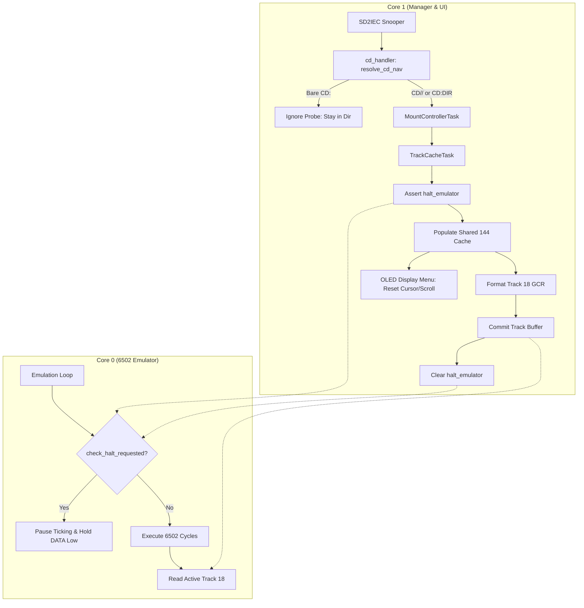

# Directory Synchronization, CD Probe Fix, and Emulation Halt Plan

> **For agentic workers:** REQUIRED SUB-SKILL: Use superpowers:subagent-driven-development to implement this plan task-by-task. Steps use checkbox (`- [ ]`) syntax for tracking.

**Goal:** Fix the bare `CD:` probe handling so `fb64` startup does not trigger an unwanted root transition and disk swap, implement true 6502 pause with IEC DATA low holdoff during directory generation and disk swap, and unify the 144-entry directory cache between the OLED display and the virtual disk emulator with reactive page scrolling.

**Architecture:**
1. In `cd_handler.rs`, differentiate `CD//` (root transition) from bare `CD:` / `CD: ` (probe/query), returning `CdNavAction::Ignore` for probes so the drive remains in `/files` or current folder.
2. In `pico1541-rp-common`, decouple `check_halt_requested()` from `is_reset_line_asserted()` to prevent 6502 hardware reboots during halt. In the Core 0 loop, pause CPU ticking and assert the IEC DATA line LOW (bus busy holdoff) while `check_halt_requested()` is asserted by Core 1 during Track 18 preparation and disk swap.
3. In `pico1541-manager`, expand `ACTIVE_CHILDREN` to 144 entries as a unified shared page cache. Synchronize page navigation so `CURRENT_PAGE` updates notify the OLED UI event loop to reset cursor and scroll to 0 and render the new page.

**Architecture Diagram:**

**Tech Stack:** Rust (`no_std`), Embassy, RP2040/RP2350 PAC & PIO, CBM 1541-II emulation, 6502 assembly, PETSCII.

## Global Constraints
- `#![no_std]` compliance across all firmware crates (`pico1541-common`, `pico1541-manager`, `pico1541-emulator`, `pico1541-rp-common`, `pico1541-rp2040`, `pico1541-rp2350`).
- No compiler warnings.
- Keep all unit tests passing (`cargo test --all`).
- Dual-core separation: Core 0 is Emulator, Core 1 is Manager.
- IEC signal logic: `true = Asserted` (line pulled low on bus). Hardware 7405 inverts signal.
- Stay on feature branch `support-fb-tool`. Do NOT merge or create a PR.

---

### Task 1: Fix Bare `CD:` Probe in `cd_handler.rs`

**Files:**
- Modify: `crates/pico1541-manager/src/tasks/mount_manager/cd_handler.rs`
- Test: `crates/pico1541-manager/tests/cd_navigation.rs`

**Interfaces:**
- `resolve_cd_nav(current: &DriveLocation, cmd: &str) -> CdNavAction`
- Consumes: `DriveLocation`, `cmd` string
- Produces: `CdNavAction::Ignore` when `cmd` is bare `CD:` or `CD: ` (spaces only), `CdNavAction::Transition(DriveLocation::Root)` when `cmd` is `CD//`.

- [ ] **Step 1: Write the failing unit tests in `tests/cd_navigation.rs`**
Add tests asserting that `resolve_cd_nav` returns `CdNavAction::Ignore` for `"CD:"` and `"CD: "` when `current` is `DriveLocation::VirtualDirectory { path: "/files", use_internal: true }` and `DriveLocation::VirtualDirectory { path: "/", use_internal: false }`, while `"CD//"` still returns `CdNavAction::Transition(DriveLocation::Root)`.

- [ ] **Step 2: Run tests to verify failure**
Run `cargo test -p pico1541-manager --test cd_navigation` and confirm the new tests fail.

- [ ] **Step 3: Implement minimal code in `cd_handler.rs`**
Update `resolve_cd_nav` to distinguish `CD//` from `CD:`/`CD: `.
If `body.is_empty()`:
- Check if `cmd.trim().eq_ignore_ascii_case("CD//")`. If so, return `CdNavAction::Transition(DriveLocation::Root)`.
- Otherwise (bare `CD:`, `CD: `), return `CdNavAction::Ignore`.
Update lines 64-66 in `DriveLocation::VirtualDirectory` and anywhere `body.is_empty()` was incorrectly returning `ToRoot`.

- [ ] **Step 4: Run tests and verify they pass**
Run `cargo test -p pico1541-manager --test cd_navigation` and verify all tests pass.

- [ ] **Step 5: Commit**
`git add crates/pico1541-manager/src/tasks/mount_manager/cd_handler.rs crates/pico1541-manager/tests/cd_navigation.rs`
`git commit -m "fix(manager): treat bare CD: probe as ignore in cd_handler"`

---

### Task 2: Core 0 CPU Pause & IEC DATA Line Holdoff

**Files:**
- Modify: `crates/pico1541-rp-common/src/emulation/bridge.rs`
- Modify: `crates/pico1541-rp-common/src/emulation/mod.rs`
- Modify: `crates/pico1541-common/src/interface.rs`
- Modify: `crates/pico1541-manager/src/tasks/mount_manager/mod.rs`
- Modify: `crates/pico1541-manager/src/tasks/mount_manager/track.rs`

**Interfaces:**
- `HardwareBridge::is_reset_line_asserted(&self) -> bool`: returns only physical reset pin state.
- `HardwareBridge::check_halt_requested(&self) -> bool`: returns `halt_emulator` flag.
- `HardwareBridge::assert_iec_data_busy(&mut self, asserted: bool)`: drives DATA low (asserted) when halted.

- [ ] **Step 1: Decouple halt from reset in `bridge.rs`**
Change `is_reset_line_asserted` in `bridge.rs` to only test `(self.iec_reset_gpio.read() != 0)`.

- [ ] **Step 2: Implement IEC DATA line busy holdoff in `bridge.rs`**
In `bridge.rs`, implement `assert_iec_data_busy`:
When `asserted == true`, push a word to PIO1 sm0 TX FIFO with `PB1 = 1` (DATA asserted).
When `asserted == false`, push the current VIA PB state to restore normal control.

- [ ] **Step 3: Update Core 0 loop in `emulation/mod.rs`**
In `crates/pico1541-rp-common/src/emulation/mod.rs`, before each 512-tick chunk:
If `hw.check_halt_requested()` is true:
- Call `hw.assert_iec_data_busy(true)`.
- Loop with `cortex_m::asm::nop()` while `hw.check_halt_requested()` is true, updating timekeeper base if needed.
- Call `hw.assert_iec_data_busy(false)`.

- [ ] **Step 4: Coordinate halt in `TrackCacheTask` during directory load and disk swap**
In `crates/pico1541-manager/src/tasks/mount_manager/mod.rs` and `track.rs`:
Before `simulate_disk_swap` and directory GCR assembly, set `halt_emulator` (`true`).
After the track buffer is committed and swap finishes, clear `halt_emulator` (`false`).

- [ ] **Step 5: Run tests and verify RP2040/RP2350 compilation**
Run `cargo test --all`.
Run `cargo build --release -p pico1541-rp2040 --target thumbv6m-none-eabi`.
Run `cargo build --release -p pico1541-rp2350 --target thumbv8m.main-none-eabihf`.

- [ ] **Step 6: Commit**
`git add crates/pico1541-rp-common crates/pico1541-common crates/pico1541-manager`
`git commit -m "fix(emulation): pause 6502 and hold IEC DATA low during track assembly"`

---

### Task 3: Unified 144-Entry Shared Directory Cache & Reactive Paging

**Files:**
- Modify: `crates/pico1541-manager/src/tasks/mount_manager/mod.rs`
- Modify: `crates/pico1541-manager/src/tasks/ui/browser.rs`
- Modify: `crates/pico1541-manager/src/tasks/menu.rs`
- Modify: `crates/pico1541-manager/src/lib.rs`
- Test: `crates/pico1541-manager/tests/mount_manager_integration.rs`

**Interfaces:**
- `ACTIVE_CHILDREN`: `Mutex<CriticalSectionRawMutex, heapless::Vec<CachedChildEntry, 144>>`
- `PAGE_SIGNAL`: `Signal<CriticalSectionRawMutex, ()>` (or notify via `LOCATION_CHANGED`)

- [ ] **Step 1: Expand `ACTIVE_CHILDREN` to 144 entries**
In `mount_manager/mod.rs`, update `CachedChildEntry` and `ACTIVE_CHILDREN` capacity from 48 to 144 (`PAGE_CAPACITY + 2`).
Ensure both `mount_sequence` and `refresh_paged_directory` populate all loaded entries into `ACTIVE_CHILDREN`.

- [ ] **Step 2: Connect `PAGE_CHANGED` to UI Notification**
In `mount_manager/mod.rs`, when `PAGE_CHANGED.store(true, ...)` occurs, signal `LOCATION_CHANGED.signal(())` (or trigger the UI event loop).

- [ ] **Step 3: Update `browser.rs` and `menu.rs` to reset on page change and use shared cache**
In `browser.rs`, when a location/page change occurs while staying in the same path:
- Reset `cursor = 0` and `scroll_offset = 0`.
- Populate menu blocks from `ACTIVE_CHILDREN` rather than doing redundant independent `list_dir_range` calls to storage.

- [ ] **Step 4: Update integration tests**
Update `mount_manager_integration.rs` to verify that `ACTIVE_CHILDREN` holds up to 144 entries and child resolution succeeds across the full page.

- [ ] **Step 5: Run tests and verify RP2040/RP2350 compilation**
Run `cargo test --all`.
Run `cargo build --release -p pico1541-rp2040 --target thumbv6m-none-eabi`.
Run `cargo build --release -p pico1541-rp2350 --target thumbv8m.main-none-eabihf`.

- [ ] **Step 6: Commit**
`git add crates/pico1541-manager`
`git commit -m "feat(manager): expand shared child cache to 144 entries and sync UI page scrolling"`

---

### Task 4: Full System Verification & Code Cleanup

**Files:**
- Review: all modified files across workspace.

- [ ] **Step 1: Check compiler warnings**
Ensure 0 compiler warnings on host tests and both target architectures.

- [ ] **Step 2: Run all unit and integration tests**
Run `cargo test --all`.

- [ ] **Step 3: Verify clean git working directory and status**
Run `git status` and verify all changes are cleanly committed on branch `support-fb-tool`.
