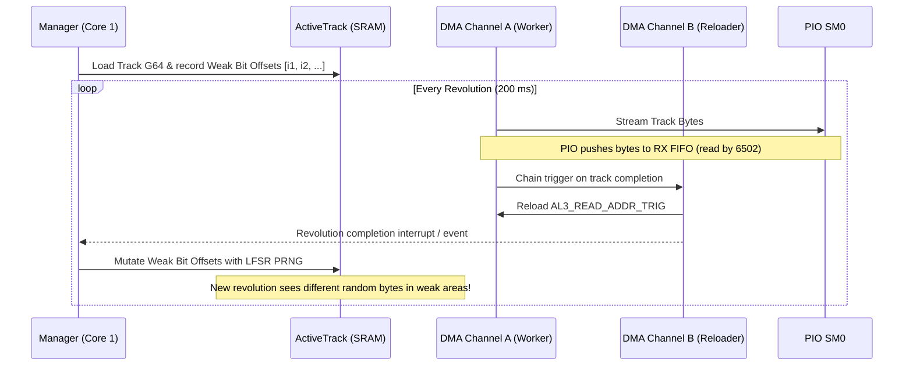

# Design Specification: NIB-to-G64 Converter (`nib2g64`) & Weak-Bit Emulation Architecture

**Date:** 2026-10-16  
**Status:** Approved  
**Phase 1 Target:** `tools/nib2g64`  
**Phase 2 Target:** `pico1541-manager`, `pico1541-rp-common` (RP2350 firmware)

---

## 1. Overview & Context

Commodore 64 disk preservation archives rely on raw disk capture formats such as **.NIB** (MNIB / nibtools raw nibble dumps) and **.NBZ** (LZ77-compressed NIB). These images store raw GCR bytes as read directly from the drive head, preserving custom sync lengths, non-standard sector headers, and unformatted "weak-bit" gaps used by copy protections (e.g. RapidLok, V-MAX!, Datasoft).

In Pico1541, spinning disk emulation operates via a dedicated hardware PIO state machine continuously fed by an RP2350 DMA ping-pong loop. While the standard .D64 format discards raw bit timing and weak bits entirely, the .G64 format preserves cycle-level GCR track data and supports designating weak-bit regions.

This specification addresses two key milestones:
1. **Phase 1 (Immediate):** A standalone, portable Rust CLI tool `tools/nib2g64` in the workspace to convert `.nib` and `.nbz` images into standard `.g64` files, featuring smart seam detection and configurable weak-bit sanitization.
2. **Phase 2 (Firmware Architecture):** Emulating weak bits within Pico1541's RP2350 firmware by dynamically mutating marked weak-bit regions in SRAM on each disk revolution, preserving 100% of the PIO and DMA ping-pong architecture without CPU bit-banging.

---

## 2. Phase 1: `tools/nib2g64` Specification

### 2.1 Crate & Module Structure
A new binary crate located at `tools/nib2g64`:
```text
tools/nib2g64/
├── Cargo.toml
└── src/
    ├── main.rs         # CLI parsing, file/batch orchestration, output reporting
    ├── lz77.rs         # Marcus Geelnard LZ77 decompressor (for transparent .nbz support)
    ├── nib.rs          # NIB parser: header validation, track & speed zone map extraction
    ├── gcr.rs          # GCR stream analysis: sync detection, sector headers, seam wrap, weak bits
    └── g64.rs          # G64 file builder: header, track & speed offset tables, track serialization
```

### 2.2 CLI Usage & Options
```bash
# Convert a single file (default output: <stem>.g64)
cargo run -p nib2g64 -- input.nib
cargo run -p nib2g64 -- input.nbz -o game.g64

# Batch convert a directory
cargo run -p nib2g64 -- /path/to/folder/

# Optional flags:
#   --keep-raw          Preserve captured raw bits instead of replacing weak-bit runs with 0x00
#   --align <mode>      Alignment preference: 'auto' (default: sector gap/0), 'none', or 'sync'
#   --verbose, -v       Detailed per-track diagnostic printout (track length, speed zone, weak runs)
```

### 2.3 NIB Format Details
- Fixed 256-byte (`0x100`) header:
  - `0x00..0x0C` (13 bytes): Magic ASCII `"MNIB-1541-RAW"` or `"MNIB-1571-RAW"`.
  - `0x0D` (1 byte): Version number (`0x01`–`0x03`).
  - `0x10..0xFF`: Track mapping table with sequential `(track_num, density)` pairs:
    - `track_num`: Half-track encoded as $2 \times \text{track}$ (Track 1.0 = `2`, Track 18.0 = `36`). Terminates when `track_num == 0` or 84 entries reached.
    - `density`: Bits 0..1 indicate speed zone (`0..3`), upper bits are flags.
- Track Data: Sequential 8,192-byte (`0x2000`) blocks starting at `0x100`.

### 2.4 Smart Seam & Overlap Detection
A raw NIB track captures 8,192 bytes, which exceeds a single 360° disk revolution (200 ms @ 300 RPM).
Nominal capacities by speed zone:
- **Zone 3 (Trk 1–17, 250 kHz):** Nominal 6,250 bytes (Search window: 5,900–6,600)
- **Zone 2 (Trk 18–24, 267 kHz):** Nominal 6,666 bytes (Search window: 6,300–7,000)
- **Zone 1 (Trk 25–30, 286 kHz):** Nominal 7,142 bytes (Search window: 6,800–7,500)
- **Zone 0 (Trk 31–40, 308 kHz):** Nominal 7,692 bytes (Search window: 7,300–8,000)

**Algorithm:**
1. **Header Identification:** Scan track for CBM sector headers (sync run followed by GCR block ID `0x52` / `0x08`, track, and sector ID).
2. **Cycle Period Matching:** Identify the earliest sector header near offset 0 and find its recurrence in the search window. The byte distance yields the exact revolution length $L$.
3. **Correlation Fallback:** For non-standard / copy-protected tracks without standard headers, perform sliding-window pattern matching between `buffer[0..16]` and the search window.
4. **Unformatted / Killer Tracks:** If no repetition is found, clamp at the nominal zone capacity.
5. **Alignment:**
   - **`auto` (default):** Rotate track so the wrap seam falls within the longest inter-sector gap or immediately preceding Sector 0.
   - **`none`:** Retain raw start offset, cropping at length $L$.

### 2.5 Weak-Bit Detection & Sanitization
- **Physical Criterion:** Valid GCR encoding guarantees at most two consecutive zero bits (`00`). A run of three or more zero bits (`0b000`) represents unstable or unformatted flux transitions causing read-head clock loss.
- **Bitwise Evaluation:** Evaluated across a 10-bit window: `((prev_byte & 0x03) << 8) | current_byte`. If a 3-bit zero mask matches (`(data & 7) == 0`), the byte is flagged as bad GCR.
- **Replacement:**
  - **Default:** Replaced with `0x00` bytes (the emulator standard for weak bits).
  - **`--keep-raw`:** Preserved as raw captured bytes from the NIB image.

### 2.6 G64 Container Specification
- **Header (`0x00..0x0B`):**
  - `0x00..0x07`: `"GCR-1541"`
  - `0x08`: Version `0x00`
  - `0x09`: Total half-tracks = `84` (`0x54`)
  - `0x0A..0x0B`: Max track size (little-endian `u16`, default `7928` or max calculated $L$).
- **Track Offset Table (`0x0C..0x015B`):** 84 × 4-byte `u32` little-endian file offsets pointing to track data blocks (or `0` if empty).
- **Speed Zone Table (`0x015C..0x02AB`):** 84 × 4-byte `u32` little-endian speed zone entries (`0..3`).
- **Track Data Payloads:**
  - Sequential blocks starting at `0x02AC`.
  - Format: 2-byte little-endian `u16` length $L$, followed by $L$ bytes of GCR track data.

---

## 3. Phase 2: Firmware Weak-Bit Emulation Architecture

### 3.1 Constraints & Mandates
- **RP2040/RP2350 DMA Loop Integrity:** The two-channel DMA ping-pong loop (`Channel A` streaming data to PIO, chaining to `Channel B` which rewrites `AL3_READ_ADDR_TRIG`) must remain untouched per `GEMINI.md`.
- **PIO Instruction Budget:** PIO instruction space is strictly capped at 32 instructions and is currently near capacity. The PIO state machine must not be burdened with PRNG or weak-bit logic.

### 3.2 Solution: Revolution-Synchronized DMA Shadow Mutation


1. **Pre-Analysis on Track Load:** When Core 1 loads a G64 track into `ActiveTrack`, it identifies all `0x00` byte ranges (or bad GCR patterns) and stores a lightweight slice list of weak-bit offsets.
2. **End-of-Revolution Notification:** DMA Channel B asserts an interrupt/event flag upon resetting Channel A.
3. **In-SRAM Mutation:** A fast, low-overhead linear feedback shift register (LFSR) PRNG overwrites the weak-bit offsets in `ActiveTrack` in SRAM.
4. **Physical Fidelity:** On the subsequent revolution, DMA Channel A reads the modified bytes, causing the 6502 emulator on Core 0 to receive varying bytes across revolutions—cleanly passing copy-protection checks without impacting real-time timing.

---

## 4. Test & Verification Plan

1. **Unit Testing (`tools/nib2g64`):**
   - Verify LZ77 decompression against test vectors.
   - Verify bad GCR detection on synthesized bit patterns (`0b000` vs valid GCR).
   - Verify seam detection on circular buffers with known repeat offsets.
   - Verify G64 round-trip serialization by feeding output into `pico1541-manager::formats::G64Image`.
2. **Integration Testing:**
   - Convert `temp/arkanoid.nib` to `.g64`.
   - Verify clean parsing in `G64Image::from_storage()` with 84 tracks and valid speed zones.
3. **Workspace Verification:**
   - Run `cargo test` across all crates.
   - Verify clean release build of `pico1541-rp2350`.
