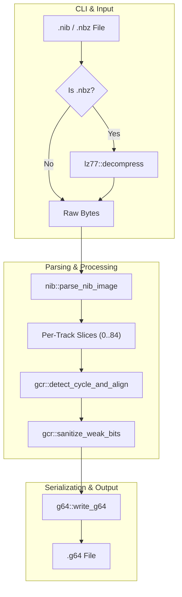

# `nib2g64` Implementation Plan

> **For agentic workers:** REQUIRED SUB-SKILL: Use superpowers:subagent-driven-development to implement this plan task-by-task. Steps use checkbox (`- [ ]`) syntax for tracking.

**Goal:** Build a high-fidelity standalone Rust CLI tool `tools/nib2g64` to convert `.nib` and `.nbz` Commodore 64 disk images to `.g64`, featuring smart seam overlap detection and configurable weak-bit sanitization.

**Architecture:** The tool takes a `.nib` or `.nbz` file, decompresses `.nbz` streams via LZ77 on the fly, parses the 256-byte NIB header and track map, calculates physical rotation lengths via sector header matching and correlation, marks/replaces weak-bit runs with standard `0x00` placeholders (or retains raw bits with `--keep-raw`), and writes out a fully compliant G64 container with track and speed tables.

**Architecture Diagram:**



**Tech Stack:**
- Rust (2021 edition)
- Standalone workspace CLI tool (`tools/nib2g64`)
- Standard library (`std::fs`, `std::path`, `std::env`) without heavy external CLI dependencies

## Global Constraints
- Must compile cleanly with zero warnings (`cargo clippy -p nib2g64` and `cargo test -p nib2g64`).
- All existing workspace tests in `cargo test` must pass.
- Release firmware for RP2350 (`pico1541-rp2350`) must build cleanly.
- Must accurately parse standard NIB files (magic `"MNIB-1541-RAW"` / `"MNIB-1571-RAW"`) and produce G64 readable by `pico1541-manager::formats::G64Image`.

---

### Task 1: Scaffolding, LZ77 Decompression & NIB Image Parser

**Files:**
- Modify: `Cargo.toml:1-30` (add `tools/nib2g64` to workspace members)
- Create: `tools/nib2g64/Cargo.toml`
- Create: `tools/nib2g64/src/lz77.rs`
- Create: `tools/nib2g64/src/nib.rs`
- Test: `tools/nib2g64/src/lz77.rs` (unit tests in module)
- Test: `tools/nib2g64/src/nib.rs` (unit tests in module)

**Interfaces:**
- Consumes: Raw file bytes from `.nib` or `.nbz` files.
- Produces:
  - `lz77::decompress(data: &[u8]) -> Result<Vec<u8>, String>`
  - `nib::TrackEntry { half_track: u8, speed_zone: u8, data: &'a [u8] }`
  - `nib::NibImage<'a>::from_bytes(bytes: &'a [u8]) -> Result<NibImage<'a>, String>`

- [ ] **Step 1: Add `tools/nib2g64` to root workspace `Cargo.toml`**

Add `"tools/nib2g64"` to `members = [...]` in the root [Cargo.toml](file:///home/johnny/git/dev/Pico1541/Cargo.toml).

- [ ] **Step 2: Create `tools/nib2g64/Cargo.toml`**

```toml
[package]
name = "nib2g64"
version = "0.1.0"
edition = "2021"

[dependencies]
```

- [ ] **Step 3: Implement `tools/nib2g64/src/lz77.rs` with unit tests**

Implement Marcus Geelnard LZ77 decompressor matching the algorithm in `tools/nbz2nib/src/lz77.rs`, including comprehensive unit tests for valid compressed streams and corrupt input handling.

- [ ] **Step 4: Implement `tools/nib2g64/src/nib.rs` with unit tests**

Define `NibImage` struct parsing the 256-byte header:
- Validate magic `"MNIB-1541-RAW"` or `"MNIB-1571-RAW"`.
- Parse track entries `(half_track, density)` from offset `0x10..0x100`.
- Provide accessor `fn track(&self, half_track: u8) -> Option<TrackEntry<'_>>` returning a slice of 8,192 bytes.
- Include unit tests with mock header and synthetic track buffers.

- [ ] **Step 5: Run tests for Task 1**

Run: `cargo test -p nib2g64`
Expected: PASS

- [ ] **Step 6: Commit Task 1**

```bash
git add Cargo.toml tools/nib2g64
git commit -m "feat(nib2g64): Add crate scaffolding, LZ77 decompressor, and NIB parser"
```

---

### Task 2: GCR Seam Overlap Detection, Alignment & Weak-Bit Sanitizer

**Files:**
- Create: `tools/nib2g64/src/gcr.rs`
- Test: `tools/nib2g64/src/gcr.rs` (unit tests in module)

**Interfaces:**
- Consumes: 8,192-byte track slices and speed zone from `nib.rs`.
- Produces:
  - `gcr::is_bad_gcr(prev_byte: u8, curr_byte: u8) -> bool`
  - `gcr::sanitize_weak_bits(track: &mut [u8], keep_raw: bool) -> usize` (returns count of weak bytes)
  - `gcr::detect_cycle_and_align(raw_track: &[u8], speed_zone: u8, align_mode: AlignMode) -> (Vec<u8>, usize)` (returns aligned track buffer and rotation length $L$)

- [ ] **Step 1: Write failing tests for weak-bit detection and seam detection**

In `tools/nib2g64/src/gcr.rs`:
- Test `is_bad_gcr`: verify valid GCR byte pairs return false; verify bit sequences with 3+ zeros return true.
- Test `sanitize_weak_bits`: verify runs of bad GCR bytes are replaced with `0x00` when `keep_raw = false`, and untouched when `keep_raw = true`.
- Test `detect_cycle_and_align`: create an 8,192-byte synthetic track with a repeating pattern at offset 6,250 (Zone 3 nominal); verify it detects $L = 6250$.

- [ ] **Step 2: Run test to verify it fails**

Run: `cargo test -p nib2g64 -- gcr`
Expected: FAIL (functions not implemented yet)

- [ ] **Step 3: Implement GCR analysis algorithms in `tools/nib2g64/src/gcr.rs`**

- Implement `is_bad_gcr` using the 10-bit window formula: `((prev_byte & 0x03) << 8) | curr_byte`, checking for 3 consecutive zero bits.
- Implement `sanitize_weak_bits`: scan stream, replace bad GCR runs with `0x00` unless `keep_raw` is set.
- Implement `detect_cycle_and_align`:
  - Search for CBM sector headers (`0xFF` sync followed by `0x52` header marker).
  - Search the speed-zone specific capacity window (e.g. 5,900..6,600 for zone 3) for the repeating sector.
  - Implement correlation fallback for non-standard tracks.
  - Realign to sector gap or Sector 0 based on `AlignMode`.

- [ ] **Step 4: Run tests to verify they pass**

Run: `cargo test -p nib2g64 -- gcr`
Expected: PASS

- [ ] **Step 5: Commit Task 2**

```bash
git add tools/nib2g64/src/gcr.rs
git commit -m "feat(nib2g64): Implement GCR seam detection, alignment, and weak-bit sanitizer"
```

---

### Task 3: G64 Container Builder & Serializer

**Files:**
- Create: `tools/nib2g64/src/g64.rs`
- Test: `tools/nib2g64/src/g64.rs` (unit tests in module)

**Interfaces:**
- Consumes: Aligned and sanitized track buffers for up to 84 half-tracks.
- Produces:
  - `g64::G64Builder::new()`
  - `g64::G64Builder::set_track(&mut self, half_track: u8, speed_zone: u8, data: &[u8])`
  - `g64::G64Builder::serialize(&self) -> Vec<u8>`

- [ ] **Step 1: Write failing unit test for G64 serialization**

In `tools/nib2g64/src/g64.rs`:
- Build a mock G64 image with 2 tracks (half-track 2 = track 1.0, half-track 36 = track 18.0).
- Serialize to bytes.
- Verify:
  - Magic `"GCR-1541"` at `0x00..0x08`.
  - Half-tracks count = 84 at `0x09`.
  - Max track len in `0x0A..0x0B`.
  - Non-zero offsets at indices 0 and 34 in offset table (`0x0C..0x015B`).
  - Matching speed zones at indices 0 and 34 in speed table (`0x015C..0x02AB`).
  - 2-byte little-endian length prefix preceding each track payload.

- [ ] **Step 2: Run test to verify it fails**

Run: `cargo test -p nib2g64 -- g64`
Expected: FAIL

- [ ] **Step 3: Implement `tools/nib2g64/src/g64.rs`**

- Implement `G64Builder`.
- Compute file offsets: `0x02AC + accumulated_payload_bytes`.
- Write track data blocks: `u16` length + payload bytes.

- [ ] **Step 4: Run tests to verify they pass**

Run: `cargo test -p nib2g64 -- g64`
Expected: PASS

- [ ] **Step 5: Commit Task 3**

```bash
git add tools/nib2g64/src/g64.rs
git commit -m "feat(nib2g64): Implement G64 container builder and binary serializer"
```

---

### Task 4: CLI Application & Integration Testing

**Files:**
- Create: `tools/nib2g64/src/main.rs`
- Test: Integration test converting `temp/arkanoid.nib` to `.g64` and verifying with `G64Image`.

**Interfaces:**
- Consumes: Command line arguments (`input`, `-o`, `--keep-raw`, `--align`, `--verbose`).
- Produces: Formatted `.g64` file on disk.

- [ ] **Step 1: Implement `main.rs`**

- Implement CLI arg parsing (supporting `-o`, `--keep-raw`, `--align`, `--verbose`, `-h/--help`).
- Handle single file conversion (`.nib` and `.nbz` via automatic extension detection).
- Handle directory batch conversion.
- Provide clean human-readable output (tracks processed, weak bits detected, final output size).

- [ ] **Step 2: Build and run `nib2g64` against `temp/arkanoid.nib`**

Run: `cargo run -p nib2g64 -- temp/arkanoid.nib -o temp/arkanoid.g64 -v`
Expected: Successfully generates `temp/arkanoid.g64`.

- [ ] **Step 3: Write an integration test verifying converted G64 with `pico1541-manager`**

Create `tools/nib2g64/tests/integration_test.rs`:
- Use `NibImage`, convert tracks with `detect_cycle_and_align` + `G64Builder`.
- Verify the serialized G64 bytes can be read by `pico1541_manager::formats::g64::G64Image::from_storage()` across all tracks.

- [ ] **Step 4: Run integration test**

Run: `cargo test -p nib2g64 --test integration_test`
Expected: PASS

- [ ] **Step 5: Commit Task 4**

```bash
git add tools/nib2g64/src/main.rs tools/nib2g64/tests
git commit -m "feat(nib2g64): Implement CLI orchestration and integration tests"
```

---

### Task 5: Code Quality, Workspace Verification & Clean Build

**Files:**
- Review all modified and newly created files.

- [ ] **Step 1: Check compiler warnings and lints**

Run: `cargo clippy -p nib2g64 -- -D warnings`
Expected: Clean pass with zero warnings.

- [ ] **Step 2: Run all unit and integration tests across entire workspace**

Run: `cargo test`
Expected: All tests pass.

- [ ] **Step 3: Verify RP2350 release build**

Run: `cargo build --package pico1541-rp2350 --release`
Expected: Clean build with zero errors.

- [ ] **Step 4: Commit and finalize Phase 1**

```bash
git commit --allow-empty -m "chore: Finalize Phase 1 nib2g64 tool implementation"
```
