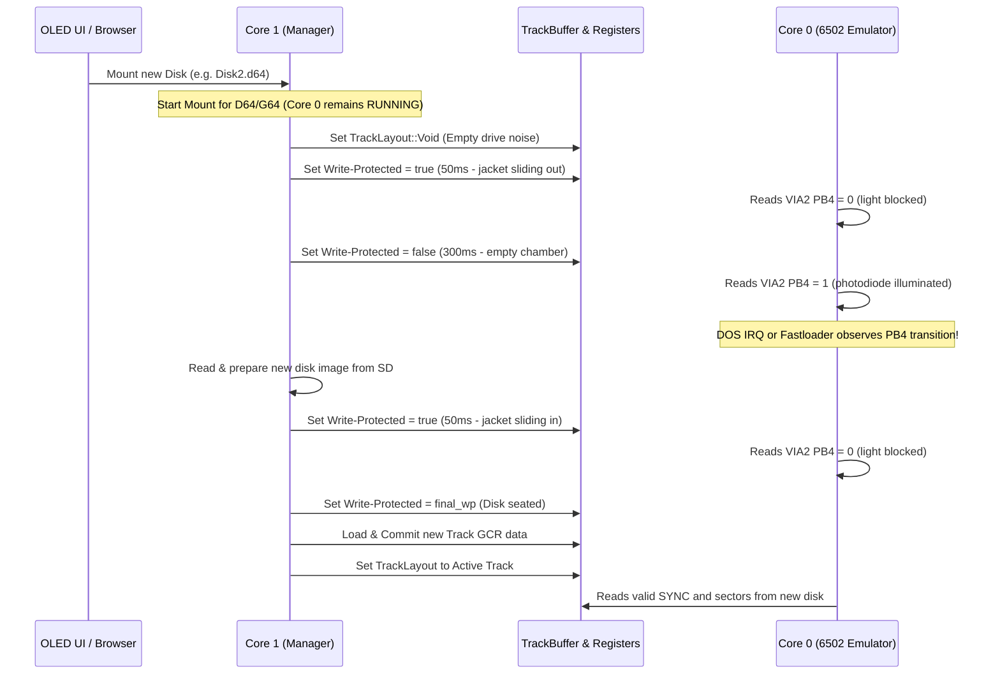

# Design Specification: Accurate Optical Write-Protect Sensor & Disk Swap Emulation

**Date:** 2026-10-16  
**Status:** In Review  
**Branch:** `fix/comaland-loader-step`  

---

## 1. Overview & Problem Statement

In Commodore 1541 disk drives, disk insertion and removal are detected exclusively through hardware:
1. **Optical Write-Protect Sensor:** A phototransistor and infrared LED detect the presence/absence of a disk jacket and the write-protect notch, wired directly to VIA2 Port B bit 4 (`PB4`).
2. **Magnetic Read Head:** While a disk is removed or being inserted, the head reads unformatted noise (no SYNC marks).
3. **Continuous CPU Execution:** The drive's 6502 CPU **never stops running**. It runs continuously at 1 MHz. In standard CBM DOS 2.6, the 10ms timer IRQ polls VIA2 PB4, detects state changes, and sets `wpsw` (`$001C`) = 1 purely in software. Custom fastloaders and demo loaders either poll VIA2 PB4 directly or wait for user input on the C64 before reading sectors from the new disk.

### The Problem in Pico1541
Previously, disk swapping suffered from two interdependent issues:
1. **Emulator Halting during Swap:**
   [`mount_sequence`](file:///home/johnny/git/dev/Pico1541/crates/pico1541-manager/src/tasks/mount_manager/mod.rs) asserted `HALT_EMULATOR = true` before running [`simulate_disk_swap`](file:///home/johnny/git/dev/Pico1541/crates/pico1541-manager/src/tasks/mount_manager/mod.rs#L185). As a result, Core 0 (the 6502 emulator) was completely frozen while the optical write-protect sensor was toggled over ~400ms. When Core 0 was unhalted, the pin had already returned to its final state; the 6502 never saw the physical transition.
2. **Invasive RAM Poking (`force_disk_change`):**
   Because Core 0 was frozen and missed the sensor toggle, a workaround (`force_disk_change`) was added to write `$01` directly into 1541 zero-page RAM at `$001C` (`wpsw`) and `$001D`. 
   However, custom fastloaders (such as Comaland's) do not run standard CBM DOS; they repurpose zero page locations `$001C` and `$001D` for their own variables and GCR decoding. Directly poking `$001C` corrupted the fastloader's internal memory state, causing the drive to hang or crash upon swapping disks.

---

## 2. Proposed Architecture & Design

### 2.1 Principle of Accurate Hardware Emulation
For physical disk images (`.d64` and `.g64`), Pico1541 will strictly emulate real hardware behavior without software memory injection:
- **No Emulator Halt during Image Swap:** Core 0 continues running cycle-exact 1 MHz emulation throughout the mount and swap sequence.
- **`TrackLayout::Void` during Transition:** When a mount/swap begins, the active track is immediately set to `TrackLayout::Void` (unformatted noise / no sync), matching a drive with no disk inserted.
- **Physical Optical Sensor Simulation:**
  - Sliding out old disk: jacket blocks light (`wp = true` -> VIA2 PB4 = 0) for 50ms.
  - Drive empty: phototransistor fully illuminated (`wp = false` -> VIA2 PB4 = 1) for 250–300ms.
  - Sliding in new disk: jacket blocks light (`wp = true` -> VIA2 PB4 = 0) for 50ms.
  - Disk seated: sensor reflects the new image's write-protect status (`final_wp`).
- **Complete Removal of `force_disk_change`:**
  - Remove all artificial memory writes to 1541 RAM (`$001C`/`$001D`).
  - Standard CBM DOS will naturally detect the PB4 edge via its internal 10ms timer IRQ and update `wpsw` on its own.
  - Custom fastloaders will observe the VIA2 PB4 transition in real-time without their zero-page memory being corrupted.

### 2.2 Preserving Virtual Directory Behavior
When browsing virtual directories on SD Card or Internal storage (`VirtualDirectory` / single PRG files):
- Virtual directory generation involves on-the-fly Track 18 formatting where the C64 host might issue `LOAD "$",8` before sectors are ready.
- Halting during virtual directory navigation will be retained specifically for virtual navigation if needed, but will **never** be applied to `.d64` and `.g64` image mounts.

---

## 3. Data Flow

---

## 4. Implementation Details

1. **[`crates/pico1541-manager/src/tasks/mount_manager/mod.rs`](file:///home/johnny/git/dev/Pico1541/crates/pico1541-manager/src/tasks/mount_manager/mod.rs):**
   - In `mount_sequence`:
     - Check if target is a disk image (`is_d64 || is_g64`).
     - Only assert `HALT_EMULATOR = true` for virtual directory/file navigation; leave `HALT_EMULATOR = false` for D64/G64 images.
     - Immediately set active layout to `TrackLayout::Void`.
   - In `simulate_disk_swap`:
     - Remove `self.track_handle.force_disk_change()`.
2. **[`crates/pico1541-emulator/src/systembus.rs`](file:///home/johnny/git/dev/Pico1541/crates/pico1541-emulator/src/systembus.rs):**
   - Remove the `if self.mechanics.pop_force_disk_change() { ... }` block that writes to `$001C` and `$001D`.
3. **[`crates/pico1541-emulator/src/drivemechanics.rs`](file:///home/johnny/git/dev/Pico1541/crates/pico1541-emulator/src/drivemechanics.rs) & [`crates/pico1541-common/src/track_buffer.rs`](file:///home/johnny/git/dev/Pico1541/crates/pico1541-common/src/track_buffer.rs):**
   - Remove unused `force_disk_change` atomic flags and methods.
4. **[`crates/pico1541-emulator/tests/virtual_disk.rs`](file:///home/johnny/git/dev/Pico1541/crates/pico1541-emulator/tests/virtual_disk.rs):**
   - Update tests to verify that write-protect toggle (VIA2 PB4 edge) triggers CBM DOS `wpsw` updating naturally via the DOS IRQ routine, rather than via artificial memory writes.

---

## 5. Verification Plan

1. **Unit Tests:**
   - Run `cargo test -p pico1541-emulator`
   - Run `cargo test -p pico1541-manager`
   - Run `cargo test -p racc6502v4`
2. **Firmware Release Build:**
   - Run `cargo build -p pico1541-rp2350 --target thumbv8m.main-none-eabihf --release`
   - Verify zero compiler warnings.
3. **Live Hardware Verification:**
   - Flash release firmware.
   - Run *Comaland* on physical C64.
   - Perform Disk 1 -> Disk 2 swap when prompted by the demo.
   - Confirm demo detects the swap cleanly and loads Disk 2 without hanging.
