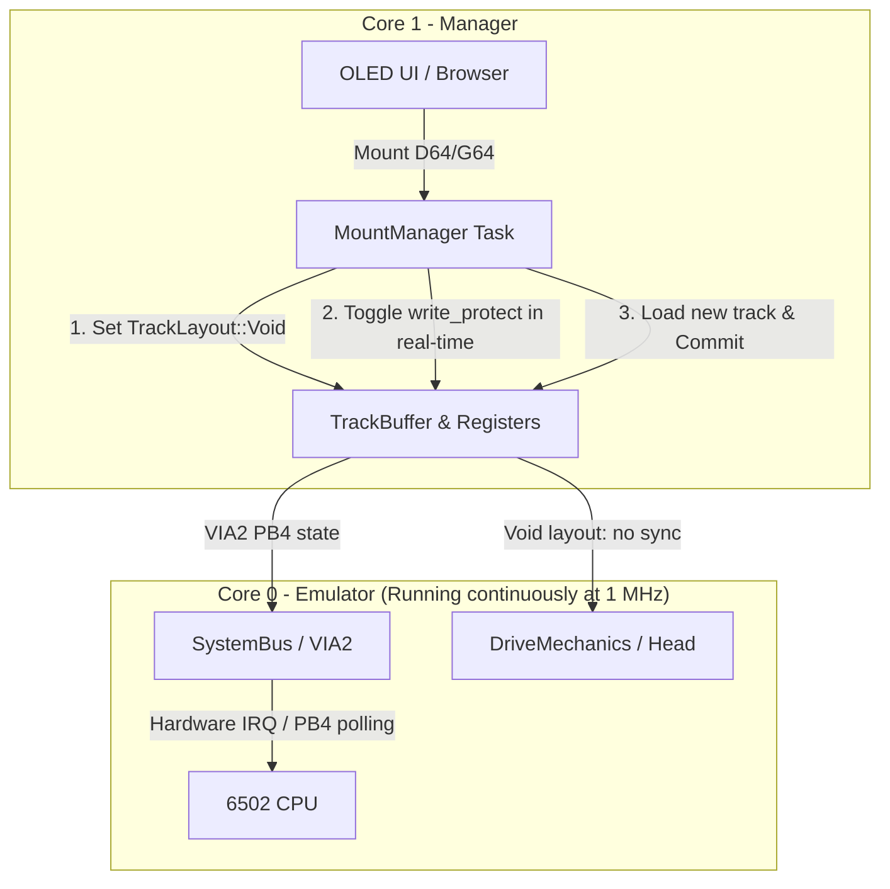

# Accurate Optical Write-Protect Sensor & Disk Swap Implementation Plan

> **For agentic workers:** REQUIRED SUB-SKILL: Use superpowers:subagent-driven-development to implement this plan task-by-task. Steps use checkbox (`- [ ]`) syntax for tracking.

**Goal:** Implement realistic optical write-protect sensor disk swapping for D64/G64 disk images without pausing the 6502 emulator and without artificial memory writes to zero-page RAM ($001C/$001D).

**Architecture:** Core 0 (6502 emulator) remains active during D64 and G64 disk mounting and swapping. When a swap occurs, the track layout is set to `TrackLayout::Void` and the optical write-protect sensor on VIA2 PB4 toggles over ~400ms in real-time, allowing standard CBM DOS or custom fastloaders to detect the disk swap naturally through hardware without zero-page RAM corruption.

**Architecture Diagram:**



**Tech Stack:** Rust (`no_std`), Embassy async, RP2350 dual-core architecture.

## Global Constraints
- Firmware crates must remain `no_std`.
- Core 0 execution must remain cycle-exact 1 MHz.
- All modifications remain on feature branch `fix/comaland-loader-step` (no merge or PR).
- Preserve all existing logging lines.
- All unit tests must pass (`cargo test`).
- Target `pico1541-rp2350` must compile in `--release` with 0 warnings.

---

### Task 1: Clean Up `force_disk_change` Artificial Memory Write in Emulator & Common

**Files:**
- Modify: `crates/pico1541-common/src/track_buffer.rs:215-245, 435-485`
- Modify: `crates/pico1541-emulator/src/drivemechanics.rs:55-65`
- Modify: `crates/pico1541-emulator/src/systembus.rs:120-132`
- Test: `crates/pico1541-emulator/tests/virtual_disk.rs:305-325`

**Interfaces:**
- Removes `force_disk_change` and `pop_force_disk_change` across `TrackHandle`, `DriveMechanics`, and `SystemBus`.
- Eliminates direct writes to `0x001C` and `0x001D` in `SystemBus::poll_io`.

- [x] **Step 1: Write a unit test verifying VIA2 PB4 reflects physical write-protect state**
  In `crates/pico1541-emulator/tests/virtual_disk.rs`, replace `test_force_disk_change_sets_wpsw` with `test_write_protect_sensor_reflects_on_via2_pb4`:
  ```rust
  #[test]
  fn test_write_protect_sensor_reflects_on_via2_pb4() {
      let (mut drive, mut bridge) = setup_drive(false, 8);
      let (mut handle, _) = bridge.buffer.split();

      // Protected: PB4 = 0 (low)
      handle.set_write_protected(true);
      for _ in 0..10 { drive.tick(&mut bridge); }
      assert_eq!(drive.bus_mut().via2.pb_in() & 0x10, 0x00, "Protected disk must set VIA2 PB4 = 0");

      // Unprotected: PB4 = 0x10 (high)
      handle.set_write_protected(false);
      for _ in 0..10 { drive.tick(&mut bridge); }
      assert_eq!(drive.bus_mut().via2.pb_in() & 0x10, 0x10, "Unprotected disk must set VIA2 PB4 = 0x10");
  }
  ```

- [x] **Step 2: Run test to verify it compiles**
  Run `cargo test -p pico1541-emulator --test virtual_disk`.

- [x] **Step 3: Remove `force_disk_change` and RAM poking from `systembus.rs`, `drivemechanics.rs`, and `track_buffer.rs`**
  - In `crates/pico1541-emulator/src/systembus.rs`: remove lines 124–129 where `self.mechanics.pop_force_disk_change()` wrote to `0x001C` and `0x001D`.
  - In `crates/pico1541-emulator/src/drivemechanics.rs`: remove `pop_force_disk_change()`.
  - In `crates/pico1541-common/src/track_buffer.rs`: remove `force_disk_change`, `set_force_disk_change`, and `pop_force_disk_change`.

- [x] **Step 4: Run unit tests across `pico1541-emulator` and `pico1541-common`**
  Run:
  ```bash
  cargo test -p pico1541-common
  cargo test -p pico1541-emulator
  ```
  Ensure all tests compile and pass.

- [x] **Step 5: Commit changes**
  Commit Task 1 changes with message:
  `refactor(emulator): eliminate artificial RAM writes and force_disk_change`

---

### Task 2: Update Mount Manager for D64/G64 Non-Halting Optical Swap

**Files:**
- Modify: `crates/pico1541-manager/src/tasks/mount_manager/mod.rs:185-230, 234-420`
- Test: `crates/pico1541-manager/tests/mount_manager_integration.rs`

**Interfaces:**
- In `mount_sequence`:
  - If `is_d64 || is_g64`: do NOT assert `HALT_EMULATOR`. Immediately set active layout to `TrackLayout::Void`.
  - In `simulate_disk_swap`: remove `self.track_handle.force_disk_change()`.
  - If `is_single_file`: retain existing synchronization semantics.

- [x] **Step 1: Write an integration test for mounting D64/G64 with active layout voiding**
  In `crates/pico1541-manager/tests/mount_manager_integration.rs`, verify `simulate_disk_swap` toggles `is_write_protected` through the expected phases and ends with `final_write_protected` without setting `force_disk_change`.

- [x] **Step 2: Update `simulate_disk_swap` in `mount_manager/mod.rs`**
  Remove `self.track_handle.force_disk_change();` from line 197 in `simulate_disk_swap`.
  Ensure `TrackLayout::Void` is preserved during the swap sequence:
  ```rust
  async fn simulate_disk_swap(&mut self, final_write_protected: bool) {
      #[cfg(feature = "defmt")]
      defmt::info!("Simulating physical disk swap (Write Protect sensor toggle).");

      self.track_handle.set_active_layout(TrackLayout::Void);
      self.track_handle.set_write_protected(true); // LOW (sliding out)
      embassy_time::Timer::after_millis(50).await;
      self.track_handle.set_write_protected(false); // HIGH (no disk, phototransistor uncovered)
      embassy_time::Timer::after_millis(300).await;
      self.track_handle.set_write_protected(true); // LOW (sliding in, phototransistor covered)
      embassy_time::Timer::after_millis(50).await;
      self.track_handle.set_write_protected(final_write_protected);
  }
  ```

- [x] **Step 3: Update `mount_sequence` in `mount_manager/mod.rs` to keep Core 0 running for D64/G64**
  In `mount_sequence`:
  - Check `is_d64 || is_g64`.
  - For `is_d64 || is_g64`: do not call `HALT_EMULATOR.store(true)`. Immediately set `self.track_handle.set_active_layout(TrackLayout::Void)`.
  - For virtual files / directories (`is_single_file` or virtual directory): keep `HALT_EMULATOR.store(true)` to prevent host race conditions with directory generation.
  - At the end of `mount_sequence`: only clear `HALT_EMULATOR.store(false)` if it was previously halted.

- [x] **Step 4: Run manager tests**
  Run:
  ```bash
  cargo test -p pico1541-manager
  ```
  Verify all unit and integration tests pass.

- [ ] **Step 5: Commit changes**
  Commit Task 2 changes with message:
  `fix(manager): run physical optical write-protect simulation without halting emulator for D64/G64`

---

### Task 3: Workspace Verification & Hardware Target Build

**Files:**
- None (build & verification)

- [ ] **Step 1: Run full test suite across all workspace crates**
  Run:
  ```bash
  cargo test -p racc6502v4
  cargo test -p pico1541-emulator
  cargo test -p pico1541-manager
  cargo test -p pico1541-common
  ```

- [ ] **Step 2: Build release firmware for RP2350**
  Run:
  ```bash
  cargo build -p pico1541-rp2350 --target thumbv8m.main-none-eabihf --release
  ```
  Verify the build succeeds with 0 errors and 0 compiler warnings.

- [ ] **Step 3: Invoke automated reviewer subagent**
  Launch reviewer subagent to check spec compliance, code quality, and absence of regressions.
