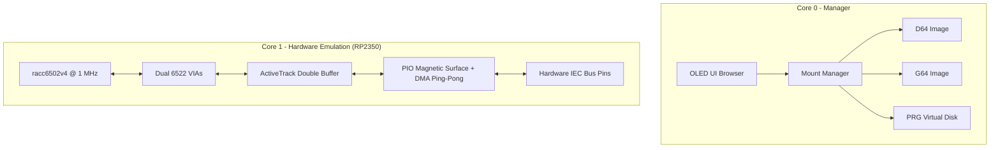

# Implementation Plan: Deprecate RP2040, Drop NIB Format & Refine README

> **For agentic workers:** REQUIRED SUB-SKILL: Use superpowers:subagent-driven-development to implement this plan task-by-task. Steps use checkbox (`- [ ]`) syntax for tracking.

**Goal:** Remove the underpowered RP2040 target and non-functional NIB disk format, resolving the `rp-pac` workspace collision and focusing the codebase and public README entirely on the Raspberry Pi Pico 2 (RP2350) with transparent emulation caveats.

**Architecture:** 
1. Remove `crates/pico1541-rp2040` and references in root configuration, enabling unified workspace builds targeting RP2350.
2. Remove NIB image decoding from `pico1541-manager` (formats, mount manager, UI, and unit tests), relying on G64 for raw track captures.
3. Update `README.md` to highlight Raspberry Pi Pico 2 (RP2350), remove RP2040/NIB references, and provide an honest "Emulation Status & Known Limitations" section detailing current demo compatibility and absence of weak-bit emulation.

**Architecture Diagram:**



**Tech Stack:**
- Rust (no_std, embedded ARM Cortex-M33 `thumbv8m.main-none-eabihf`)
- Embassy async runtime (`embassy-rp` for RP2350)
- `racc6502v4` cycle-exact micro-step 6502 CPU core

## Global Constraints
- Target architecture is strictly Raspberry Pi Pico 2 (RP2350 / Cortex-M33).
- Must eliminate the `rp-pac` feature collision between `rp2040` and `rp235x`.
- All remaining unit tests in `cargo test` must pass.
- Release firmware for RP2350 must compile cleanly with zero warnings.

---

### Task 1: Remove RP2040 Support & v1 Hardware from Workspace

**Files:**
- Delete: `crates/pico1541-rp2040/` (entire directory)
- Delete: `hardware/kicad/Pico1541/` (entire v1 hardware directory)
- Modify: `HARDWARE.md`
- Modify: `Cargo.toml:1-25`
- Modify: `.cargo/config.toml:17-49`

**Interfaces:**
- Eliminates `rp2040` crate, v1 hardware design, and feature conflict from workspace.

- [ ] **Step 1: Remove `crates/pico1541-rp2040` and `hardware/kicad/Pico1541` directories**

```bash
git rm -rf crates/pico1541-rp2040 hardware/kicad/Pico1541
```

- [ ] **Step 2: Update `HARDWARE.md` to remove v1 hardware specification**

- [ ] **Step 3: Update workspace members in `Cargo.toml`**

Remove `"crates/pico1541-rp2040",` from `[workspace.members]`.

- [ ] **Step 4: Update `.cargo/config.toml` aliases**

Ensure aliases default to `pico1541-rp2350` and target `thumbv8m.main-none-eabihf`.

- [ ] **Step 5: Verify workspace check passes**

Run: `cargo check` and `cargo check -p pico1541-rp2350 --target thumbv8m.main-none-eabihf`
Expected: PASS without `rp-pac` conflicting feature error.

- [ ] **Step 6: Commit**

```bash
git add Cargo.toml .cargo/config.toml HARDWARE.md
git commit -m "refactor: drop rp2040 crate and v1 hardware design"
```

---

### Task 2: Remove NIB Format Support from `pico1541-manager`

**Files:**
- Delete: `crates/pico1541-manager/src/formats/nib.rs`
- Modify: `crates/pico1541-manager/src/formats/mod.rs`
- Modify: `crates/pico1541-manager/src/lib.rs`
- Modify: `crates/pico1541-manager/src/storage.rs`
- Modify: `crates/pico1541-manager/src/tasks/mount_manager/mod.rs`
- Modify: `crates/pico1541-manager/src/tasks/mount_manager/cd_handler.rs`
- Modify: `crates/pico1541-manager/src/tasks/mount_manager/file_opener.rs`
- Modify: `crates/pico1541-manager/src/tasks/ui/browser.rs`
- Modify: `crates/pico1541-manager/tests/formats.rs`
- Modify: `crates/pico1541-manager/tests/disk_test.rs`
- Modify: `crates/pico1541-manager/tests/cd_navigation.rs`

- [ ] **Step 1: Delete `crates/pico1541-manager/src/formats/nib.rs`**

```bash
git rm crates/pico1541-manager/src/formats/nib.rs
```

- [ ] **Step 2: Remove NIB exports and variants from `src/formats/mod.rs` and `src/lib.rs`**

Remove:
- `pub mod nib;`
- `pub use nib::NibImage;`
- `AnyDiskImage::Nib` variant and match arms
- `MountPayload::Nib` variant and match arms

- [ ] **Step 3: Remove `.nib` handling in mount manager and browser UI**

In `storage.rs`, `cd_handler.rs`, `file_opener.rs`, `mount_manager/mod.rs`, and `ui/browser.rs`, remove checks for `.nib` and `MountPayload::Nib`.

- [ ] **Step 4: Remove NIB tests from integration test suite**

Remove NIB tests from:
- `crates/pico1541-manager/tests/formats.rs`
- `crates/pico1541-manager/tests/disk_test.rs`
- `crates/pico1541-manager/tests/cd_navigation.rs`

- [ ] **Step 5: Run tests to verify clean compilation and passing tests**

Run: `cargo test`
Expected: PASS all tests.

- [ ] **Step 6: Commit**

```bash
git add crates/pico1541-manager/
git commit -m "feat(manager): drop broken NIB format support in favor of G64"
```

---

### Task 3: Overhaul `README.md` for RP2350 and Realistic Compatibility Notes

**Files:**
- Modify: `README.md`

- [ ] **Step 1: Update Title & Introduction**
  - Brand as: "A cycle-accurate Commodore 1541 disk drive emulator running on the Raspberry Pi Pico 2 (RP2350)."
  - Remove references to RP2040 and Pico 1.

- [ ] **Step 2: Add "Emulation Status & Known Limitations" Section**
  - Transparent statement: "While Pico1541 strives for cycle-exact emulation and successfully runs standard DOS, custom fastloaders, and many protected titles, compatibility is not yet 100%."
  - Note: "A small number of edge-case demos do not yet boot or experience timing issues."
  - Note: "There is currently no support for *weak bit* (unstable/random flux) emulation. Copy protection systems that verify weak or unformatted bit patterns will fail authentication."
  - Note on disk formats: "Supports `.D64`, `.G64`, and `.PRG`. For copy-protected disks, `.G64` images are recommended. (If you have `.NIB` files, convert them to `.G64` using VICE or external disk conversion utilities before mounting)."

- [ ] **Step 3: Update Hardware Pinout Table**
  - Keep exclusively the Hardware Revision 2 (RP2350 / Pico 2) pinout table.
  - Remove Revision 1 (RP2040) table.

- [ ] **Step 4: Update Building & Flashing Instructions**
  - Keep only RP2350 instructions:
    - Target: `thumbv8m.main-none-eabihf`
    - Build: `cargo build -p pico1541-rp2350 --target thumbv8m.main-none-eabihf --release`
    - Flash: `elf2uf2-rs -d target/thumbv8m.main-none-eabihf/release/pico1541-rp2350`
  - Remove all RP2040 commands.

- [ ] **Step 5: Verify Markdown formatting and links**

- [ ] **Step 6: Commit**

```bash
git add README.md
git commit -m "docs: focus README on RP2350 and add emulation status caveats"
```

---

### Task 4: Full Verification and Build Validation

**Files:**
- Workspace root

- [ ] **Step 1: Run release build for RP2350**

Run: `cargo build -p pico1541-rp2350 --target thumbv8m.main-none-eabihf --release`
Expected: Build succeeds with 0 errors.

- [ ] **Step 2: Run all unit tests**

Run: `cargo test`
Expected: All tests pass.

- [ ] **Step 3: Run git status check**

Verify git tree is clean and on branch `docs/update-readme-launch-ready`.
