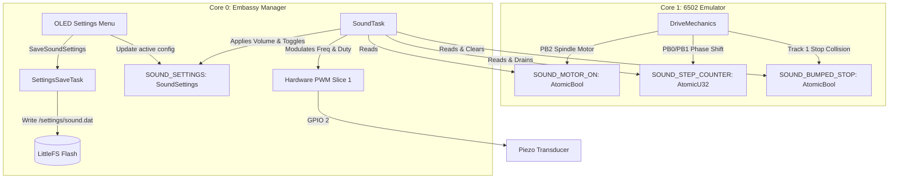

# 1541 Sound Emulation Implementation Plan

> **For agentic workers:** REQUIRED SUB-SKILL: Use superpowers:subagent-driven-development to implement this plan task-by-task. Steps use checkbox (`- [ ]`) syntax for tracking.

**Goal:** Implement mechanical sound emulation for the 1541 drive on the RP2350 microcontroller using a passive Piezo speaker on GPIO 2, supporting spindle motor hum, head stepping chatter, head-bumping clatter against track 1 stop, master volume control, and LittleFS-backed OLED settings.

**Architecture:** Core 1 (6502 Emulator) notifies mechanical state changes using lock-free atomics with zero cycle delay. Core 0 (Embassy Manager) runs an async `SoundTask` controlling RP2350 Hardware PWM on GPIO 2 (PWM Slice 1, Channel A). Master volume scales PWM duty cycle, while frequencies modulate between 110 Hz (motor hum) and 1.2 kHz (stepper clicks & accented head-knocking clatter). Sound settings are configurable via an OLED submenu and persisted to LittleFS at `/settings/sound.dat`.

**Architecture Diagram:**



**Tech Stack:** Rust (`no_std`), Embassy RP (`embassy-rp::pwm`, `embassy-sync`, `embassy-time`), LittleFS, Embedded Graphics.

## Global Constraints
- Target platform: RP2350 (`thumbv8m.main-none-eabihf`), RP2040 compatible.
- All firmware crates must remain `no_std`.
- Core 1 must never block, yield, or experience timing jitter for sound generation.
- All inter-core communication for audio must be strictly lock-free (`Relaxed` atomic operations).
- Zero compiler warnings in `--release` build.

---

### Task 1: Core Sound Settings & Atomic Sound State (`pico1541-common`)

**Files:**
- Create: `crates/pico1541-common/src/sound.rs`
- Modify: `crates/pico1541-common/src/lib.rs`
- Test: `crates/pico1541-common/tests/sound_tests.rs`

**Interfaces:**
- Consumes: None
- Produces: `SoundVolume`, `SoundSettings`, `notify_step(bumped: bool)`, `notify_motor(running: bool)`, `get_and_clear_steps() -> (u32, bool)`, `is_motor_running() -> bool`

- [ ] **Step 1: Write failing unit test for SoundSettings serialization & atomic notification**

```rust
// crates/pico1541-common/tests/sound_tests.rs
use pico1541_common::sound::{SoundSettings, SoundVolume, notify_step, notify_motor, get_and_clear_steps, is_motor_running};

#[test]
fn test_sound_settings_default_and_roundtrip() {
    let default = SoundSettings::default();
    assert_eq!(default.volume, SoundVolume::Medium);
    assert!(default.motor_enabled);
    assert!(default.stepper_enabled);

    let bytes = default.to_bytes();
    let restored = SoundSettings::from_bytes(&bytes).expect("deserialization failed");
    assert_eq!(default, restored);

    let custom = SoundSettings {
        volume: SoundVolume::Off,
        motor_enabled: false,
        stepper_enabled: true,
    };
    let restored_custom = SoundSettings::from_bytes(&custom.to_bytes()).unwrap();
    assert_eq!(custom, restored_custom);
}

#[test]
fn test_sound_notification_atomics() {
    // Reset state
    let _ = get_and_clear_steps();
    notify_motor(false);
    assert!(!is_motor_running());

    notify_motor(true);
    assert!(is_motor_running());

    notify_step(false);
    notify_step(true);

    let (count, bumped) = get_and_clear_steps();
    assert_eq!(count, 2);
    assert!(bumped);

    // After clearing, count is 0 and bumped is false
    let (count2, bumped2) = get_and_clear_steps();
    assert_eq!(count2, 0);
    assert!(!bumped2);
}
```

- [ ] **Step 2: Run test to verify it fails**

Run: `cargo test --test sound_tests`
Expected: FAIL with "unresolved import" or "file not found"

- [ ] **Step 3: Implement SoundSettings and atomics in `crates/pico1541-common/src/sound.rs`**

```rust
use core::sync::atomic::{AtomicBool, AtomicU32, Ordering};

#[derive(Copy, Clone, PartialEq, Eq, Debug)]
#[cfg_attr(feature = "defmt", derive(defmt::Format))]
#[repr(u8)]
pub enum SoundVolume {
    Off = 0,
    Low = 1,
    Medium = 2,
    High = 3,
}

impl SoundVolume {
    pub fn from_u8(v: u8) -> Self {
        match v {
            1 => Self::Low,
            2 => Self::Medium,
            3 => Self::High,
            _ => Self::Off,
        }
    }

    pub fn duty_percent(self) -> u8 {
        match self {
            Self::Off => 0,
            Self::Low => 5,
            Self::Medium => 20,
            Self::High => 50,
        }
    }
}

#[derive(Copy, Clone, PartialEq, Eq, Debug)]
#[cfg_attr(feature = "defmt", derive(defmt::Format))]
pub struct SoundSettings {
    pub volume: SoundVolume,
    pub motor_enabled: bool,
    pub stepper_enabled: bool,
}

impl Default for SoundSettings {
    fn default() -> Self {
        Self {
            volume: SoundVolume::Medium,
            motor_enabled: true,
            stepper_enabled: true,
        }
    }
}

impl SoundSettings {
    pub fn to_bytes(&self) -> [u8; 3] {
        [
            self.volume as u8,
            self.motor_enabled as u8,
            self.stepper_enabled as u8,
        ]
    }

    pub fn from_bytes(bytes: &[u8]) -> Option<Self> {
        if bytes.len() < 3 {
            return None;
        }
        Some(Self {
            volume: SoundVolume::from_u8(bytes[0]),
            motor_enabled: bytes[1] != 0,
            stepper_enabled: bytes[2] != 0,
        })
    }
}

pub static SOUND_STEP_COUNTER: AtomicU32 = AtomicU32::new(0);
pub static SOUND_BUMPED_STOP: AtomicBool = AtomicBool::new(false);
pub static SOUND_MOTOR_ON: AtomicBool = AtomicBool::new(false);

#[inline(always)]
pub fn notify_step(bumped: bool) {
    SOUND_STEP_COUNTER.fetch_add(1, Ordering::Relaxed);
    if bumped {
        SOUND_BUMPED_STOP.store(true, Ordering::Relaxed);
    }
}

#[inline(always)]
pub fn notify_motor(running: bool) {
    SOUND_MOTOR_ON.store(running, Ordering::Relaxed);
}

#[inline(always)]
pub fn get_and_clear_steps() -> (u32, bool) {
    let steps = SOUND_STEP_COUNTER.swap(0, Ordering::Relaxed);
    let bumped = SOUND_BUMPED_STOP.swap(false, Ordering::Relaxed);
    (steps, bumped)
}

#[inline(always)]
pub fn is_motor_running() -> bool {
    SOUND_MOTOR_ON.load(Ordering::Relaxed)
}
```

- [ ] **Step 4: Export module in `crates/pico1541-common/src/lib.rs` and verify tests pass**

Add `pub mod sound;` to `crates/pico1541-common/src/lib.rs`.
Run: `cargo test --test sound_tests`
Expected: PASS

- [ ] **Step 5: Commit**

```bash
git add crates/pico1541-common/
git commit -m "feat(common): add sound settings and atomic state notification"
```

---

### Task 2: Emulator Step & Motor Sound Detection (`pico1541-emulator`)

**Files:**
- Modify: `crates/pico1541-emulator/src/drivemechanics.rs:164-200`
- Test: `crates/pico1541-emulator/tests/sound_mechanics.rs`

**Interfaces:**
- Consumes: `pico1541_common::sound::{notify_step, notify_motor, get_and_clear_steps, is_motor_running}`
- Produces: Mechanical state updates dispatched to sound atomics during VIA2 writes

- [ ] **Step 1: Write unit test in `crates/pico1541-emulator/tests/sound_mechanics.rs`**

```rust
use pico1541_common::sound::{get_and_clear_steps, is_motor_running};
use pico1541_common::context::via::{VIA2_MASK_MOTOR, VIA2_MASK_STEP};
use pico1541_emulator::drivemechanics::DriveMechanics;
use pico1541_emulator::surface::NullSurface;
use pico1541_emulator::trackhandle::NullTrackHandle;

struct DummyHw;
impl pico1541_common::context::ViaHardware for DummyHw {}
impl pico1541_common::interface::HostInterface for DummyHw {
    fn send_event(&mut self, _: pico1541_common::interface::DriveEvent) {}
}

#[test]
fn test_mechanics_sound_triggers_and_bumping() {
    let _ = get_and_clear_steps();
    let mut mechanics = DriveMechanics::new(NullSurface, NullTrackHandle);
    let mut hw = DummyHw;

    // 1. Motor turn ON
    mechanics.update_from_state(VIA2_MASK_MOTOR, 0, 0, &mut hw);
    assert!(is_motor_running());

    // 2. Motor turn OFF
    mechanics.update_from_state(0, VIA2_MASK_MOTOR, 100, &mut hw);
    assert!(!is_motor_running());

    // 3. Normal Step (Phase change 0 -> 1 = Step IN)
    let _ = get_and_clear_steps();
    mechanics.update_from_state(1, 0, 200, &mut hw);
    let (steps, bumped) = get_and_clear_steps();
    assert_eq!(steps, 1);
    assert!(!bumped);

    // 4. Head Bumping (Attempting to step OUT while at MIN_HALF_TRACK)
    // Put head at MIN_HALF_TRACK
    for _ in 0..100 {
        // Step OUT: delta 3 (phase sequence: 0 -> 3 -> 2 -> 1 -> 0)
        mechanics.update_from_state(3, 0, 300, &mut hw);
        mechanics.update_from_state(0, 3, 400, &mut hw);
    }
    let _ = get_and_clear_steps();

    // Now at min half-track, attempt another step OUT (0 -> 3)
    mechanics.update_from_state(3, 0, 500, &mut hw);
    let (steps, bumped) = get_and_clear_steps();
    assert_eq!(steps, 1);
    assert!(bumped, "Should flag head bumped when stepping below MIN_HALF_TRACK");
}
```

- [ ] **Step 2: Run test to verify it fails**

Run: `cargo test --test sound_mechanics`
Expected: FAIL (sound notifications not yet wired into `drivemechanics.rs`)

- [ ] **Step 3: Update `DriveMechanics::update_from_state` in `crates/pico1541-emulator/src/drivemechanics.rs`**

Modify stepper handling:
```rust
        // :? Did stepper motor phase change? (PB0, PB1)
        let is_track_step = state_changes & pico1541_common::context::via::VIA2_MASK_STEP != 0;
        if is_track_step {
            let last_phase = last_state & pico1541_common::context::via::VIA2_MASK_STEP;
            let new_phase = full_state & pico1541_common::context::via::VIA2_MASK_STEP;
            let delta = (new_phase.wrapping_sub(last_phase)
                & pico1541_common::context::via::VIA2_MASK_STEP) as i8;

            let last_half_track_pos = self.halftrack_head_pos;
            let step: i8 = match delta {
                1 => 1,  // Step IN
                3 => -1, // Step OUT
                _ => 0,
            };

            let bumped = (step < 0 && last_half_track_pos <= MIN_HALF_TRACK)
                || (step > 0 && last_half_track_pos >= MAX_HALF_TRACK);

            pico1541_common::sound::notify_step(bumped);

            if step != 0 {
                self.halftrack_head_pos =
                    (last_half_track_pos + step).clamp(MIN_HALF_TRACK, MAX_HALF_TRACK);

                if self.halftrack_head_pos >= 0 && self.halftrack_head_pos <= MAX_HALF_TRACK {
                    let current_half_track = self.halftrack_head_pos as u8;
                    let new_track_identifier =
                        self.current_identifier.with_half_track(current_half_track);
                    self.track_handle.update_head_half_track(current_half_track);
                    self.evaluate_track_identifier(new_track_identifier, master_clock);

                    hardware.track_changed(current_half_track);
                }
            }
        }

        if (state_changes & pico1541_common::context::via::VIA2_MASK_MOTOR) != 0 {
            let motor_on = (full_state & pico1541_common::context::via::VIA2_MASK_MOTOR) != 0;
            self.surface.set_motor_running(motor_on, master_clock);
            pico1541_common::sound::notify_motor(motor_on);
        }
```

- [ ] **Step 4: Run test to verify it passes**

Run: `cargo test --test sound_mechanics`
Expected: PASS

- [ ] **Step 5: Commit**

```bash
git add crates/pico1541-emulator/
git commit -m "feat(emulator): integrate stepper clatter and motor state into sound triggers"
```

---

### Task 3: Manager Sound Driver & Settings Commands (`pico1541-manager`)

**Files:**
- Modify: `crates/pico1541-manager/src/lib.rs` (add `SettingsCommand::SaveSoundSettings`)
- Modify: `crates/pico1541-manager/src/driver.rs` (add `save_sound_settings` to `SettingsDriver`)
- Modify: `crates/pico1541-manager/src/tasks/settings_save.rs`
- Modify: `crates/pico1541-rp-common/src/tasks/settings.rs`
- Test: `crates/pico1541-manager/tests/sound_settings_test.rs`

**Interfaces:**
- Consumes: `pico1541_common::sound::SoundSettings`
- Produces: `SettingsCommand::SaveSoundSettings`, persistence to `/settings/sound.dat`

- [ ] **Step 1: Write test for `SaveSoundSettings` in `crates/pico1541-manager/tests/sound_settings_test.rs`**

```rust
use pico1541_common::sound::{SoundSettings, SoundVolume};
use pico1541_manager::driver::SettingsDriver;
use pico1541_manager::{SettingsCommand, SETTINGS_CHANNEL};

struct MockSettingsDriver {
    saved_sound: Option<SoundSettings>,
}

impl SettingsDriver for MockSettingsDriver {
    async fn save_drive_id(&mut self, _: u8) {}
    async fn save_boot_rom(&mut self, _: &str) {}
    async fn delete_rom(&mut self, _: &str) {}
    async fn install_rom_start(&mut self, _: &str, _: u32, _: u32) {}
    async fn install_rom_chunk(&mut self, _: &[u8]) {}
    async fn install_rom_finish(&mut self) {}
    async fn load_rom_to_memory(&mut self, _: &str) {}
    async fn save_sound_settings(&mut self, settings: &SoundSettings) {
        self.saved_sound = Some(*settings);
    }
}

#[tokio::test]
async fn test_settings_save_sound() {
    let mut driver = MockSettingsDriver { saved_sound: None };
    let target = SoundSettings {
        volume: SoundVolume::High,
        motor_enabled: true,
        stepper_enabled: false,
    };
    driver.save_sound_settings(&target).await;
    assert_eq!(driver.saved_sound, Some(target));
}
```

- [ ] **Step 2: Run test to verify it fails**

Run: `cargo test --test sound_settings_test`
Expected: FAIL (missing `save_sound_settings` in `SettingsDriver`)

- [ ] **Step 3: Add `save_sound_settings` to `SettingsDriver` and `SaveSoundSettings` to `SettingsCommand`**

In `crates/pico1541-manager/src/lib.rs`:
```rust
pub enum SettingsCommand {
    SaveDriveId(u8),
    SaveBootRom(heapless::String<32>),
    DeleteRom(heapless::String<32>),
    InstallRomStart { name: heapless::String<32>, size: u32, offset: u32 },
    InstallRomChunk(heapless::Vec<u8, 256>),
    InstallRomFinish,
    LoadRomToMemory(heapless::String<32>),
    SaveSoundSettings(pico1541_common::sound::SoundSettings),
}
```

In `crates/pico1541-manager/src/driver.rs`:
```rust
pub trait SettingsDriver {
    ...
    async fn save_sound_settings(&mut self, _settings: &pico1541_common::sound::SoundSettings) {}
}
```

In `crates/pico1541-manager/src/tasks/settings_save.rs`:
```rust
SettingsCommand::SaveSoundSettings(settings) => {
    self.driver.save_sound_settings(&settings).await;
}
```

In `crates/pico1541-rp-common/src/tasks/settings.rs`:
```rust
SettingsCommand::SaveSoundSettings(settings) => match Filesystem::mount(flash_storage, config) {
    Ok(fs) => {
        let _ = fs.mkdir("/settings");
        if let Ok(file) = fs.open(
            "/settings/sound.dat",
            OpenFlags::WRITE | OpenFlags::CREATE | OpenFlags::TRUNC,
        ) {
            let bytes = settings.to_bytes();
            let _ = file.write(&bytes);
            let _ = file.sync();
            defmt::info!("Successfully wrote /settings/sound.dat: {:?}", settings);
        }
        flash_storage = fs.unmount().unwrap();
    }
    Err((_, storage)) => {
        flash_storage = storage;
    }
},
```

- [ ] **Step 4: Run test to verify it passes**

Run: `cargo test --test sound_settings_test`
Expected: PASS

- [ ] **Step 5: Commit**

```bash
git add crates/pico1541-manager/ crates/pico1541-rp-common/
git commit -m "feat(manager): add SaveSoundSettings command and LittleFS flash persistence"
```

---

### Task 4: OLED Sound Settings Menu (`pico1541-manager`)

**Files:**
- Modify: `crates/pico1541-manager/src/tasks/ui/mod.rs` (add `PageState::SoundSettings`)
- Modify: `crates/pico1541-manager/src/tasks/ui/settings.rs`
- Test: `crates/pico1541-manager/tests/sound_ui_test.rs`

**Interfaces:**
- Consumes: `SoundSettings`, `SETTINGS_CHANNEL`
- Produces: `run_sound_settings_menu` function in `settings.rs`

- [ ] **Step 1: Write test for Sound Settings menu items in `crates/pico1541-manager/tests/sound_ui_test.rs`**

```rust
use pico1541_common::sound::{SoundSettings, SoundVolume};

#[test]
fn test_sound_settings_cycle_volume() {
    let mut vol = SoundVolume::Off;
    vol = match vol {
        SoundVolume::Off => SoundVolume::Low,
        SoundVolume::Low => SoundVolume::Medium,
        SoundVolume::Medium => SoundVolume::High,
        SoundVolume::High => SoundVolume::Off,
    };
    assert_eq!(vol, SoundVolume::Low);
}
```

- [ ] **Step 2: Run test to verify it passes**

Run: `cargo test --test sound_ui_test`
Expected: PASS

- [ ] **Step 3: Implement Sound Settings menu in `crates/pico1541-manager/src/tasks/ui/settings.rs`**

Add `run_sound_settings_menu`:
```rust
pub async fn run_sound_settings_menu<D, Internal>(
    display: &mut D,
    internal: &mut Internal,
    context: &UiContext,
    sound_settings: &mut pico1541_common::sound::SoundSettings,
) -> PageState
where
    D: DisplayDriver,
    Internal: FileStorageDriver,
{
    loop {
        let mut items = heapless::Vec::<heapless::String<32>, 5>::new();

        let mut vol_str = heapless::String::<32>::new();
        let vol_name = match sound_settings.volume {
            pico1541_common::sound::SoundVolume::Off => "Off",
            pico1541_common::sound::SoundVolume::Low => "Low",
            pico1541_common::sound::SoundVolume::Medium => "Medium",
            pico1541_common::sound::SoundVolume::High => "High",
        };
        let _ = core::write!(vol_str, "Volume: {}", vol_name);
        let _ = items.push(vol_str);

        let mut mot_str = heapless::String::<32>::new();
        let _ = core::write!(
            mot_str,
            "Motor: {}",
            if sound_settings.motor_enabled { "On" } else { "Off" }
        );
        let _ = items.push(mot_str);

        let mut step_str = heapless::String::<32>::new();
        let _ = core::write!(
            step_str,
            "Stepper: {}",
            if sound_settings.stepper_enabled { "On" } else { "Off" }
        );
        let _ = items.push(step_str);

        let _ = items.push(heapless::String::from("Back"));

        let mut menu = Menu::new("--- Sound Settings ---", items);
        match menu.run(display, context).await {
            MenuEvent::Selected(0) => {
                sound_settings.volume = match sound_settings.volume {
                    pico1541_common::sound::SoundVolume::Off => pico1541_common::sound::SoundVolume::Low,
                    pico1541_common::sound::SoundVolume::Low => pico1541_common::sound::SoundVolume::Medium,
                    pico1541_common::sound::SoundVolume::Medium => pico1541_common::sound::SoundVolume::High,
                    pico1541_common::sound::SoundVolume::High => pico1541_common::sound::SoundVolume::Off,
                };
                let _ = context.settings_tx.try_send(crate::SettingsCommand::SaveSoundSettings(*sound_settings));
            }
            MenuEvent::Selected(1) => {
                sound_settings.motor_enabled = !sound_settings.motor_enabled;
                let _ = context.settings_tx.try_send(crate::SettingsCommand::SaveSoundSettings(*sound_settings));
            }
            MenuEvent::Selected(2) => {
                sound_settings.stepper_enabled = !sound_settings.stepper_enabled;
                let _ = context.settings_tx.try_send(crate::SettingsCommand::SaveSoundSettings(*sound_settings));
            }
            MenuEvent::Selected(3) | MenuEvent::Back => return PageState::Settings,
            _ => {}
        }
    }
}
```

In `run_settings_menu`:
Add `Sound Settings` to the items:
```rust
let _ = items.push(heapless::String::from("Sound Settings"));
```
And handle its selection by returning `PageState::SoundSettings`.

In `crates/pico1541-manager/src/tasks/ui/mod.rs`:
Add `SoundSettings` to `PageState` and dispatch `run_sound_settings_menu`.

- [ ] **Step 4: Verify manager compiles and tests pass**

Run: `cargo test -p pico1541-manager`
Expected: PASS

- [ ] **Step 5: Commit**

```bash
git add crates/pico1541-manager/
git commit -m "feat(ui): add Sound Settings submenu to OLED settings"
```

---

### Task 5: Hardware PWM Sound Driver & Embassy SoundTask (`pico1541-rp-common` & `pico1541-rp2350`)

**Files:**
- Modify: `crates/pico1541-rp-common/src/driver/speaker.rs`
- Create: `crates/pico1541-rp-common/src/tasks/sound.rs`
- Modify: `crates/pico1541-rp-common/src/tasks/mod.rs`
- Modify: `crates/pico1541-rp2350/src/main.rs`

**Interfaces:**
- Consumes: `pico1541_common::sound::*`, `embassy_rp::pwm::Pwm`
- Produces: `SoundTask` running on Core 0, driving GPIO 2

- [ ] **Step 1: Implement `PwmPiezo` in `crates/pico1541-rp-common/src/driver/speaker.rs`**

```rust
use embassy_rp::pwm::{Config as PwmConfig, Pwm, SetDutyCycle};
use embassy_rp::Peripheral;
use pico1541_common::sound::SoundVolume;

pub struct PwmPiezo<'d> {
    pwm: Pwm<'d>,
}

impl<'d> PwmPiezo<'d> {
    pub fn new<T: embassy_rp::pwm::Channel>(
        slice: impl Peripheral<P = T> + 'd,
        pin: impl Peripheral<P = impl embassy_rp::pwm::PwmPinA<T>> + 'd,
    ) -> Self {
        let mut config = PwmConfig::default();
        config.top = 0;
        config.compare_a = 0;
        let pwm = Pwm::new_output_a(slice, pin, config);
        Self { pwm }
    }

    pub fn stop(&mut self) {
        let mut config = PwmConfig::default();
        config.top = 0;
        config.compare_a = 0;
        self.pwm.set_config(&config);
    }

    /// Set frequency in Hz and duty cycle percent (0-50%)
    pub fn play_tone(&mut self, freq_hz: u32, duty_percent: u8) {
        if freq_hz == 0 || duty_percent == 0 {
            self.stop();
            return;
        }

        // System clock is 250 MHz or 125 MHz. Use divider to fit inside 16-bit TOP.
        // For 110 Hz: 250_000_000 / (divider * top) = 110
        // With divider 64: 250_000_000 / 64 = 3_906_250 Hz counter clock.
        // top = 3_906_250 / 110 = 35_511 (fits in u16!)
        let divider: u8 = 64;
        let counter_hz = 250_000_000 / (divider as u32);
        let top = (counter_hz / freq_hz).clamp(1, 65535) as u16;
        let compare = (top as u32 * (duty_percent as u32) / 100).clamp(0, top as u32) as u16;

        let mut config = PwmConfig::default();
        config.divider = divider.into();
        config.top = top;
        config.compare_a = compare;
        self.pwm.set_config(&config);
    }
}
```

- [ ] **Step 2: Create `crates/pico1541-rp-common/src/tasks/sound.rs`**

```rust
use crate::driver::speaker::PwmPiezo;
use embassy_time::{Duration, Timer};
use pico1541_common::sound::{get_and_clear_steps, is_motor_running, SoundSettings, SoundVolume};
use core::sync::atomic::{AtomicU8, Ordering};

pub static CURRENT_SOUND_SETTINGS: SoundSettingsCell = SoundSettingsCell::new();

pub struct SoundSettingsCell {
    volume: AtomicU8,
    motor: core::sync::atomic::AtomicBool,
    stepper: core::sync::atomic::AtomicBool,
}

impl SoundSettingsCell {
    pub const fn new() -> Self {
        Self {
            volume: AtomicU8::new(SoundVolume::Medium as u8),
            motor: core::sync::atomic::AtomicBool::new(true),
            stepper: core::sync::atomic::AtomicBool::new(true),
        }
    }

    pub fn get(&self) -> SoundSettings {
        SoundSettings {
            volume: SoundVolume::from_u8(self.volume.load(Ordering::Relaxed)),
            motor_enabled: self.motor.load(Ordering::Relaxed),
            stepper_enabled: self.stepper.load(Ordering::Relaxed),
        }
    }

    pub fn set(&self, settings: SoundSettings) {
        self.volume.store(settings.volume as u8, Ordering::Relaxed);
        self.motor.store(settings.motor_enabled, Ordering::Relaxed);
        self.stepper.store(settings.stepper_enabled, Ordering::Relaxed);
    }
}

#[embassy_executor::task]
pub async fn sound_task(mut piezo: PwmPiezo<'static>) {
    let mut playing_motor = false;

    loop {
        let settings = CURRENT_SOUND_SETTINGS.get();
        let volume_percent = settings.volume.duty_percent();

        if volume_percent == 0 {
            if playing_motor {
                piezo.stop();
                playing_motor = false;
            }
            Timer::after(Duration::from_millis(10)).await;
            continue;
        }

        let (steps, bumped) = get_and_clear_steps();

        if steps > 0 && settings.stepper_enabled {
            playing_motor = false;
            // Play stepping clicks
            for i in 0..steps.min(10) {
                let duration_us = if bumped && i == 0 { 2800 } else { 1800 };
                piezo.play_tone(1200, volume_percent);
                Timer::after(Duration::from_micros(duration_us)).await;

                piezo.stop();
                if steps > 1 {
                    Timer::after(Duration::from_micros(500)).await;
                }
            }
        } else if is_motor_running() && settings.motor_enabled {
            if !playing_motor {
                piezo.play_tone(110, volume_percent / 2); // Soft low-frequency hum
                playing_motor = true;
            }
            Timer::after(Duration::from_millis(2)).await;
        } else {
            if playing_motor {
                piezo.stop();
                playing_motor = false;
            }
            Timer::after(Duration::from_millis(2)).await;
        }
    }
}
```

- [ ] **Step 3: Export in `crates/pico1541-rp-common/src/tasks/mod.rs`**

Add `pub mod sound;` and `pub use sound::{sound_task, CURRENT_SOUND_SETTINGS};`.

- [ ] **Step 4: Update `crates/pico1541-rp2350/src/main.rs`**

- In `main`: load `/settings/sound.dat` if exists, initialize `CURRENT_SOUND_SETTINGS`.
- Replace `pins.piezo` (Output) with `PwmPiezo::new(p.PWM_SLICE1, p.PIN_2)`.
- Spawn `sound_task`.
- Update `SaveSoundSettings` handler to also call `CURRENT_SOUND_SETTINGS.set(settings)`.

- [ ] **Step 5: Check compilation for RP2350 target**

Run: `cargo check -p pico1541-rp2350 --target thumbv8m.main-none-eabihf --release`
Expected: PASS with 0 warnings.

- [ ] **Step 6: Commit**

```bash
git add crates/pico1541-rp-common/ crates/pico1541-rp2350/
git commit -m "feat(rp2350): implement PWM sound driver and async SoundTask"
```

---

### Task 6: End-to-End Release Build & System Verification

**Files:**
- Test: Full cargo test suite & firmware binary compilation

- [ ] **Step 1: Run full unit test suite**

Run: `cargo test`
Expected: ALL PASS

- [ ] **Step 2: Build release firmware**

Run: `cargo build -p pico1541-rp2350 --target thumbv8m.main-none-eabihf --release`
Expected: Clean build, 0 warnings, binary generated.

- [ ] **Step 3: Commit final integration verification**

```bash
git commit --allow-empty -m "chore: complete 1541 sound emulation implementation and verification"
```
