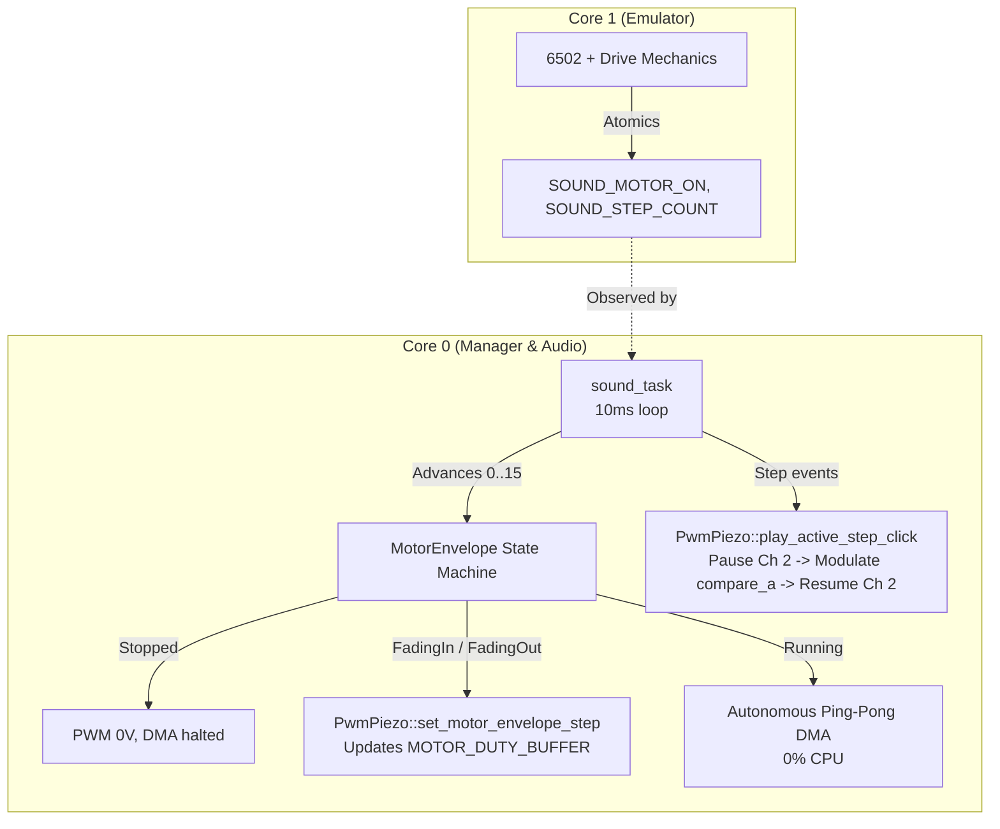

# 1541 Motor Sound Fade-In/Out & Click Elimination Implementation Plan

> **For agentic workers:** REQUIRED SUB-SKILL: Use superpowers:subagent-driven-development to implement this plan task-by-task. Steps use checkbox (`- [ ]`) syntax for tracking.

**Goal:** Eliminate startup/shutdown clicks and pops on the piezo speaker by adding a 150 ms fade-in/fade-out envelope to the 1541 spindle motor sound, and achieve seamless stepper click overlay without interrupting motor hum.

**Architecture:** 
- In `pico1541-common`, `sample_to_pwm_duty_faded` scales both the DC carrier offset ($0\text{V} \leftrightarrow 1.65\text{V}$) and the AC audio amplitude according to an envelope progress $\alpha = \text{step} / \text{max\_steps}$.
- In `pico1541-rp-common`, `PwmPiezo` gains envelope stepping and a carrier-locked stepper click method that modulates compare around the 1.65V DC center at 22,050 Hz without stopping the PWM or dropping to 0V.
- In `sound_task`, a 4-state envelope machine (`Stopped`, `FadingIn`, `Running`, `FadingOut`) steps every 10 ms over 150 ms, returning to autonomous 0% CPU operation once steady-state `Running` is reached.

**Architecture Diagram:**



**Tech Stack:** Rust (`no_std`), Embassy RP (`embassy-rp`), Cortex-M33 architecture, Hardware PWM (Slice 1 Channel A), Ping-Pong DMA (Channels 2 & 3).

## Global Constraints
- Strictly `#![no_std]` across all firmware crates.
- Core 1 emulation execution and timing must remain strictly isolated (zero cycle disruption).
- Steady-state motor hum must remain **0% Core 0 CPU utilization** via autonomous DMA.
- Fade transition must strictly eliminate the DC capacitive step impulse by ramping DC bias continuously from 0V to 1.65V over 150 ms.
- Zero compiler warnings on target `thumbv8m.main-none-eabihf` in `--release` mode.

---

### Task 1: Faded Duty Calculation & Buffer Ramp in `pico1541-common`

**Files:**
- Modify: `crates/pico1541-common/src/motor_sample.rs`
- Modify: `crates/pico1541-common/tests/motor_sample_tests.rs`

**Interfaces:**
- Produces: `sample_to_pwm_duty_faded(sample: i8, top: u16, volume: SoundVolume, step: u8, max_steps: u8) -> u16`

- [ ] **Step 1: Write unit tests for faded duty scaling in `crates/pico1541-common/tests/motor_sample_tests.rs`**

```rust
#[test]
fn test_sample_to_pwm_duty_faded_boundaries() {
    let top = 11337u16;

    // Step 0 should always produce duty = 0 (0V DC)
    for sample in [-128i8, -25, 0, 25, 127] {
        assert_eq!(sample_to_pwm_duty_faded(sample, top, SoundVolume::High, 0, 15), 0);
        assert_eq!(sample_to_pwm_duty_faded(sample, top, SoundVolume::Medium, 0, 15), 0);
        assert_eq!(sample_to_pwm_duty_faded(sample, top, SoundVolume::Low, 0, 15), 0);
    }

    // Step max_steps should match sample_to_pwm_duty
    for sample in [-25i8, 0, 25] {
        assert_eq!(
            sample_to_pwm_duty_faded(sample, top, SoundVolume::High, 15, 15),
            sample_to_pwm_duty(sample, top, SoundVolume::High)
        );
        assert_eq!(
            sample_to_pwm_duty_faded(sample, top, SoundVolume::Medium, 15, 15),
            sample_to_pwm_duty(sample, top, SoundVolume::Medium)
        );
    }

    // Mid-step (e.g. step 7 of 15) must scale both DC center and AC amplitude smoothly
    let duty_mid_zero = sample_to_pwm_duty_faded(0, top, SoundVolume::High, 7, 15);
    let expected_center = ((top as u32 / 2) * 7 / 15) as u16;
    assert_eq!(duty_mid_zero, expected_center);

    // Monotonic DC center progression
    let mut prev_dc = 0;
    for step in 0..=15 {
        let dc = sample_to_pwm_duty_faded(0, top, SoundVolume::High, step, 15);
        assert!(dc >= prev_dc, "DC bias must be monotonically non-decreasing");
        prev_dc = dc;
    }
}
```

- [ ] **Step 2: Run test to verify failure**

Run: `cargo test --test motor_sample_tests`
Expected: FAIL with "cannot find function `sample_to_pwm_duty_faded`"

- [ ] **Step 3: Implement `sample_to_pwm_duty_faded` in `crates/pico1541-common/src/motor_sample.rs`**

```rust
/// Scales a signed 8-bit PCM sample to a 16-bit PWM counter duty value,
/// simultaneously ramping the DC bias (from 0 to top/2) and AC gain (from 0 to volume gain)
/// according to the envelope step progress `step / max_steps`.
#[inline]
pub fn sample_to_pwm_duty_faded(
    sample: i8,
    top: u16,
    volume: SoundVolume,
    step: u8,
    max_steps: u8,
) -> u16 {
    if volume == SoundVolume::Off || step == 0 || max_steps == 0 {
        return 0;
    }

    let clamped_step = step.min(max_steps) as u32;
    let max_steps_u32 = max_steps as u32;

    // Ramped DC center: 0 -> top / 2
    let full_center = (top / 2) as u32;
    let center = ((full_center * clamped_step) / max_steps_u32) as i32;

    // Full volume gain
    let full_gain = match volume {
        SoundVolume::Off => 0,
        SoundVolume::Low => (top as i32) / 250,
        SoundVolume::Medium => (top as i32) / 100,
        SoundVolume::High => (top as i32) / 60,
    };

    // Ramped gain: 0 -> full_gain
    let gain = (full_gain * clamped_step as i32) / (max_steps_u32 as i32);

    let duty = center + (sample as i32 * gain);
    duty.clamp(0, top as i32) as u16
}
```

- [ ] **Step 4: Run test to verify it passes**

Run: `cargo test --test motor_sample_tests`
Expected: PASS

- [ ] **Step 5: Commit**

```bash
git add crates/pico1541-common/src/motor_sample.rs crates/pico1541-common/tests/motor_sample_tests.rs
git commit -m "feat(common): implement sample_to_pwm_duty_faded for envelope scaling"
```

---

### Task 2: Driver Envelope Updates & Carrier-Locked Stepper Click in `PwmPiezo`

**Files:**
- Modify: `crates/pico1541-rp-common/src/driver/speaker.rs`

**Interfaces:**
- Produces:
  - `PwmPiezo::set_motor_envelope_step(&mut self, volume: SoundVolume, step: u8, max_steps: u8)`
  - `PwmPiezo::play_active_step_click(&mut self, volume: SoundVolume, is_bump: bool)`
  - `PwmPiezo::pause_motor_dma()`
  - `PwmPiezo::resume_motor_dma()`

- [ ] **Step 1: Implement `set_motor_envelope_step` in `crates/pico1541-rp-common/src/driver/speaker.rs`**

```rust
    /// Updates the motor duty buffer to a specific envelope progress step (0..=max_steps).
    ///
    /// When step == 0, the buffer is zeroed and DMA/PWM output rests at 0V.
    /// When step > 0, populates the buffer with `sample_to_pwm_duty_faded` and ensures
    /// DMA and the 22,050 Hz PWM carrier are actively streaming.
    pub fn set_motor_envelope_step(&mut self, volume: SoundVolume, step: u8, max_steps: u8) {
        if volume == SoundVolume::Off || step == 0 {
            Self::zero_duty_buffer();
            return;
        }

        let buf_ptr = core::ptr::addr_of_mut!(MOTOR_DUTY_BUFFER) as *mut u16;
        unsafe {
            MOTOR_BUFFER_PTR = buf_ptr;
            for i in 0..MOTOR_SAMPLE_COUNT {
                *buf_ptr.add(i) = pico1541_common::motor_sample::sample_to_pwm_duty_faded(
                    MOTOR_HUM_SAMPLE[i],
                    MOTOR_PWM_TOP,
                    volume,
                    step,
                    max_steps,
                );
            }
        }
        cortex_m::asm::dmb();
        core::sync::atomic::compiler_fence(core::sync::atomic::Ordering::Release);

        if !self.motor_humming {
            let mut config = PwmConfig::default();
            config.divider = 1u8.into();
            config.top = MOTOR_PWM_TOP;
            config.compare_a = 0;
            self.pwm.set_config(&config);

            Self::start_dma();
            self.motor_humming = true;
        }
    }

    fn zero_duty_buffer() {
        let buf_ptr = core::ptr::addr_of_mut!(MOTOR_DUTY_BUFFER) as *mut u16;
        unsafe {
            for i in 0..MOTOR_SAMPLE_COUNT {
                *buf_ptr.add(i) = 0;
            }
        }
        cortex_m::asm::dmb();
        core::sync::atomic::compiler_fence(core::sync::atomic::Ordering::Release);
    }
```

- [ ] **Step 2: Implement DMA pause/resume and carrier-locked click in `crates/pico1541-rp-common/src/driver/speaker.rs`**

```rust
    /// Temporarily pauses Worker Channel 2 without resetting the chaining configuration.
    pub fn pause_motor_dma() {
        let dma = pac::DMA;
        dma.ch(DMA_CH_WORKER)
            .al1_ctrl()
            .modify(|w| *w &= !DMA_CHANNEL_ENABLE_MASK);
    }

    /// Resumes Worker Channel 2 streaming immediately.
    pub fn resume_motor_dma() {
        let dma = pac::DMA;
        cortex_m::asm::dmb();
        core::sync::atomic::compiler_fence(core::sync::atomic::Ordering::Release);
        dma.ch(DMA_CH_WORKER)
            .ctrl_trig()
            .modify(|w| w.set_en(true));
    }

    /// Plays a sharp 1.2 kHz stepper click while the motor hum is active.
    ///
    /// Preserves the 22,050 Hz ultrasonic carrier and 1.65V DC center, toggling compare
    /// between center +/- amplitude for ~1.66 ms (or ~2.5 ms on track 1 bump), then
    /// immediately resumes motor DMA with zero DC transient pop or dropout.
    pub async fn play_active_step_click(&mut self, volume: SoundVolume, is_bump: bool) {
        Self::pause_motor_dma();

        let center = (MOTOR_PWM_TOP / 2) as u32;
        let amp = match volume {
            SoundVolume::Off => 0,
            SoundVolume::Low => (MOTOR_PWM_TOP as u32) / 6,
            SoundVolume::Medium => (MOTOR_PWM_TOP as u32) / 4,
            SoundVolume::High => (MOTOR_PWM_TOP as u32) / 3,
        };

        let high = (center + amp).min(MOTOR_PWM_TOP as u32) as u16;
        let low = center.saturating_sub(amp) as u16;

        let cycles = if is_bump { 3 } else { 2 };
        for _ in 0..cycles {
            // Half period of 1200 Hz is ~416 us
            pac::PWM.ch(1).cc().write(|w| w.set_a(high));
            embassy_time::Timer::after(embassy_time::Duration::from_micros(416)).await;
            pac::PWM.ch(1).cc().write(|w| w.set_a(low));
            embassy_time::Timer::after(embassy_time::Duration::from_micros(416)).await;
        }

        // Return compare to center prior to unpausing DMA
        pac::PWM.ch(1).cc().write(|w| w.set_a(center as u16));
        Self::resume_motor_dma();
    }
```

- [ ] **Step 3: Check compilation for target `thumbv8m.main-none-eabihf`**

Run: `cargo check -p pico1541-rp2350 --target thumbv8m.main-none-eabihf --release`
Expected: PASS with 0 warnings.

- [ ] **Step 4: Commit**

```bash
git add crates/pico1541-rp-common/src/driver/speaker.rs
git commit -m "feat(rp-common): add envelope stepping and carrier-locked step click to PwmPiezo"
```

---

### Task 3: Envelope State Machine in `sound_task`

**Files:**
- Modify: `crates/pico1541-rp-common/src/tasks/sound.rs`

**Interfaces:**
- Consumes: `PwmPiezo::set_motor_envelope_step`, `PwmPiezo::play_active_step_click`, `pico1541_common::sound::*`

- [ ] **Step 1: Define `MotorEnvelope` enum and update `sound_task` in `crates/pico1541-rp-common/src/tasks/sound.rs`**

```rust
const FADE_STEPS: u8 = 15;
const FADE_STEP_DURATION_MS: u64 = 10;

#[derive(Copy, Clone, Debug, PartialEq, Eq)]
enum MotorEnvelope {
    Stopped,
    FadingIn { step: u8 },
    Running,
    FadingOut { step: u8 },
}

#[embassy_executor::task]
pub async fn sound_task(mut piezo: PwmPiezo<'static>) {
    let mut envelope = MotorEnvelope::Stopped;
    let mut last_volume = CURRENT_SOUND_SETTINGS.get().volume;

    loop {
        let settings = CURRENT_SOUND_SETTINGS.get();
        let volume_percent = settings.volume.duty_percent();

        // 1. Muted Volume Handling
        if volume_percent == 0 {
            if envelope != MotorEnvelope::Stopped {
                piezo.stop_motor_hum();
                envelope = MotorEnvelope::Stopped;
            }
            let _ = get_and_clear_steps();
            Timer::after(Duration::from_millis(10)).await;
            continue;
        }

        // 2. Stepper Click Handling
        let (steps, bumped) = get_and_clear_steps();
        if steps > 0 && settings.stepper_enabled {
            for i in 0..steps.min(10) {
                let is_bump = bumped && i == 0;
                if envelope == MotorEnvelope::Stopped {
                    // Motor stopped: standard tone click
                    let duration_us = if is_bump { 2800 } else { 1800 };
                    piezo.play_tone(1200, volume_percent);
                    Timer::after(Duration::from_micros(duration_us)).await;
                    piezo.stop();
                } else {
                    // Motor active: carrier-locked click without dropping DC bias or restarting DMA
                    piezo.play_active_step_click(settings.volume, is_bump).await;
                }

                if steps > 1 {
                    Timer::after(Duration::from_micros(500)).await;
                }
            }
        }

        // 3. Spindle Motor Envelope State Machine
        let motor_should_run = is_motor_running() && settings.motor_enabled;

        // Handle live volume change while running
        if settings.volume != last_volume {
            if envelope == MotorEnvelope::Running {
                piezo.update_motor_volume(settings.volume);
            }
            last_volume = settings.volume;
        }

        match envelope {
            MotorEnvelope::Stopped => {
                if motor_should_run {
                    piezo.set_motor_envelope_step(settings.volume, 1, FADE_STEPS);
                    envelope = MotorEnvelope::FadingIn { step: 1 };
                }
                Timer::after(Duration::from_millis(10)).await;
            }
            MotorEnvelope::FadingIn { step } => {
                if !motor_should_run {
                    // Motor stopped mid-fade-in: reverse to fading out
                    envelope = MotorEnvelope::FadingOut { step };
                } else if step >= FADE_STEPS {
                    envelope = MotorEnvelope::Running;
                } else {
                    let next_step = step + 1;
                    piezo.set_motor_envelope_step(settings.volume, next_step, FADE_STEPS);
                    envelope = MotorEnvelope::FadingIn { step: next_step };
                }
                Timer::after(Duration::from_millis(FADE_STEP_DURATION_MS)).await;
            }
            MotorEnvelope::Running => {
                if !motor_should_run {
                    piezo.set_motor_envelope_step(settings.volume, FADE_STEPS - 1, FADE_STEPS);
                    envelope = MotorEnvelope::FadingOut { step: FADE_STEPS - 1 };
                    Timer::after(Duration::from_millis(FADE_STEP_DURATION_MS)).await;
                } else {
                    Timer::after(Duration::from_millis(10)).await;
                }
            }
            MotorEnvelope::FadingOut { step } => {
                if motor_should_run {
                    // Motor re-triggered mid-fade-out: reverse to fading in
                    envelope = MotorEnvelope::FadingIn { step };
                    Timer::after(Duration::from_millis(FADE_STEP_DURATION_MS)).await;
                } else if step <= 1 {
                    piezo.set_motor_envelope_step(settings.volume, 0, FADE_STEPS);
                    piezo.stop_motor_hum();
                    envelope = MotorEnvelope::Stopped;
                    Timer::after(Duration::from_millis(10)).await;
                } else {
                    let next_step = step - 1;
                    piezo.set_motor_envelope_step(settings.volume, next_step, FADE_STEPS);
                    envelope = MotorEnvelope::FadingOut { step: next_step };
                    Timer::after(Duration::from_millis(FADE_STEP_DURATION_MS)).await;
                }
            }
        }
    }
}
```

- [ ] **Step 2: Check target compilation**

Run: `cargo check -p pico1541-rp2350 --target thumbv8m.main-none-eabihf --release`
Expected: PASS with 0 warnings.

- [ ] **Step 3: Run full cargo test suite**

Run: `cargo test`
Expected: ALL PASS.

- [ ] **Step 4: Commit**

```bash
git add crates/pico1541-rp-common/src/tasks/sound.rs
git commit -m "feat(sound): integrate 150ms fade envelope and active step clicks in sound_task"
```

---

### Task 4: Release Build, Full Workspace Test Suite, and Final Verification

**Files:**
- Test: Full cargo test suite & firmware binary compilation

- [ ] **Step 1: Run full unit test suite**

Run: `cargo test`
Expected: ALL PASS.

- [ ] **Step 2: Build release firmware binary**

Run: `cargo build -p pico1541-rp2350 --target thumbv8m.main-none-eabihf --release`
Expected: Clean build, 0 warnings, binary generated.

- [ ] **Step 3: Commit final verification**

```bash
git commit --allow-empty -m "chore: verify 1541 motor sound fade-in/out and click elimination"
```
