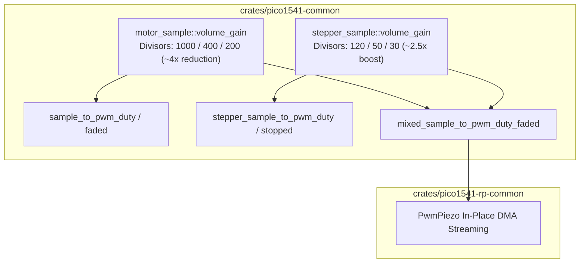

# Sound Gain Rebalance Implementation Plan

> **For agentic workers:** REQUIRED SUB-SKILL: Use superpowers:subagent-driven-development to implement this plan task-by-task. Steps use checkbox (`- [ ]`) syntax for tracking.

**Goal:** Rebalance audio gains between the spindle motor hum and mechanical stepper clatter on the piezo speaker, reducing motor hum by ~4x and boosting stepper clatter by ~2.5x to match real 1541 acoustics.

**Architecture:** Update `volume_gain` divisors in `motor_sample.rs` (1000/400/200) and `stepper_sample.rs` (120/50/30). These functions feed directly into `sample_to_pwm_duty`, `sample_to_pwm_duty_faded`, `stepper_sample_to_pwm_duty`, `stepper_sample_to_pwm_duty_stopped`, and `mixed_sample_to_pwm_duty_faded`, automatically rebalancing both standalone and continuous-phase mixed DMA playback.

**Architecture Diagram:**



**Tech Stack:** Rust (`no_std`), RP2350 PWM hardware pacing, Embassy async.

## Global Constraints
- `#![no_std]` compliance across all firmware crates.
- No dynamic memory allocations.
- No changes to hardware DMA logic or register access; reuse existing buffer mixing architecture.
- Maintain cycle-exact 1 MHz execution on Core 1 and 0% steady-state CPU overhead on Core 0.
- All target checks must pass for `thumbv8m.main-none-eabihf` in `--release`.

---

### Task 1: Update Spindle Motor Hum Gain (`pico1541-common::motor_sample`)

**Files:**
- Modify: `crates/pico1541-common/src/motor_sample.rs:460-467`
- Test: `crates/pico1541-common/tests/motor_sample_tests.rs:18-44`

**Interfaces:**
- Produces: `pub(crate) fn volume_gain(volume: SoundVolume, top: u16) -> i32`
  - `SoundVolume::Off => 0`
  - `SoundVolume::Low => (top as i32) / 1000`
  - `SoundVolume::Medium => (top as i32) / 400`
  - `SoundVolume::High => (top as i32) / 200`

- [ ] **Step 1: Write the failing test**

In `crates/pico1541-common/tests/motor_sample_tests.rs`, update `test_sample_to_pwm_duty_scaling` to assert the new calibrated excursion magnitudes:

```rust
#[test]
fn test_sample_to_pwm_duty_scaling() {
    let top = 11337u16; // 22,050 Hz @ 250 MHz
    let center = top / 2;

    // Off volume: duty should be 0 (no output, transistor turned off)
    assert_eq!(sample_to_pwm_duty(0, top, SoundVolume::Off), 0);
    assert_eq!(sample_to_pwm_duty(20, top, SoundVolume::Off), 0);
    assert_eq!(sample_to_pwm_duty(-20, top, SoundVolume::Off), 0);

    // Zero sample at Medium volume: duty should be centered at midpoint
    assert_eq!(sample_to_pwm_duty(0, top, SoundVolume::Medium), center);

    // Positive sample at Medium volume: duty should be above center but <= top
    let duty_pos = sample_to_pwm_duty(20, top, SoundVolume::Medium);
    assert!(duty_pos > center);
    assert!(duty_pos <= top);

    // Negative sample at Medium volume: duty should be below center but >= 0
    let duty_neg = sample_to_pwm_duty(-20, top, SoundVolume::Medium);
    assert!(duty_neg < center);

    // Monotonic volume scaling: High > Medium > Low
    let excursion_low = (sample_to_pwm_duty(20, top, SoundVolume::Low) as i32 - center as i32).abs();
    let excursion_med = (sample_to_pwm_duty(20, top, SoundVolume::Medium) as i32 - center as i32).abs();
    let excursion_high = (sample_to_pwm_duty(20, top, SoundVolume::High) as i32 - center as i32).abs();
    assert!(excursion_high > excursion_med);
    assert!(excursion_med > excursion_low);

    // Calibrated excursion checks at TOP = 11337:
    // Low: top / 1000 = 11 -> 20 * 11 = 220
    // Med: top / 400 = 28 -> 20 * 28 = 560
    // High: top / 200 = 56 -> 20 * 56 = 1120
    assert_eq!(excursion_low, 220);
    assert_eq!(excursion_med, 560);
    assert_eq!(excursion_high, 1120);
}
```

- [ ] **Step 2: Run test to verify it fails**

Run: `cargo test -p pico1541-common --test motor_sample_tests`
Expected: FAIL with assertion `excursion_low == 220` (actual was 880 under old divisor 250).

- [ ] **Step 3: Write minimal implementation**

In `crates/pico1541-common/src/motor_sample.rs`:
```rust
#[inline]
pub(crate) fn volume_gain(volume: SoundVolume, top: u16) -> i32 {
    match volume {
        SoundVolume::Off => 0,
        SoundVolume::Low => (top as i32) / 1000,
        SoundVolume::Medium => (top as i32) / 400,
        SoundVolume::High => (top as i32) / 200,
    }
}
```

- [ ] **Step 4: Run test to verify it passes**

Run: `cargo test -p pico1541-common --test motor_sample_tests`
Expected: PASS

- [ ] **Step 5: Commit**

```bash
git add crates/pico1541-common/src/motor_sample.rs crates/pico1541-common/tests/motor_sample_tests.rs
git commit -m "feat(common): reduce motor hum volume gain by 4x for subtle background hum"
```

---

### Task 2: Update Stepper Clatter Gain (`pico1541-common::stepper_sample`)

**Files:**
- Modify: `crates/pico1541-common/src/stepper_sample.rs:194-201`
- Test: `crates/pico1541-common/tests/stepper_sample_tests.rs:35-67`

**Interfaces:**
- Produces: `fn volume_gain(volume: SoundVolume, top: u16) -> i32`
  - `SoundVolume::Off => 0`
  - `SoundVolume::Low => (top as i32) / 120`
  - `SoundVolume::Medium => (top as i32) / 50`
  - `SoundVolume::High => (top as i32) / 30`

- [ ] **Step 1: Write the failing test**

In `crates/pico1541-common/tests/stepper_sample_tests.rs`, update `test_stepper_sample_to_pwm_duty` to assert the boosted calibrated excursion magnitudes (using sample `10` to avoid clamping in High volume):

```rust
#[test]
fn test_stepper_sample_to_pwm_duty() {
    let top = 11337u16; // 22,050 Hz @ 250 MHz
    let center = top / 2;

    // Off volume: duty should be 0 (no output, transistor turned off)
    assert_eq!(stepper_sample_to_pwm_duty(0, top, SoundVolume::Off), 0);
    assert_eq!(stepper_sample_to_pwm_duty(20, top, SoundVolume::Off), 0);
    assert_eq!(stepper_sample_to_pwm_duty(-20, top, SoundVolume::Off), 0);

    // Zero sample at Medium volume: duty should be centered at midpoint
    assert_eq!(stepper_sample_to_pwm_duty(0, top, SoundVolume::Medium), center);

    // Positive sample at Medium volume: duty should be above center but <= top
    let duty_pos = stepper_sample_to_pwm_duty(20, top, SoundVolume::Medium);
    assert!(duty_pos > center);
    assert!(duty_pos <= top);

    // Negative sample at Medium volume: duty should be below center but >= 0
    let duty_neg = stepper_sample_to_pwm_duty(-20, top, SoundVolume::Medium);
    assert!(duty_neg < center);

    // High volume should have greater excursion than Medium, and Medium > Low
    let excursion_low = (stepper_sample_to_pwm_duty(10, top, SoundVolume::Low) as i32 - center as i32).abs();
    let excursion_med = (stepper_sample_to_pwm_duty(10, top, SoundVolume::Medium) as i32 - center as i32).abs();
    let excursion_high = (stepper_sample_to_pwm_duty(10, top, SoundVolume::High) as i32 - center as i32).abs();
    assert!(excursion_high > excursion_med);
    assert!(excursion_med > excursion_low);

    // Calibrated excursion checks at TOP = 11337 with sample = 10:
    // Low: top / 120 = 94 -> 10 * 94 = 940
    // Med: top / 50 = 226 -> 10 * 226 = 2260
    // High: top / 30 = 377 -> 10 * 377 = 3770
    assert_eq!(excursion_low, 940);
    assert_eq!(excursion_med, 2260);
    assert_eq!(excursion_high, 3770);

    // Extreme values should clamp within [0, top]
    assert!(stepper_sample_to_pwm_duty(127, top, SoundVolume::High) <= top);
    assert!(stepper_sample_to_pwm_duty(-128, top, SoundVolume::High) <= top);
}
```

- [ ] **Step 2: Run test to verify it fails**

Run: `cargo test -p pico1541-common --test stepper_sample_tests`
Expected: FAIL with assertion `excursion_low == 940` (actual was 450 under old divisor 250).

- [ ] **Step 3: Write minimal implementation**

In `crates/pico1541-common/src/stepper_sample.rs`:
```rust
#[inline]
fn volume_gain(volume: SoundVolume, top: u16) -> i32 {
    match volume {
        SoundVolume::Off => 0,
        SoundVolume::Low => (top as i32) / 120,
        SoundVolume::Medium => (top as i32) / 50,
        SoundVolume::High => (top as i32) / 30,
    }
}
```

- [ ] **Step 4: Run test to verify it passes**

Run: `cargo test -p pico1541-common --test stepper_sample_tests`
Expected: PASS

- [ ] **Step 5: Commit**

```bash
git add crates/pico1541-common/src/stepper_sample.rs crates/pico1541-common/tests/stepper_sample_tests.rs
git commit -m "feat(common): boost stepper clatter volume gain by 2.5x for distinct mechanical clicks"
```

---

### Task 3: Full Workspace Verification & Target Release Build

**Files:**
- None (verification only)

- [ ] **Step 1: Run full unit test suite**

Run: `cargo test`
Expected: All tests pass across all crates.

- [ ] **Step 2: Run target release build**

Run: `cargo check -p pico1541-rp2350 --target thumbv8m.main-none-eabihf --release`
Expected: 0 errors, 0 warnings.
