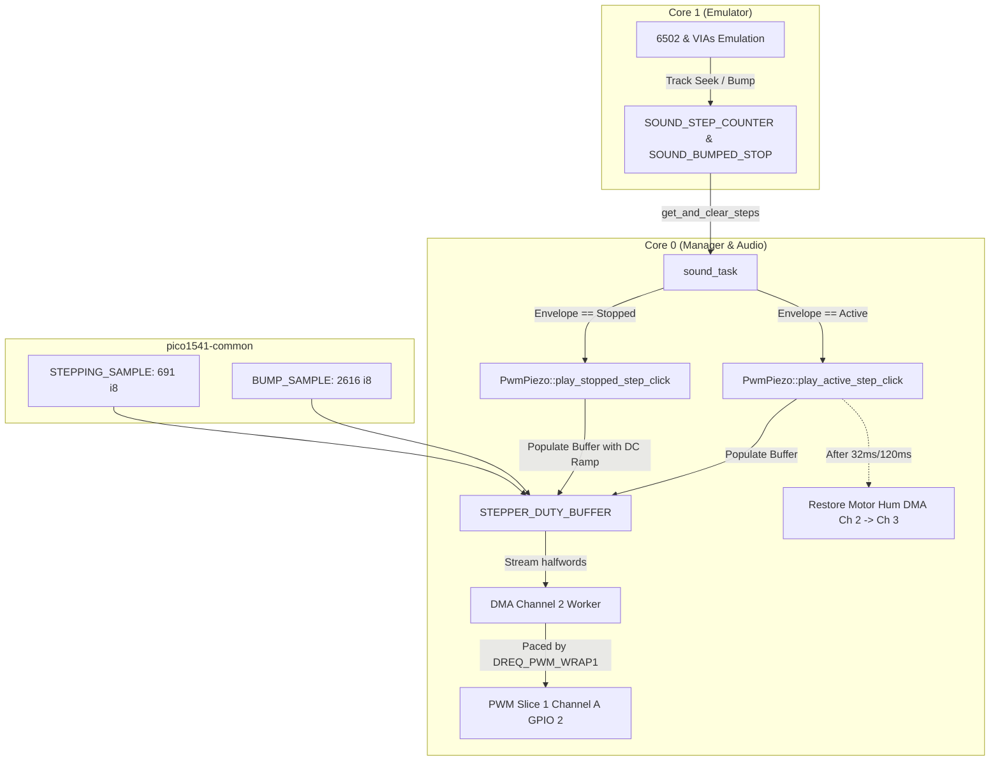

# Authentic 1541 Stepper & Bump Sample Playback Implementation Plan

> **For agentic workers:** REQUIRED SUB-SKILL: Use superpowers:subagent-driven-development to implement this plan task-by-task. Steps use checkbox (`- [ ]`) syntax for tracking.

**Goal:** Replace synthetic square-wave stepper tones with authentic 1541 mechanical recordings (`stepping` and `bump` extracted from VICE) streamed through the 22,050 Hz ultrasonic PWM carrier via hardware DMA.

**Architecture:**
A new module `stepper_sample.rs` in `pico1541-common` provides `STEPPING_SAMPLE` (691 samples @ 22,050 Hz) and `BUMP_SAMPLE` (2,616 samples @ 22,050 Hz) with duty cycle conversion math (`stepper_sample_to_pwm_duty` for active motor playback around 1.65V DC center, and `stepper_sample_to_pwm_duty_stopped` with smooth 1.1 ms sub-audible DC ramp-in and ramp-out to eliminate capacitive DC switching clicks when the spindle is stopped).
In `pico1541-rp-common`, `PwmPiezo` receives `play_active_step_click` (pausing motor DMA, streaming the mechanical step sample via Worker DMA Channel 2 without changing the carrier or DC bias, and seamlessly restoring circular motor hum DMA) and `play_stopped_step_click` (streaming the DC-ramped sample via one-shot DMA with the 22,050 Hz carrier and silencing to 0V upon completion).
`sound_task` invokes these authentic playback methods in response to track stepping events and track 1 bump knock events.

**Architecture Diagram:**



**Tech Stack:** Rust (`#![no_std]`), RP2350 (Cortex-M33), Embassy RP, Hardware DMA (Channels 2 & 3), PWM Slice 1 Channel A (GPIO 2).

## Global Constraints

- `#![no_std]` compliance across all firmware crates (`pico1541-common`, `pico1541-rp-common`, `pico1541-rp2350`).
- No dynamic memory allocation (`no_std`).
- Dual-core separation: Core 0 owns audio DMA and manager tasks; Core 1 emulation execution remains strictly cycle-exact and 100% isolated.
- 0% Core 0 CPU utilization in steady-state motor hum and during sample streaming (hardware DMA paced by `DREQ_PWM_WRAP1`).
- Ultrasonic carrier frequency strictly maintained at 22,050 Hz (`TOP = 11,337`).
- Zero DC switching clicks: continuous 1.65V DC center during active motor playback; smooth 1.1 ms sub-audible DC ramp-in and ramp-out during stopped motor playback.
- Target compilation: `thumbv8m.main-none-eabihf` in `--release` mode with zero compiler warnings.
- Git workflow: stay on branch `feature/sound-emulation`. Do **NOT** merge into `main` or create a PR.

---

### Task 1: Sample Data & Duty Scaling in `pico1541-common`

**Files:**
- Create: `crates/pico1541-common/src/stepper_sample.rs`
- Modify: `crates/pico1541-common/src/lib.rs`
- Create: `crates/pico1541-common/tests/stepper_sample_tests.rs`

**Interfaces:**
- Produces:
  - `pub const STEPPER_SAMPLE_RATE: u32 = 22050;`
  - `pub const STEPPING_SAMPLE: [i8; 691];`
  - `pub const BUMP_SAMPLE: [i8; 2616];`
  - `pub const STEPPER_DC_RAMP_SAMPLES: usize = 25;`
  - `pub fn stepper_sample_to_pwm_duty(sample: i8, top: u16, volume: SoundVolume) -> u16`
  - `pub fn stepper_sample_to_pwm_duty_stopped(sample: i8, top: u16, volume: SoundVolume, index: usize, total_len: usize) -> u16`

- [ ] **Step 1: Write the failing unit tests**

Create `crates/pico1541-common/tests/stepper_sample_tests.rs`:

```rust
use pico1541_common::sound::SoundVolume;
use pico1541_common::stepper_sample::{
    stepper_sample_to_pwm_duty, stepper_sample_to_pwm_duty_stopped, BUMP_SAMPLE,
    STEPPER_DC_RAMP_SAMPLES, STEPPER_SAMPLE_RATE, STEPPING_SAMPLE,
};

#[test]
fn test_sample_lengths_and_rates() {
    assert_eq!(STEPPER_SAMPLE_RATE, 22050);
    assert_eq!(STEPPING_SAMPLE.len(), 691);
    assert_eq!(BUMP_SAMPLE.len(), 2616);

    // Verify sample ranges match authentic recordings
    let min_step = *STEPPING_SAMPLE.iter().min().unwrap();
    let max_step = *STEPPING_SAMPLE.iter().max().unwrap();
    assert_eq!(min_step, -28);
    assert_eq!(max_step, 31);

    let min_bump = *BUMP_SAMPLE.iter().min().unwrap();
    let max_bump = *BUMP_SAMPLE.iter().max().unwrap();
    assert_eq!(min_bump, -101);
    assert_eq!(max_bump, 90);
}

#[test]
fn test_stepper_sample_to_pwm_duty_active() {
    let top = 11337u16;
    let center = top / 2;

    // Volume Off produces 0
    for s in [-28i8, 0, 31] {
        assert_eq!(stepper_sample_to_pwm_duty(s, top, SoundVolume::Off), 0);
    }

    // Zero sample produces center duty
    assert_eq!(stepper_sample_to_pwm_duty(0, top, SoundVolume::High), center);
    assert_eq!(stepper_sample_to_pwm_duty(0, top, SoundVolume::Medium), center);
    assert_eq!(stepper_sample_to_pwm_duty(0, top, SoundVolume::Low), center);

    // Negative sample produces duty < center, positive produces duty > center
    let duty_neg = stepper_sample_to_pwm_duty(-28, top, SoundVolume::High);
    let duty_pos = stepper_sample_to_pwm_duty(31, top, SoundVolume::High);
    assert!(duty_neg < center);
    assert!(duty_pos > center);
    assert!(duty_pos <= top);
}

#[test]
fn test_stepper_sample_to_pwm_duty_stopped_dc_ramp() {
    let top = 11337u16;
    let len = STEPPING_SAMPLE.len();

    // Volume Off produces 0
    assert_eq!(
        stepper_sample_to_pwm_duty_stopped(0, top, SoundVolume::Off, 0, len),
        0
    );

    // First sample (index 0) must be 0 (0V DC start)
    assert_eq!(
        stepper_sample_to_pwm_duty_stopped(0, top, SoundVolume::High, 0, len),
        0
    );

    // DC ramp up: monotonic progression from 0 to center
    let mut prev_dc = 0;
    for i in 0..STEPPER_DC_RAMP_SAMPLES {
        let dc = stepper_sample_to_pwm_duty_stopped(0, top, SoundVolume::High, i, len);
        assert!(dc >= prev_dc, "DC ramp-in must be non-decreasing at index {}", i);
        prev_dc = dc;
    }

    // Steady state mid-sample matches active duty
    let mid_idx = len / 2;
    assert_eq!(
        stepper_sample_to_pwm_duty_stopped(15, top, SoundVolume::High, mid_idx, len),
        stepper_sample_to_pwm_duty(15, top, SoundVolume::High)
    );

    // DC ramp down: ends at 0
    let last_idx = len - 1;
    let end_dc = stepper_sample_to_pwm_duty_stopped(0, top, SoundVolume::High, last_idx, len);
    assert_eq!(end_dc, 0);
}
```

- [ ] **Step 2: Run test to verify it fails**

Run: `cargo test -p pico1541-common --test stepper_sample_tests`
Expected: FAIL with "cannot find module or items in `pico1541_common::stepper_sample`"

- [ ] **Step 3: Implement `stepper_sample.rs` and export in `lib.rs`**

Create `crates/pico1541-common/src/stepper_sample.rs` with `STEPPING_SAMPLE`, `BUMP_SAMPLE`, `stepper_sample_to_pwm_duty`, and `stepper_sample_to_pwm_duty_stopped`.
Modify `crates/pico1541-common/src/lib.rs` to add `pub mod stepper_sample;`.

- [ ] **Step 4: Run test to verify it passes**

Run: `cargo test -p pico1541-common --test stepper_sample_tests`
Expected: PASS

- [ ] **Step 5: Commit**

```bash
git add crates/pico1541-common/src/stepper_sample.rs crates/pico1541-common/src/lib.rs crates/pico1541-common/tests/stepper_sample_tests.rs
git commit -m "feat(common): add authentic 1541 stepper and bump sample tables and duty scaling"
```

---

### Task 2: Driver Hardware DMA Stepper Playback in `PwmPiezo` (`pico1541-rp-common`)

**Files:**
- Modify: `crates/pico1541-rp-common/src/driver/speaker.rs`

**Interfaces:**
- Consumes:
  - `pico1541_common::stepper_sample::{stepper_sample_to_pwm_duty, stepper_sample_to_pwm_duty_stopped, BUMP_SAMPLE, STEPPING_SAMPLE}`
- Produces:
  - `PwmPiezo::play_active_step_click(&mut self, volume: SoundVolume, is_bump: bool)`
  - `PwmPiezo::play_stopped_step_click(&mut self, volume: SoundVolume, is_bump: bool)`

- [ ] **Step 1: Implement `STEPPER_DUTY_BUFFER` and buffer population helper in `speaker.rs`**

Add buffer storage:
```rust
pub const STEPPER_BUFFER_CAPACITY: usize = pico1541_common::stepper_sample::BUMP_SAMPLE.len();
static mut STEPPER_DUTY_BUFFER: [u16; STEPPER_BUFFER_CAPACITY] = [0; STEPPER_BUFFER_CAPACITY];
```

Implement helper:
```rust
fn populate_stepper_buffer(volume: SoundVolume, is_bump: bool, stopped: bool) -> usize {
    let buf_ptr = core::ptr::addr_of_mut!(STEPPER_DUTY_BUFFER) as *mut u16;
    let len = if is_bump {
        pico1541_common::stepper_sample::BUMP_SAMPLE.len()
    } else {
        pico1541_common::stepper_sample::STEPPING_SAMPLE.len()
    };

    unsafe {
        if stopped {
            for i in 0..len {
                let sample = if is_bump {
                    pico1541_common::stepper_sample::BUMP_SAMPLE[i]
                } else {
                    pico1541_common::stepper_sample::STEPPING_SAMPLE[i]
                };
                *buf_ptr.add(i) = pico1541_common::stepper_sample::stepper_sample_to_pwm_duty_stopped(
                    sample,
                    MOTOR_PWM_TOP,
                    volume,
                    i,
                    len,
                );
            }
        } else {
            for i in 0..len {
                let sample = if is_bump {
                    pico1541_common::stepper_sample::BUMP_SAMPLE[i]
                } else {
                    pico1541_common::stepper_sample::STEPPING_SAMPLE[i]
                };
                *buf_ptr.add(i) = pico1541_common::stepper_sample::stepper_sample_to_pwm_duty(
                    sample,
                    MOTOR_PWM_TOP,
                    volume,
                );
            }
        }
    }
    cortex_m::asm::dmb();
    core::sync::atomic::compiler_fence(core::sync::atomic::Ordering::Release);
    len
}
```

- [ ] **Step 2: Implement `play_active_step_click` and `play_stopped_step_click`**

Implement `play_active_step_click`:
```rust
/// Plays an authentic mechanical stepper or bump sample while the spindle motor is active.
///
/// Temporarily points Worker DMA Channel 2 to `STEPPER_DUTY_BUFFER`, streaming the 31.3 ms
/// step (or 118.6 ms bump) at 22,050 Hz without dropping the ultrasonic carrier or 1.65V DC center.
/// When the sample completes, seamlessly restores circular motor hum streaming.
pub async fn play_active_step_click(&mut self, volume: SoundVolume, is_bump: bool) {
    if !self.motor_humming || volume == SoundVolume::Off {
        return;
    }

    let len = Self::populate_stepper_buffer(volume, is_bump, false);
    Self::pause_motor_dma();

    let dma = pac::DMA;
    let ch_worker = dma.ch(DMA_CH_WORKER);

    // Configure Worker Channel 2 to stream the stepper buffer (unchained):
    ch_worker
        .read_addr()
        .write_value(core::ptr::addr_of!(STEPPER_DUTY_BUFFER) as u32);
    ch_worker
        .trans_count()
        .write_value(pac::dma::regs::ChTransCount(len as u32));
    ch_worker
        .ctrl_trig()
        .modify(|w| w.set_chain_to(DMA_CH_WORKER as u8));

    cortex_m::asm::dmb();
    core::sync::atomic::compiler_fence(core::sync::atomic::Ordering::Release);
    ch_worker.ctrl_trig().modify(|w| w.set_en(true));

    // Await sample playback completion: 691 samples ≈ 31.3 ms (32 ms), 2616 samples ≈ 118.6 ms (120 ms)
    let duration_ms = if is_bump { 120 } else { 32 };
    embassy_time::Timer::after(embassy_time::Duration::from_millis(duration_ms)).await;

    // Restore Worker Channel 2 to circular motor hum buffer
    Self::pause_motor_dma();
    ch_worker
        .read_addr()
        .write_value(core::ptr::addr_of!(MOTOR_DUTY_BUFFER) as u32);
    ch_worker
        .trans_count()
        .write_value(pac::dma::regs::ChTransCount(MOTOR_SAMPLE_COUNT as u32));
    ch_worker
        .ctrl_trig()
        .modify(|w| w.set_chain_to(DMA_CH_RELOADER as u8));

    cortex_m::asm::dmb();
    core::sync::atomic::compiler_fence(core::sync::atomic::Ordering::Release);
    ch_worker.ctrl_trig().modify(|w| w.set_en(true));
}
```

Implement `play_stopped_step_click`:
```rust
/// Plays an authentic mechanical stepper or bump sample when the spindle motor is stopped.
///
/// Sets the PWM carrier to 22,050 Hz and streams the DC-ramped sample via one-shot DMA.
/// The sub-audible 1.1 ms ramp at the start and end prevents capacitive clicks, delivering
/// a crisp, authentic mechanical click of the head stepping while the spindle is parked.
pub async fn play_stopped_step_click(&mut self, volume: SoundVolume, is_bump: bool) {
    if volume == SoundVolume::Off {
        return;
    }

    let len = Self::populate_stepper_buffer(volume, is_bump, true);

    // Configure PWM slice for 22,050 Hz carrier
    let mut config = PwmConfig::default();
    config.divider = 1u8.into();
    config.top = MOTOR_PWM_TOP;
    config.compare_a = 0;
    self.pwm.set_config(&config);

    let dma = pac::DMA;
    let ch_worker = dma.ch(DMA_CH_WORKER);

    ch_worker
        .write_addr()
        .write_value(pac::PWM.ch(1).cc().as_ptr() as u32);
    ch_worker
        .read_addr()
        .write_value(core::ptr::addr_of!(STEPPER_DUTY_BUFFER) as u32);
    ch_worker
        .trans_count()
        .write_value(pac::dma::regs::ChTransCount(len as u32));

    let mut ctrl_worker = ch_worker.ctrl_trig().read();
    ctrl_worker.set_data_size(pac::dma::vals::DataSize::SIZE_HALFWORD);
    ctrl_worker.set_incr_read(true);
    ctrl_worker.set_incr_write(false);
    ctrl_worker.set_treq_sel(pac::dma::vals::TreqSel::PWM_WRAP1);
    ctrl_worker.set_chain_to(DMA_CH_WORKER as u8);
    ctrl_worker.set_ring_sel(false);
    ctrl_worker.set_ring_size(0);
    ctrl_worker.set_en(false);
    ch_worker.ctrl_trig().write_value(ctrl_worker);

    cortex_m::asm::dmb();
    core::sync::atomic::compiler_fence(core::sync::atomic::Ordering::Release);
    ch_worker.ctrl_trig().modify(|w| w.set_en(true));

    let duration_ms = if is_bump { 120 } else { 32 };
    embassy_time::Timer::after(embassy_time::Duration::from_millis(duration_ms)).await;

    // Silence PWM and set compare to 0
    self.stop();
}
```

- [ ] **Step 3: Verify target compilation**

Run: `cargo check -p pico1541-rp2350 --target thumbv8m.main-none-eabihf --release`
Run: `cargo test`

- [ ] **Step 4: Commit**

```bash
git add crates/pico1541-rp-common/src/driver/speaker.rs
git commit -m "feat(rp-common): add authentic stepper and bump sample DMA playback to PwmPiezo"
```

---

### Task 3: Integration in `sound_task` (`pico1541-rp-common`)

**Files:**
- Modify: `crates/pico1541-rp-common/src/tasks/sound.rs`

**Interfaces:**
- Consumes:
  - `PwmPiezo::play_active_step_click`
  - `PwmPiezo::play_stopped_step_click`

- [ ] **Step 1: Update `sound_task` to dispatch sample playback**

In `crates/pico1541-rp-common/src/tasks/sound.rs`:
Update Section 2 (Stepper Click Handling):
```rust
        // 2. Stepper Click Handling
        let (steps, bumped) = get_and_clear_steps();
        if steps > 0 && settings.stepper_enabled {
            for i in 0..steps.min(10) {
                let is_bump = bumped && i == 0;
                if envelope == MotorEnvelope::Stopped {
                    // Motor stopped: authentic mechanical sample with smooth DC ramp
                    piezo.play_stopped_step_click(settings.volume, is_bump).await;
                } else {
                    // Motor active: authentic mechanical sample streamed over ultrasonic carrier
                    piezo.play_active_step_click(settings.volume, is_bump).await;
                }

                if steps > 1 {
                    Timer::after(Duration::from_millis(4)).await;
                }
            }
        }
```

Remove unused tone duration imports if no longer needed.

- [ ] **Step 2: Verify target compilation & unit tests**

Run: `cargo check -p pico1541-rp2350 --target thumbv8m.main-none-eabihf --release`
Run: `cargo test`

- [ ] **Step 3: Commit**

```bash
git add crates/pico1541-rp-common/src/tasks/sound.rs
git commit -m "feat(sound): integrate authentic stepper sample playback into sound_task"
```

---

### Task 4: Target Verification & Handoff

**Files:**
- Verify: all crates

- [ ] **Step 1: Check compiler warnings on target**

Run: `cargo check -p pico1541-rp2350 --target thumbv8m.main-none-eabihf --release`
Ensure 0 warnings.

- [ ] **Step 2: Run all unit tests**

Run: `cargo test`
Ensure 100% tests pass.

- [ ] **Step 3: Final Feature Code Review**

Invoke `code-reviewer` agent to perform whole-feature review against requirements and constraints.

- [ ] **Step 4: Prepare branch handoff for user**

Do **NOT** merge into `main` or create a PR. Hand off `feature/sound-emulation` to user.
