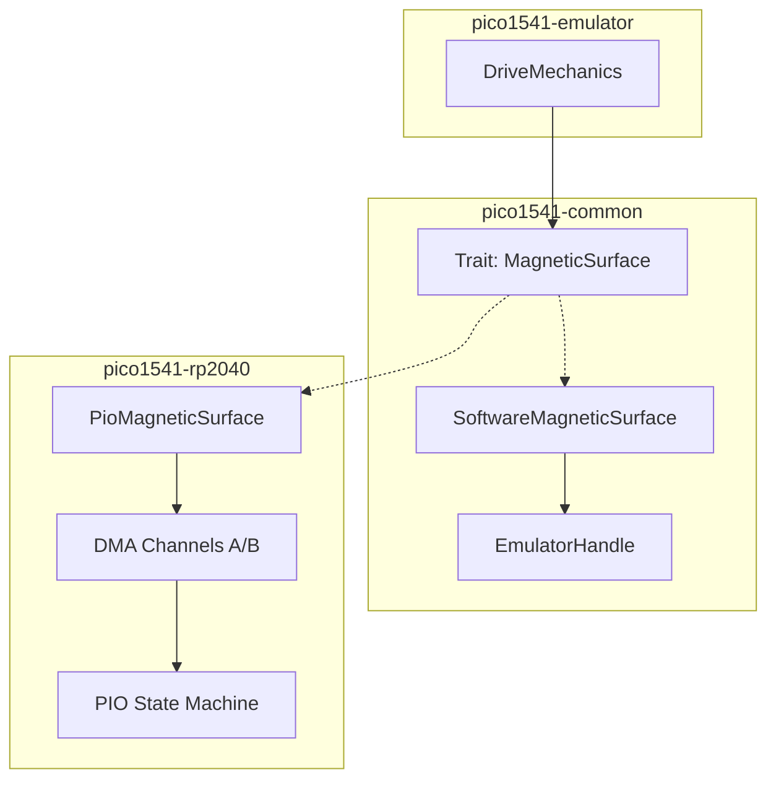

# PIO Magnetic Surface Implementation Plan

> **For agentic workers:** REQUIRED SUB-SKILL: Use superpowers:subagent-driven-development to implement this plan task-by-task. Steps use checkbox (`- [ ]`) syntax for tracking.

**Goal:** Offload `.g64` bit-level alignment and SYNC detection to the RP2040 PIO via a zero-cost abstraction boundary (`MagneticSurface`).

**Architecture:** We will introduce a `MagneticSurface` trait to the agnostic `pico1541-common` crate, replacing the direct use of `EmulatorHandle` inside `DriveMechanics`. The host PC tests will use a `SoftwareMagneticSurface` fallback, while the real RP2040 firmware will use a `PioMagneticSurface` powered by a custom `pioasm` state machine and DMA ping-pong looping.

**Architecture Diagram:**



**Tech Stack:** Rust, `embassy-rp` (DMA/PIO), `pioasm`

## Global Constraints
- `pico1541-common`, `pico1541-emulator`, and `pico1541-rp2040` must remain `no_std`.
- `pico1541-rp2040` must compile in `--release` mode.
- Avoid dynamic dispatch (`dyn Trait`); rely on zero-cost static dispatch (generics).
- Do not remove existing log lines; resolve all compiler warnings.

---

### Task 1: Define `MagneticSurface` Trait and Software Fallback

**Files:**
- Create: `crates/pico1541-common/src/magnetic_surface.rs`
- Modify: `crates/pico1541-common/src/lib.rs` (to export the module)

**Interfaces:**
- Consumes: `EmulatorHandle` from `crate::track_buffer`
- Produces: `MagneticSurface` trait and `SoftwareMagneticSurface` struct.

- [ ] **Step 1: Create the trait and struct definitions**

Create `crates/pico1541-common/src/magnetic_surface.rs` and write the barebones implementation:

```rust
use crate::track_buffer::EmulatorHandle;

pub trait MagneticSurface {
    fn is_sync_active(&self) -> bool;
    fn try_read_byte(&mut self) -> Option<u8>;
    fn get_absolute_head_position(&self, master_clock: u32) -> u32;
    fn write_byte_at(&mut self, index: u32, data: u8);
    fn start_reading(&mut self, track_id: u8, rotation_percentage: f64);
    fn stop_reading(&mut self);
}

pub struct SoftwareMagneticSurface {
    pub track_handle: EmulatorHandle,
    is_sync: bool,
}

impl SoftwareMagneticSurface {
    pub fn new(track_handle: EmulatorHandle) -> Self {
        Self { track_handle, is_sync: false }
    }
}
```

- [ ] **Step 2: Implement the trait for the Software fallback**

Add the trait implementation using the legacy bit-shifting from `EmulatorHandle`:

```rust
impl MagneticSurface for SoftwareMagneticSurface {
    fn is_sync_active(&self) -> bool {
        self.is_sync
    }

    fn try_read_byte(&mut self) -> Option<u8> {
        // Provide a dummy sector for now, as is_listening is the crucial part for bit-shifting.
        // We assume try_read_byte is called when reading is active.
        let gcr_byte = self.track_handle.next_read_byte(0, 0xFF, true);
        let next_gcr_byte = self.track_handle.peek_next_byte();
        
        // SYNC is 0xFF. If we see two in a row, we are in SYNC.
        if gcr_byte == 0xFF && next_gcr_byte == 0xFF {
            self.is_sync = true;
        } else if gcr_byte == 0xFF && !self.is_sync {
            // End of SYNC mark.
            self.is_sync = false;
        }
        
        Some(gcr_byte)
    }

    fn get_absolute_head_position(&self, _master_clock: u32) -> u32 {
        self.track_handle.get_current_byte_idx() as u32
    }

    fn write_byte_at(&mut self, _index: u32, data: u8) {
        self.track_handle.next_write_byte(0, 0xFF, data);
    }

    fn start_reading(&mut self, track_id: u8, _rotation_percentage: f64) {
        self.track_handle.update_head_half_track(track_id);
    }

    fn stop_reading(&mut self) {}
}
```

- [ ] **Step 3: Export module**

Append to `crates/pico1541-common/src/lib.rs`:

```rust
pub mod magnetic_surface;
```

- [ ] **Step 4: Verify crate compilation**

Run: `cargo build -p pico1541-common`
Expected: PASS

- [ ] **Step 5: Commit**

```bash
git add crates/pico1541-common/src/
git commit -m "feat: Add MagneticSurface trait and Software fallback"
```

---

### Task 2: Refactor `DriveMechanics` (Agnostic Emulator Layer)

**Files:**
- Modify: `crates/pico1541-emulator/src/drivemechanics.rs`
- Modify: `crates/pico1541-emulator/src/systembus.rs`
- Modify: `crates/pico1541-emulator/src/lib.rs`
- Modify: `crates/pico1541-emulator/tests/disk_streaming.rs`

**Interfaces:**
- Consumes: `MagneticSurface` from `pico1541-common`
- Produces: `DriveMechanics<S: MagneticSurface>`, `SystemBus<S: MagneticSurface>`, `Emulator<H, S>`

- [ ] **Step 1: Update `DriveMechanics` struct**

Modify `crates/pico1541-emulator/src/drivemechanics.rs` to replace `track_handle: EmulatorHandle` with `surface: S`:

```rust
use pico1541_common::magnetic_surface::MagneticSurface;

pub struct DriveMechanics<S: MagneticSurface> {
    pub halftrack_head_pos: i8,
    pub surface: S,
    // ... rest of fields
}

impl<S: MagneticSurface> DriveMechanics<S> {
    pub fn new(surface: S) -> Self {
        Self {
            halftrack_head_pos: INITIAL_HALF_TRACK,
            surface,
            // ... rest
        }
    }
}
```

*(You will need to update all `impl DriveMechanics` blocks to `impl<S: MagneticSurface> DriveMechanics<S>`)*

- [ ] **Step 2: Update `tick_slow` to use the trait**

In `crates/pico1541-emulator/src/drivemechanics.rs`:

```rust
    fn tick_slow<H: HostInterface>(&mut self, hardware: &mut H, via2: &mut Via6522, _requested_sector: u8) {
        let is_read_mode = via2.get_cb2_out().unwrap_or(true);
        let is_so_enabled = via2.get_ca2_out().unwrap_or(false);
        let is_reading = is_read_mode && is_so_enabled;
        let mut suppress_ca1 = false;

        if is_read_mode {
            if is_reading && !self.surface.is_sync_active() {
                if let Some(gcr_byte) = self.surface.try_read_byte() {
                    via2.in_a = gcr_byte;
                    self.last_gcr_byte = gcr_byte;
                }
            }
            
            if self.surface.is_sync_active() {
                via2.in_b &= !MASK_SYNC; // Assert SYNC (Pull PB7 Low)
                hardware.debug_pin_0(true);
                suppress_ca1 = true;
            } else {
                via2.in_b |= MASK_SYNC;  // Release SYNC
                hardware.debug_pin_0(false);
            }
        } else {
            // WRITE mode
            self.surface.stop_reading();
            // We use 0 as master clock for now, as host tests don't have a reliable master clock
            let index = self.surface.get_absolute_head_position(0);
            self.surface.write_byte_at(index, via2.ora);
        }

        let sync_active = (via2.in_b & MASK_SYNC) == 0;
        if !sync_active && !suppress_ca1 {
            via2.ca1_irq();
            self.so_pulse_cycles = 3; 
            hardware.debug_pin_1(true);
        }   
    }
```

- [ ] **Step 3: Update `SystemBus` and `Emulator` generics**

In `crates/pico1541-emulator/src/systembus.rs`:
```rust
pub struct SystemBus<S: MagneticSurface> {
    pub mechanics: DriveMechanics<S>,
    // ...
}
impl<S: MagneticSurface> SystemBus<S> {
    pub fn new(surface: S) -> Self { ... }
}
```

In `crates/pico1541-emulator/src/lib.rs`:
```rust
use pico1541_common::magnetic_surface::MagneticSurface;

pub struct Emulator<H: HostInterface, S: MagneticSurface> {
    hardware: H,
    pub system_bus: SystemBus<S>,
}

impl<H: HostInterface, S: MagneticSurface> Emulator<H, S> {
    pub fn new(hardware: H, surface: S) -> Self { ... }
}
```

- [ ] **Step 4: Fix unit tests to use `SoftwareMagneticSurface`**

In `crates/pico1541-emulator/tests/disk_streaming.rs` (and `disk_validation.rs`):
Wrap the track handle instantiation:
```rust
use pico1541_common::magnetic_surface::SoftwareMagneticSurface;

// Instead of DriveMechanics::new(emulator), use:
let surface = SoftwareMagneticSurface::new(emulator);
let mut mechanics = DriveMechanics::new(surface);
```
*(Apply to all instantiations in the tests)*

- [ ] **Step 5: Run tests to verify**

Run: `cargo test -p pico1541-emulator`
Expected: PASS

- [ ] **Step 6: Commit**

```bash
git add crates/pico1541-emulator/
git commit -m "refactor: Migrate DriveMechanics to MagneticSurface trait"
```

---

### Task 3: PIO State Machine for SYNC/Alignment

**Files:**
- Create: `crates/pico1541-rp2040/src/pio/magnetic_surface.pio`
- Create/Modify: `crates/pico1541-rp2040/build.rs`
- Modify: `crates/pico1541-rp2040/src/pio/mod.rs` (if exists, else create it and export)

**Interfaces:**
- Produces: Compiled PIO program module `magnetic_surface_pio` exposing `magnetic_surface_program`.

- [ ] **Step 1: Write `pioasm` script**

Create `crates/pico1541-rp2040/src/pio/magnetic_surface.pio`:
```pio
.program magnetic_surface

; Operates with:
; - Autopush enabled (threshold 8)
; - Autopull enabled (threshold 32)
; - Shift direction: Left (MSB first, typical for GCR)

.wrap_target
sync_search:
    out x, 1            ; Pull 1 bit from OSR into X
    jmp !x bit_is_zero  ; If bit is 0, reset search
    
    ; Bit is 1. Shift it into ISR and check if we hit 10 consecutive
    in null, 1          ; Wait, 'in' shifts data. If we just shift a 1...
    ; Actually, 'in' takes from a pin/OSR/X. But we can shift X.
    in x, 1
    
    jmp y-- sync_search ; Y is our counter. Decrement and loop if non-zero.
    
    ; If we fall through, Y reached 0 (we found 10 consecutive 1s).
in_sync:
    irq set 0           ; Assert IRQ 0 to flag SYNC active
    mov isr, null       ; Discard accumulated bits, reset autopush counter
    
sync_loop:
    out x, 1
    jmp !x sync_broken
    jmp sync_loop
    
sync_broken:
    irq clear 0         ; Clear SYNC flag
    
bit_is_zero:
    set y, 8            ; Reset counter to 9 (0-8 = 9 decrements, plus initial check = 10 bits)
    in null, 1          ; Shift a 0 into ISR (since X is 0, we could also 'in x, 1')
.wrap
```
*(Note: Review `in` instructions based on PIO capabilities. The above is pseudo-PIO. Adjust to exact `pioasm` syntax.)*

- [ ] **Step 2: Add `build.rs` to compile the PIO**

In `crates/pico1541-rp2040/build.rs`:
```rust
fn main() {
    println!("cargo:rerun-if-changed=src/pio/magnetic_surface.pio");
    pioasm::Builder::new("src/pio/magnetic_surface.pio")
        .build("magnetic_surface.rs")
        .unwrap();
}
```
*(Ensure `pioasm` is in `Cargo.toml` `build-dependencies`)*

- [ ] **Step 3: Export PIO module**

If you don't have a `pio` module yet, declare the inclusion in `crates/pico1541-rp2040/src/main.rs`:
```rust
mod pio {
    include!(concat!(env!("OUT_DIR"), "/magnetic_surface.rs"));
}
```

- [ ] **Step 4: Verify build**

Run: `cargo build -p pico1541-rp2040 --release`
Expected: PASS

- [ ] **Step 5: Commit**

```bash
git add crates/pico1541-rp2040/src/pio/ crates/pico1541-rp2040/build.rs
git commit -m "feat: Add PIO state machine for magnetic surface"
```

---

### Task 4: `PioMagneticSurface` with DMA Ping-Pong

**Files:**
- Create: `crates/pico1541-rp2040/src/magnetic_surface.rs`
- Modify: `crates/pico1541-rp2040/src/main.rs`

**Interfaces:**
- Consumes: PIO program, `pico1541-common::MagneticSurface`
- Produces: `PioMagneticSurface` struct.

- [ ] **Step 1: Implement `PioMagneticSurface`**

Create `crates/pico1541-rp2040/src/magnetic_surface.rs`:
```rust
use pico1541_common::magnetic_surface::MagneticSurface;
use core::sync::atomic::{AtomicBool, Ordering};

pub struct PioMagneticSurface {
    // Hold DMA and PIO handles here
    // Hold a reference to the shared atomic IRQ flag
    is_sync: &'static AtomicBool,
}

impl MagneticSurface for PioMagneticSurface {
    fn is_sync_active(&self) -> bool {
        self.is_sync.load(Ordering::Acquire)
    }

    fn try_read_byte(&mut self) -> Option<u8> {
        // Read from PIO RX FIFO (non-blocking)
        // e.g. self.rx_fifo.try_read()
        None // Implement actual read
    }

    fn get_absolute_head_position(&self, master_clock: u32) -> u32 {
        0 // Implement based on 300 RPM math
    }

    fn write_byte_at(&mut self, _index: u32, _data: u8) {}
    fn start_reading(&mut self, _track_id: u8, _rotation_percentage: f64) {}
    fn stop_reading(&mut self) {}
}
```

- [ ] **Step 2: Configure DMA Chaining**

Inside `PioMagneticSurface::new(...)` or a setup function, implement the alias trick:
```rust
// Control block: [TRANS_COUNT, READ_ADDR]
static mut DMA_CTRL_BLOCK: [u32; 2] = [0; 2];

// Configure Worker Channel A:
// -> read from TrackBuffer, write to PIO TX FIFO
// -> CHAIN_TO Channel B

// Configure Reloader Channel B:
// -> read from DMA_CTRL_BLOCK, write to Channel A AL3 (TRANS_COUNT alias 0x38)
// -> Ring size 3 (8 bytes) on READ_ADDR so it infinitely reads the 2 words.
```

- [ ] **Step 3: Integrate into `main.rs`**

Update `main.rs` to instantiate `PioMagneticSurface` and pass it to `Emulator::new()`.

- [ ] **Step 4: Verify release build**

Run: `cargo build -p pico1541-rp2040 --release`
Expected: PASS

- [ ] **Step 5: Commit**

```bash
git add crates/pico1541-rp2040/
git commit -m "feat: Implement PioMagneticSurface and DMA Ping-Pong loop"
```
