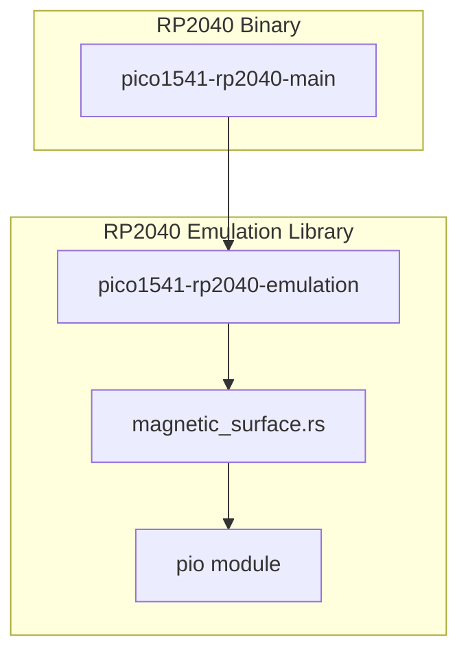

# Core Separation Refactoring Implementation Plan

> **For agentic workers:** REQUIRED SUB-SKILL: Use superpowers:subagent-driven-development to implement this plan task-by-task. Steps use checkbox (`- [ ]`) syntax for tracking.

**Goal:** Refactor the RP2040 code into two separate crates (one for the main manager core, one for the emulation core) and map the stacks of both cores to the two dedicated 4KB Scratch banks to avoid bus contention.

**Architecture:** The monolithic `pico1541-rp2040` crate will be split into `pico1541-rp2040-emulation` (a library crate for Core 1 logic) and `pico1541-rp2040-main` (a binary crate for Core 0 logic). `magnetic_surface.rs` and the `pio` module will be moved to the emulation crate, while `main.rs`, drivers, and storage will stay in the main crate. Additionally, `memory.x` will be updated to point the main stack to `SCRATCH_A` and the Core 1 stack to `SCRATCH_B`.

**Architecture Diagram:**



**Tech Stack:** Rust, Embassy, Cortex-M

## Global Constraints

- Must maintain cycle-exact timing on Core 1; any code related to the emulation loop needs to run cleanly from RAM.
- Crate renames should propagate to workspace `Cargo.toml` and `.cargo/config.toml`.

---

### Task 1: Create `pico1541-rp2040-emulation` Crate Structure

**Files:**
- Create: `crates/pico1541-rp2040-emulation/Cargo.toml`
- Create: `crates/pico1541-rp2040-emulation/src/lib.rs`

- [ ] **Step 1: Write `Cargo.toml` for the new crate**
```toml
[package]
name = "pico1541-rp2040-emulation"
version = "0.1.0"
edition = "2021"

[dependencies]
pico1541-emulator = { path = "../pico1541-emulator", features = ["defmt"] }
pico1541-manager = { path = "../pico1541-manager", features = ["defmt"] }
pico1541-common = { path = "../pico1541-common", features = ["defmt"] }

embassy-rp = { version = "0.10.0", features = ["defmt", "time-driver", "critical-section-impl", "rp2040", "unstable-pac"] }
cortex-m = "0.7.7"
defmt = "1.1.0"
pio = "0.3"
pio-proc = "0.3"
```

- [ ] **Step 2: Initialize `src/lib.rs`**
```rust
#![no_std]

pub mod emulation;
pub mod magnetic_surface;
pub mod pio {
    pub fn magnetic_surface_program() -> ::pio::Program<32> {
        ::pio::pio_file!("pio/magnetic_surface.pio").program
    }
}
```

### Task 2: Move Emulation Code to the New Crate

**Files:**
- Move: `crates/pico1541-rp2040/src/emulation.rs` -> `crates/pico1541-rp2040-emulation/src/emulation.rs`
- Move: `crates/pico1541-rp2040/src/magnetic_surface.rs` -> `crates/pico1541-rp2040-emulation/src/magnetic_surface.rs`
- Move: `crates/pico1541-rp2040/src/pio/magnetic_surface.pio` -> `crates/pico1541-rp2040-emulation/src/pio/magnetic_surface.pio`

- [ ] **Step 1: Execute move commands**
```bash
mkdir -p crates/pico1541-rp2040-emulation/src/pio
mv crates/pico1541-rp2040/src/emulation.rs crates/pico1541-rp2040-emulation/src/
mv crates/pico1541-rp2040/src/magnetic_surface.rs crates/pico1541-rp2040-emulation/src/
mv crates/pico1541-rp2040/src/pio/magnetic_surface.pio crates/pico1541-rp2040-emulation/src/pio/
rmdir crates/pico1541-rp2040/src/pio
```

- [ ] **Step 2: Fix `emulation.rs` imports**
Modify `crates/pico1541-rp2040-emulation/src/emulation.rs`:
```diff
-use crate::PioMagneticSurface;
+use crate::magnetic_surface::PioMagneticSurface;
```

### Task 3: Rename `pico1541-rp2040` to `pico1541-rp2040-main` and Link Emulation Crate

**Files:**
- Rename dir: `crates/pico1541-rp2040` -> `crates/pico1541-rp2040-main`
- Modify: `crates/pico1541-rp2040-main/Cargo.toml`
- Modify: `crates/pico1541-rp2040-main/src/main.rs`
- Modify: `Cargo.toml` (Workspace root)
- Modify: `.cargo/config.toml`

- [ ] **Step 1: Rename the folder**
```bash
mv crates/pico1541-rp2040 crates/pico1541-rp2040-main
```

- [ ] **Step 2: Update `crates/pico1541-rp2040-main/Cargo.toml`**
```diff
 [package]
-name = "pico1541-rp2040"
+name = "pico1541-rp2040-main"
 version = "0.1.0"
 edition = "2021"
 build = "build.rs"
-default-run = "pico1541-rp2040"
+default-run = "pico1541-rp2040-main"
 
 [dependencies]
 # Internal crates
+pico1541-rp2040-emulation = { path = "../pico1541-rp2040-emulation" }
 pico1541-emulator = { path = "../pico1541-emulator", features = ["defmt"] }
```
```diff
 [[bin]]
-name = "pico1541-rp2040"
+name = "pico1541-rp2040-main"
 path = "src/main.rs"
 test = false
```

- [ ] **Step 3: Update `crates/pico1541-rp2040-main/src/main.rs`**
Remove old module references and use the new crate:
```diff
-mod emulation;
-
 mod storage_manager;
 use storage_manager::*;
 use static_cell::StaticCell;
-pub mod pio {
-    pub fn magnetic_surface_program() -> ::pio::Program<32> {
-        ::pio::pio_file!("src/pio/magnetic_surface.pio").program
-    }
-}
 
 pub mod littlefs_storage;
-pub mod magnetic_surface;
 use littlefs_storage::LittleFsStorage;
 use flash_storage::FlashStorage;
-use magnetic_surface::PioMagneticSurface;
+
+use pico1541_rp2040_emulation::emulation;
+use pico1541_rp2040_emulation::magnetic_surface::PioMagneticSurface;
```

- [ ] **Step 4: Update Workspace `Cargo.toml`**
```diff
 [workspace]
 members = [
     "crates/pico1541-common",
     "crates/racc6502",
     "crates/racc6502v2",
     "crates/pico1541-manager",
     "crates/pico1541-emulator",
-    "crates/pico1541-rp2040",
+    "crates/pico1541-rp2040-main",
+    "crates/pico1541-rp2040-emulation",
     "crates/mos6502",
```

- [ ] **Step 5: Update `.cargo/config.toml`**
Find and replace all instances of `pico1541-rp2040` with `pico1541-rp2040-main`:
```bash
sed -i 's/"pico1541-rp2040"/"pico1541-rp2040-main"/g' .cargo/config.toml
```

### Task 4: Map Stacks to Scratch Memory Banks

**Files:**
- Modify: `crates/pico1541-rp2040-main/memory.x`
- Modify: `crates/pico1541-rp2040-main/src/main.rs`

- [ ] **Step 1: Update `memory.x` for stack placements**
Modify the `_stack_start` to use `SCRATCH_A` instead of `SRAM3`:
```diff
-}
-
-_stack_start = ORIGIN(SRAM3) + LENGTH(SRAM3);
-
-SECTIONS {
+    SCRATCH_A : ORIGIN = 0x20040000, LENGTH = 4K
+    SCRATCH_B : ORIGIN = 0x20041000, LENGTH = 4K
+}
+
+_stack_start = ORIGIN(SCRATCH_A) + LENGTH(SCRATCH_A);
+
+SECTIONS {
```

- [ ] **Step 2: Update `memory.x` to map the emulation code block**
Ensure that the entire emulation crate's `.text` and `.rodata` falls into the RAM sections. Modify `.ram_rodata`:
```diff
     .ram_rodata : ALIGN(4) {
         __sram_rodata = .;
         *pico1541_emulator*(.rodata .rodata.*);
+        *pico1541_rp2040_emulation*(.rodata .rodata.*);
         *racc6502v4*(.rodata .rodata.*);
         . = ALIGN(4);
         __eram_rodata = .;
```
Add `.ram_code` just below `.ram_rodata` to capture all the text for the emulation crate:
```diff
     } > RAM AT > FLASH
     __siram_rodata = LOADADDR(.ram_rodata);
+
+    .ram_code : ALIGN(4) {
+        __sram_code = .;
+        *pico1541_emulator*(.text .text.*);
+        *pico1541_rp2040_emulation*(.text .text.*);
+        *racc6502v4*(.text .text.*);
+        . = ALIGN(4);
+        __eram_code = .;
+    } > RAM AT > FLASH
+    __siram_code = LOADADDR(.ram_code);
 }
 INSERT AFTER .data;
```

- [ ] **Step 3: Update `main.rs` to initialize `.ram_code` and size the Core 1 stack for Scratch B**
Modify `crates/pico1541-rp2040-main/src/main.rs`:
```diff
 // Core 1 Stack
-#[link_section = ".sram3"]
-static mut CORE1_STACK: core::mem::MaybeUninit<Stack<8192>> = core::mem::MaybeUninit::uninit();
+#[link_section = ".core1_stack"]
+static mut CORE1_STACK: core::mem::MaybeUninit<Stack<4096>> = core::mem::MaybeUninit::uninit();
```
```diff
     // Copy .ram_rodata from Flash to RAM
     unsafe {
         extern "C" {
             static mut __sram_rodata: u32;
             static mut __eram_rodata: u32;
             static __siram_rodata: u32;
+            static mut __sram_code: u32;
+            static mut __eram_code: u32;
+            static __siram_code: u32;
         }
         let mut dest = core::ptr::addr_of_mut!(__sram_rodata);
         let end = core::ptr::addr_of_mut!(__eram_rodata);
         let mut src = core::ptr::addr_of!(__siram_rodata);
         while dest < end {
             core::ptr::write(dest, core::ptr::read(src));
             dest = dest.add(1);
             src = src.add(1);
         }
+        let mut dest = core::ptr::addr_of_mut!(__sram_code);
+        let end = core::ptr::addr_of_mut!(__eram_code);
+        let mut src = core::ptr::addr_of!(__siram_code);
+        while dest < end {
+            core::ptr::write(dest, core::ptr::read(src));
+            dest = dest.add(1);
+            src = src.add(1);
+        }
     }
```
Update the Stack cast size inside `main` (it was `Stack<8192>`):
```diff
     let stack = unsafe {
-        let ptr: *mut Stack<8192> = core::ptr::addr_of_mut!(CORE1_STACK).cast();
+        let ptr: *mut Stack<4096> = core::ptr::addr_of_mut!(CORE1_STACK).cast();
         core::ptr::write(ptr, Stack::new());
         &mut *ptr
     };
```

### Task 5: Verify Build and Tests
- [ ] **Step 1: Check standard build**
```bash
cargo build --release --package pico1541-rp2040-main --target thumbv6m-none-eabi
```
Expected: Compiles successfully without warnings.

- [ ] **Step 2: Check unit tests**
```bash
cargo test
```
Expected: All tests pass.
