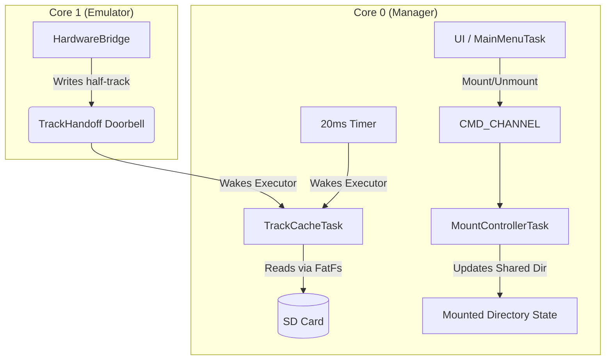

# Event Cleanup Implementation Plan

> **For agentic workers:** REQUIRED SUB-SKILL: Use superpowers:subagent-driven-development to implement this plan task-by-task. Steps use checkbox (`- [ ]`) syntax for tracking.

**Goal:** Eradicate dead event handling code and decouple the MountManager by introducing a hardware Doorbell for Track Handoffs.

**Architecture:** We will delete the idle `SnooperTask` and `DriveActivityTask` along with their channels. The `MountManagerTask` will be split into a `MountControllerTask` (handling `Mount`/`Unmount` commands from the UI) and a `TrackCacheTask` (handling pure SD read looping triggered by a 20ms timer and a new `TrackHandoff` hardware doorbell from Core 1).

**Architecture Diagram:**



**Tech Stack:** Rust (no_std, embassy)

## Global Constraints
- Target platform: rp2350 / rp2040 (bare-metal)
- Must remain `no_std`.
- Embassy primitives (`Channel`, `Mutex`) are used for async sync.

---

### Task 1: Eradicate Dead Event Channels and Tasks

**Files:**
- Modify: `/home/johnny/git/dev/Pico1541/crates/pico1541-manager/src/lib.rs`
- Modify: `/home/johnny/git/dev/Pico1541/crates/pico1541-rp2350/src/main.rs`
- Modify: `/home/johnny/git/dev/Pico1541/crates/pico1541-manager/src/tasks/mod.rs`
- Delete: `/home/johnny/git/dev/Pico1541/crates/pico1541-manager/src/tasks/snooper.rs`
- Delete: `/home/johnny/git/dev/Pico1541/crates/pico1541-manager/src/tasks/drive_activity.rs`

**Interfaces:**
- Consumes: N/A
- Produces: Simplified codebase without unused event channels.

- [ ] **Step 1: Delete dead files**

```bash
rm crates/pico1541-manager/src/tasks/snooper.rs
rm crates/pico1541-manager/src/tasks/drive_activity.rs
```

- [ ] **Step 2: Remove channels and unused commands from `lib.rs`**

```diff
--- crates/pico1541-manager/src/lib.rs
+++ crates/pico1541-manager/src/lib.rs
@@ -19,10 +19,8 @@
 #[derive(Debug, Clone, PartialEq)]
 pub enum InternalCommand {
     Mount,
     Unmount,
-    LoadFile([u8; 16]),
-    CloseChannel(u8),
     MotorState(bool),
 }
 
 pub static CMD_CHANNEL: Channel<CriticalSectionRawMutex, InternalCommand, 16> = Channel::new();
-pub static EVENT_CHANNEL: Channel<CriticalSectionRawMutex, DriveEvent, 64> = Channel::new();
-pub static ACTIVITY_CHANNEL: Channel<CriticalSectionRawMutex, DriveEvent, 16> = Channel::new();
```

- [ ] **Step 3: Remove exports from `tasks/mod.rs`**

```diff
--- crates/pico1541-manager/src/tasks/mod.rs
+++ crates/pico1541-manager/src/tasks/mod.rs
@@ -1,9 +1,7 @@
 pub mod display;
-pub mod drive_activity;
 pub mod mount_manager;
 pub mod perf;
-pub mod snooper;
 pub mod ui;
```

- [ ] **Step 4: Remove task spawns from `pico1541-rp2350/src/main.rs`**

```diff
--- crates/pico1541-rp2350/src/main.rs
+++ crates/pico1541-rp2350/src/main.rs
@@ -400,6 +400,0 @@
-#[embassy_executor::task]
-async fn activity_run(mut task: DriveActivityTask<IndicatorWrapper<CriticalSectionRawMutex>>) {
-    task.run().await;
-}
@@ -410,6 +404,0 @@
-#[embassy_executor::task]
-async fn snooper_run(mut task: SnooperTask) {
-    task.run().await;
-}
@@ -536,9 +524,6 @@
-    let indicator = ActivityIndicator::new(piezo);
-
-    static INDICATOR: StaticCell<Mutex<CriticalSectionRawMutex, ActivityIndicator>> =
-        StaticCell::new();
-    let indicator_mutex = INDICATOR.init(Mutex::new(indicator));
-    let activity_task = DriveActivityTask::new(IndicatorWrapper(indicator_mutex));
+    // Drive activity indicators removed.
@@ -628,8 +613,6 @@
-    let snooper_task = SnooperTask::new(SNOOPER_CONFIG.device_id.load(Ordering::Relaxed));
-    spawner.spawn(snooper_run(snooper_task)).unwrap();
-    spawner.spawn(activity_run(activity_task)).unwrap();
```

- [ ] **Step 5: Verify Build**

Run: `cargo build -p pico1541-rp2350`
Expected: Compile warnings about missing traits, but no errors.

### Task 2: Create `TrackHandoff` Abstraction

**Files:**
- Modify: `/home/johnny/git/dev/Pico1541/crates/pico1541-common/src/interface.rs`
- Modify: `/home/johnny/git/dev/Pico1541/crates/pico1541-rp-common/src/emulation/bridge.rs`
- Modify: `/home/johnny/git/dev/Pico1541/crates/pico1541-manager/src/lib.rs`

**Interfaces:**
- Produces: `TrackHandoff` trait and its RP2350 implementation `RpTrackHandoff`.

- [ ] **Step 1: Define `TrackHandoff` in `pico1541-common/src/interface.rs`**

```diff
--- crates/pico1541-common/src/interface.rs
+++ crates/pico1541-common/src/interface.rs
@@ -60,4 +60,15 @@
     fn check_halt_requested(&self) -> bool {
         false
     }
     fn report_performance_counters(&mut self, _ticks: u32, _idles: u32) {}
 }
+
+/// Decouples cross-core track change notifications via a hardware doorbell.
+pub trait TrackHandoff {
+    /// Notify the manager that the head has moved to a new half-track.
+    fn notify_track_change(&mut self, half_track: u8);
+    /// Get the current half-track.
+    fn current_track(&self) -> u8;
+    /// Wait until a new track is requested.
+    async fn wait_for_change(&mut self) -> u8;
+}
```

- [ ] **Step 2: Add `RpTrackHandoff` to `bridge.rs`**

```rust
// In crates/pico1541-rp-common/src/emulation/bridge.rs (bottom of file)
use pico1541_common::interface::TrackHandoff;
use core::sync::atomic::{AtomicU8, Ordering};
use embassy_sync::signal::Signal;
use embassy_sync::blocking_mutex::raw::CriticalSectionRawMutex;

static TRACK_REQUEST: AtomicU8 = AtomicU8::new(36);
static TRACK_SIGNAL: Signal<CriticalSectionRawMutex, ()> = Signal::new();

pub struct RpTrackHandoff;

impl RpTrackHandoff {
    pub const fn new() -> Self {
        Self
    }
}

impl TrackHandoff for RpTrackHandoff {
    fn notify_track_change(&mut self, half_track: u8) {
        TRACK_REQUEST.store(half_track, Ordering::Relaxed);
        TRACK_SIGNAL.signal(());
        
        #[cfg(any(feature = "rp235xa", feature = "rp2040"))]
        embassy_rp::pac::TIMER0
            .intf()
            .write(|w| w.set_alarm(3, true));
    }

    fn current_track(&self) -> u8 {
        TRACK_REQUEST.load(Ordering::Relaxed)
    }

    async fn wait_for_change(&mut self) -> u8 {
        TRACK_SIGNAL.wait().await;
        self.current_track()
    }
}
```

- [ ] **Step 3: Remove old Globals from `manager/src/lib.rs`**

```diff
--- crates/pico1541-manager/src/lib.rs
+++ crates/pico1541-manager/src/lib.rs
@@ -23,8 +23,2 @@
 pub static CMD_CHANNEL: Channel<CriticalSectionRawMutex, InternalCommand, 16> = Channel::new();
-
-pub static TRACK_REQUEST: core::sync::atomic::AtomicU8 = core::sync::atomic::AtomicU8::new(36);
-pub static TRACK_SIGNAL: embassy_sync::signal::Signal<CriticalSectionRawMutex, ()> =
-    embassy_sync::signal::Signal::new();
```

- [ ] **Step 4: Update `HardwareBridge::track_changed`**

In `crates/pico1541-rp-common/src/emulation/bridge.rs`:

```diff
@@ -237,10 +237,3 @@
     fn track_changed(&mut self, half_track: u8) {
-        pico1541_manager::TRACK_REQUEST.store(half_track, core::sync::atomic::Ordering::Relaxed);
-        pico1541_manager::TRACK_SIGNAL.signal(());
-
-        #[cfg(feature = "rp235xa")]
-        embassy_rp::pac::TIMER0
-            .intf()
-            .write(|w| w.set_alarm(3, true));
+        // We will inject the TrackHandoff trait directly into the Manager later.
+        // For now, HardwareBridge relies on the new RpTrackHandoff struct.
+        RpTrackHandoff::new().notify_track_change(half_track);
     }
```

- [ ] **Step 5: Verify build**

Run: `cargo check -p pico1541-rp2350`
Expected: Compile passes (ignoring unused code warnings).

### Task 3: Decouple MountManager into TrackCacheTask and MountControllerTask

**Files:**
- Modify: `/home/johnny/git/dev/Pico1541/crates/pico1541-manager/src/tasks/mount_manager/mod.rs`
- Modify: `/home/johnny/git/dev/Pico1541/crates/pico1541-rp2350/src/main.rs`

**Interfaces:**
- Consumes: `TrackHandoff`

- [ ] **Step 1: Rewrite `mount_manager/mod.rs` task structure**

Replace the monolithic `select3` run loop in `mount_manager/mod.rs` with `TrackCacheTask::run` and `MountControllerTask::run`.

*(Subagent will completely refactor `mount_manager/mod.rs` to break `MountManagerTask` into two structs. `TrackCacheTask` will own the `fatfs` storage and use a `select` on `timer` vs `handoff.wait_for_change()`. `MountControllerTask` will wait on `CMD_CHANNEL.receive()` and handle updating `mounted_dir` and sending `MotorState` back down if needed.)*

- [ ] **Step 2: Update `main.rs` to spawn both tasks**

```diff
--- crates/pico1541-rp2350/src/main.rs
+++ crates/pico1541-rp2350/src/main.rs
@@ -414,7 +414,14 @@
 #[embassy_executor::task]
-async fn vdisk_run(
-    mut task: MountManagerTask<
-        MyStorage,
-        PlatformStorageManager,
-        StatusLedsWrapper<CriticalSectionRawMutex>,
-    >,
-) {
-    task.run().await;
-}
+async fn track_cache_run(mut task: TrackCacheTask<MyStorage, RpTrackHandoff>) {
+    task.run().await;
+}
+
+#[embassy_executor::task]
+async fn controller_run(mut task: MountControllerTask) {
+    task.run().await;
+}
```

*(Subagent will handle the exact type bounds and initialization in `main.rs` to match the new split manager.)*

- [ ] **Step 3: Verify the full build**

Run: `cargo build -p pico1541-rp2350 --release`
Expected: Successful compile.

- [ ] **Step 4: Commit**

```bash
git add .
git commit -m "refactor: clean up events and introduce TrackHandoff doorbell"
```
